# Moyu — Grasshopper 拓扑优化插件（顺带摸鱼）

**Moyu** is a Grasshopper plugin for **Rhino 8 for Windows**: 2D pixel and 3D voxel topology optimisation (SIMP, iterating live on a Timer), plus four small games that run inside the Rhino viewport disguised as massing, landscape, facade and section study tools, each with a boss key. It is a research and teaching project on building a Rhino plugin quickly with an AI coding agent: almost all of the code, tests and documentation were written by Claude Code, and the design notes, development logs and a time log ([docs/dev-time-stats.md](docs/dev-time-stats.md)) are all in this repository. The illustrated user guide is [packaging/guide/Moyu-Guide-EN.pdf](packaging/guide/Moyu-Guide-EN.pdf) ([中文](packaging/guide/Moyu-Guide-ZH.pdf)). Licence: MIT ([LICENSE](LICENSE)). Install it from Rhino's Package Manager (`_PackageManager`, search *moyu*) or see [packaging/INSTALL.md](packaging/INSTALL.md); the rest of this README is in Chinese.

基于 Rhino 官方 `dotnet new grasshopper` 模版的 Grasshopper (GH1) 插件，有两套相同结构的工作流：

- **2D 像素**：在平面里画边界，加荷载 / 支座 / 实心或空心区域 / 材料，交给由 Timer（Trigger）驱动的 SIMP 求解器迭代，最后看密度场并导出轮廓曲线。
- **3D 体素**：用封闭实体定义设计空间，条件可以加在点、曲线或面上；求解器用多重网格预条件共轭梯度，最后输出体素块或光滑等值面网格。

另外还有四个摸鱼用的小游戏，各自伪装成一个体块 / 景观 / 立面 / 剖面研究面板（[Massing · VoxStack 叠楼](#massing-面板voxstack-叠楼)、[Landscape · Serpentine 蜿蜒](#landscape-面板serpentine-蜿蜒)、[Facade · Rebound 回弹](#facade-面板rebound-回弹)、[Section · Swift 雨燕](#section-面板swift-雨燕)），都在 Rhino 视口里玩，共用一套老板键。

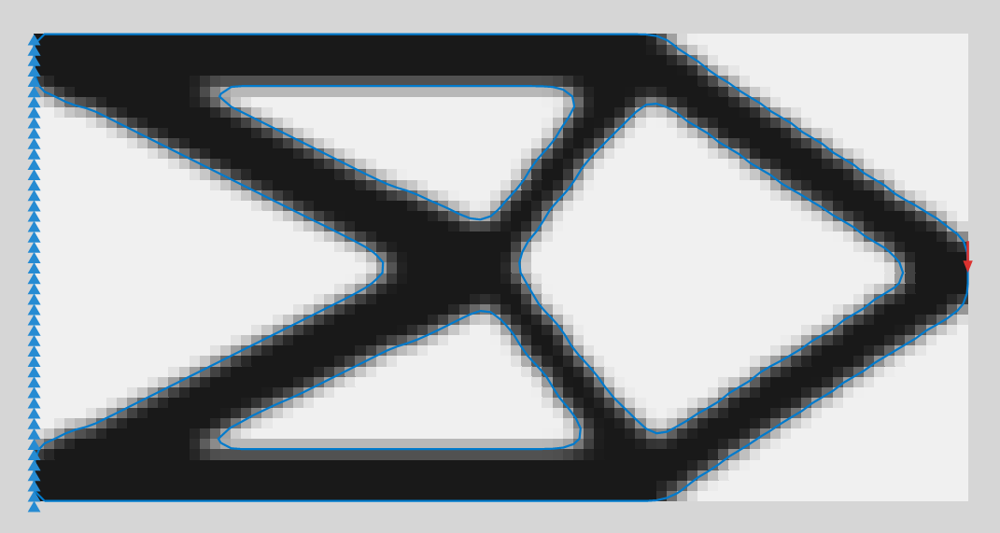

## 2D 组件（Ribbon：`Moyu` › `2D`）

| 行 | 组件 | 缩写 | 作用 |
|---|---|---|---|
| 条件 | Boundary 2D | Bnd2D | 闭合平面曲线 → 方形像素网格（设计域）。嵌套曲线 = 孔洞。自动识别 XY / XZ / YZ 平面 |
| 条件 | Load 2D | Load | 点或曲线上的力（世界坐标向量，只取平面内分量；曲线上平均分配到经过的节点） |
| 条件 | Support 2D | Support | 点或曲线约束，分别控制 X / Y（两向 = 铰支，单向 = 滚动支座） |
| 条件 | Area 2D | Area | 边界内的非设计区：始终实心（如楼板）或始终空心（如洞口） |
| 条件 | Material 2D | Mat | 杨氏模量 E、泊松比 ν（平面应力） |
| 求解 | SIMP Solver 2D | Solver | 最小柔度拓扑优化（SIMP + OC）。`Run` 为真时每次求解推进 `Steps` 步；接一个 Timer 就会一直跑到收敛 |
| 显示 | Visualize 2D | Vis | 彩色像素网格（密度 / 实心 / 平滑三种模式）、阈值等值轮廓曲线、荷载与支座符号 |

典型连线：

```
Boundary 2D ─┐
Load 2D ─────┤
Support 2D ──┼─► SIMP Solver 2D ──► Visualize 2D
Area 2D ─────┤        ▲
Material 2D ─┘        └── Timer (Params › Util › Trigger) + Toggle 接 Run，Button 接 Reset
```

运行中改荷载、支座、区域或参数时，求解器保留当前密度继续收敛（迭代预算重新计数）；想从均匀密度重新开始就按 Reset。

## 3D 组件（Ribbon：`Moyu` › `3D`）

连线方式与 2D 相同，组件名把 2D 换成 3D。

| 行 | 组件 | 缩写 | 作用 |
|---|---|---|---|
| 条件 | Boundary 3D | Bnd3D | 封闭 Brep / 网格 → 立方体素网格（长边体素数 = Resolution，默认 32）。套在里面的实体 = 孔洞。超过 15 万体素提示“每步要几秒”，超过 100 万体素给警告（每步几十秒到几分钟、数 GB 内存）。上限 160 |
| 条件 | Load 3D | Load | 点、曲线或面上的力（世界坐标向量，默认 0,0,−1）；总力平均分到接触的节点 |
| 条件 | Support 3D | Support | 点、曲线或面上的约束，分别控制 X / Y / Z |
| 条件 | Area 3D | Area | 封闭实体围出的非设计区：始终实心或始终空心 |
| 条件 | Material 3D | Mat | 杨氏模量 E、泊松比 ν（三维各向同性） |
| 求解 | SIMP Solver 3D | Solver | 8 节点六面体单元 + 多重网格预条件共轭梯度；默认体积分数 0.2、过滤半径 1.5、每跳 2 步 |
| 显示 | Visualize 3D | Vis | Mode 0 体素块 / Mode 1 光滑等值面；另输出闭合等值面网格和逐体素密度 |

网格每个方向都会补齐到 4 的倍数（分辨率 > 64 时补到 8 的倍数），补出来的体素在设计域外，只为了让多重网格能逐级减半。

**求解器的上限与状态**（2D / 3D 通用）：

- **Filter Radius** 限制在 2D [1, 12]、3D [1, 6]，输入说明里写的是最大值。
- **Steps** 最多 50；每次触发算满约 1.5 秒就停在当前步（剩下的留给下一跳，Rhino 不会卡住），按 Esc 停得更早。
- **Volume Fraction / Penalty / Filter Radius** 收到 NaN 或无穷大时按默认值算，并给出警告。
- 工作量太大时求解器直接报清楚的错误，不再卡死或抛原始异常：过滤半径的邻居表超过 1 亿项（“Filter radius R is too large for this grid; lower it or the resolution”）；2D 刚度矩阵分解超过 1.5 GB（“The stiffness matrix would need X GB; lower the resolution (the shorter side of the domain drives the cost)”，近似正方形的域大约短边超过 390 像素就会触发，Boundary 2D 的上限仍是 600）；3D 一级多重网格存储超过 1.5 亿个 double（约 128³ 的立方体，160×160×40 没问题，Boundary 3D 的上限仍是 160）。内存不够时显示 “Out of memory: lower the resolution or the filter radius.”
- **状态标签**：荷载 / 支座没接上等输入缺失时显示 **Waiting**；机构（结构不稳定）显示 **Unstable**；其他拒绝显示 **Error**，原因在运行时消息列表里。“No Timer drives this solver” 的提示只在文档里完全没有 Timer 时出现。
- **运行中调高 Volume Fraction**：材料每步按约移动限制（move limit）增加，直到达到新目标（以前可能出 NaN，一直报 “not stable” 到 Reset）。
- 3D 分析不收敛时提示 “The analysis did not converge (residual … after N CG iterations): the structure may be unstable (add supports), or press Reset”，不再笼统地说 “not stable”。

## 游戏共用的规则

四个游戏共用同一套会话框架，下面这些在每个游戏里都一样：

- **开始 / 结束**：点游戏组件下方的 **▶ Run** 在当前视口开始，再点一次（**■ Stop**）结束。点 Run 会把焦点交给 Rhino 主窗口，所以一开局按键就有效。组件被禁用（锁定）时 Run 不起作用，游戏进行中 Stop 照常能用。
- **Best 输出**：没有游戏在跑时，Best 跟着当前的 Mode / 井尺寸 / 网格 / 墙 / 皮数输入变，不只是第一局之前。
- **出错提示**：运行失败（组件报错、没有视口、启动失败）在组件上显示为警告气泡，不再写到 Rhino 命令行。
- **Internalise 的 Moyu 数据**：右键输入端 → Internalise data 存下来的 Moyu 值无法还原，报错是 “X input holds an empty T; reconnect the component that made it (Moyu data cannot be internalised)”，把产生它的组件重新接上即可。
- **键盘范围**：游戏进行中只有焦点在 **Rhino 主窗口**（或游戏所在的浮动视口）里时按键才归游戏，此时每个不带修饰键的键都被游戏截住，包括 F 键、Tab 和 PrintScreen；Grasshopper 窗口、对话框（另存为、选项……）和浮动面板的按键照常归它们自己。Ctrl / Alt 组合键任何时候都放行。
- **让出键盘**：对话框、Grasshopper 窗口或另一个 Rhino 窗口拿走键盘，或者开始了一个 Rhino 命令时，游戏自动暂停（倒计时也停住），按键和鼠标都归那个窗口或命令。点回游戏视口、按 Esc 继续。
- **鼠标**：右键拖动和左键拖动一样转视角（Rhino 不会把游戏里的右键当成 Enter 去重复上一个命令）；中键在游戏视口里不起作用。
- **Home**：镜头回到游戏的默认视角。重开一局时也会回到默认视角；视图被切成平行投影时自动回去。
- **暂停**：Esc 或 P 暂停。暂停时只吞 **Esc（继续）** 和 **Shift + Esc（退出）**，别的键还给 Rhino；画面上的提示是 ``Esc 继续 · Shift+Esc 退出 · ` 老板键``。
- **结束**：结算画面上 **Enter / 空格** 再来一局，Esc 退出。游戏停下后，开局前正在看的布局（Layout）页面会切回来。
- **老板键（1 左边的键，美式键盘上是 `` ` ``）**：一帧之内把画面切成一张正经的设计图，再按一次 3-2-1 回来；老板模式里键盘全部还给 Rhino。Rhino 失去焦点（Alt+Tab 到别的程序）时自动进老板模式。
- **输入法**：中文输入法开着也能玩，游戏中会把当前窗口的输入法切到英文，退出时还原。
- 默认完全静音；最高分是纯文本文件 `%APPDATA%\Moyu\<游戏>-scores.txt`。

## Massing 面板：VoxStack 叠楼

在 Rhino 视口里玩的 3D 体素消层游戏：积木落进 5×5×12 的井，某一层 25 格铺满就消掉。面板和组件都起了建筑名字，Ribbon 上看起来只是一组体块研究工具。画面是四个游戏共用的极简风格（见 [docs/visual-style.md](docs/visual-style.md)）：粉彩积木在白色底座上，一面一个平涂色调，配色随关卡换章节。

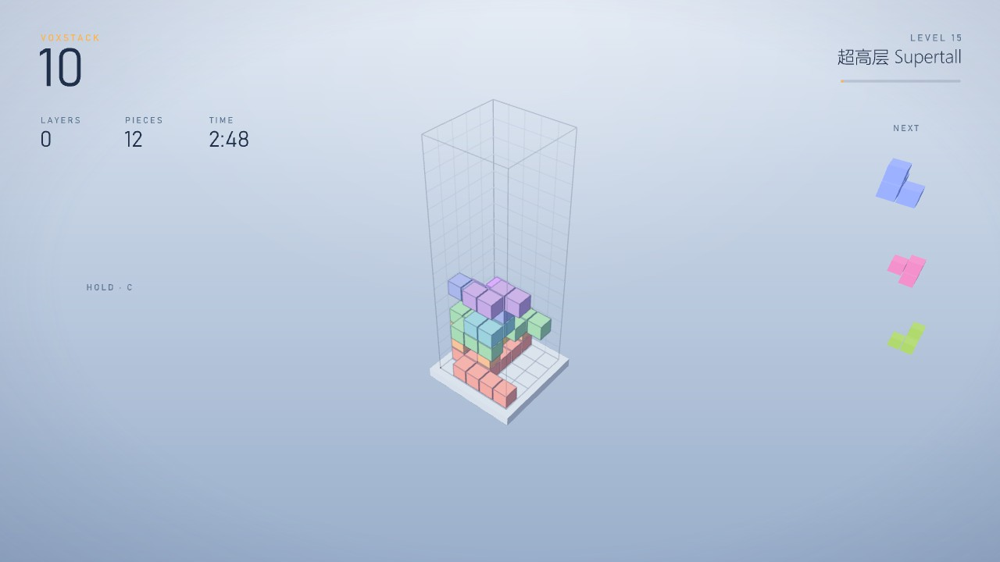

| 组件 | 缩写 | 作用 |
|---|---|---|
| Massing Study | Mass | 游戏本体。点组件下方的 **▶ Run** 就在当前视口开始，再点一次（**■ Stop**）结束。输入：Library、Width / Depth / Height（井尺寸，4–10 × 4–10 × 8–20）、Plane、Size（体素边长，默认 7.2 m）、Mode（0 马拉松 / 1 三分钟闪电 / 2 禅）、Level（**起始等级**，默认 1；设成 15 就是一开局 0.75 秒落一格）、Language（视口文字的语言，见下）。输出只在暂停、老板模式、结束时刷新：State、Score、Layers、Level、Best、Mass（当前体块网格）、Metrics（容积率等） |
| Voxel Unit | Unit | 自定义积木：随手画的封闭体（体素中心在里面就算）、体素中心点、或文本图案（`###/#.#\|#..`，层用 `\|` 分、行用 `/` 分）。最多 10 格、每边不超过 4 格、必须面连通；给点时超过 64 个点报错。自定义积木从第 1 块起就会发（开局的"先发简单积木"只管内置积木） |
| Unit Library | Lib | 内置积木集（-1 只用自定义 / 0 入门 / 1 标准 8 块 / 2 困难）＋ 自定义积木 |

**语言**：四个游戏组件（Massing / Path / Facade / Airflow Study）的最后一个输入都是 Language，管视口里画的文字（按键提示、倒数、暂停、结果画面、道具提示）。`auto`（默认）跟随 Windows 显示语言：中文 Windows 显示中文，其他语言显示英文；`ch`（也认 `zh`、`cn`、`中文`）固定中文，`en`（也认 `English`、`英文`）固定英文；不认识的写法给一条警告并按 `auto` 处理。游戏运行中改这个输入，下一帧就换。老板键的伪装画面始终是英文。

**操作**：

| 键 | 作用 |
|---|---|
| ← ↑ ↓ → | 水平移动，跟着视角走（↑ 永远是屏幕上远离你的方向） |
| **鼠标拖 Gumball 的圆环** | 视口**右下角固定**一个和 Rhino 一样的 gumball（红 X、绿 Y、蓝 Z 三个圆环，中间是当前积木的小模型），积木往下掉它也不动，只随视角转。按住一个圆环顺着它拖约 30°，积木就绕这根轴转 90°，再拖 90° 再转一次；悬停的圆环会变粗；两个圆环挨着时按拖动方向和离谁近判断；圆圈里没按到圆环不会转视角。高分屏上按系统缩放放大 |
| Q / E · W / S · A / D | 键盘也能转：绕竖轴转 · 前后翻 · 左右翻（gumball 上每个圆环旁边标着对应的键） |
| 空格 / 按住 Shift | 硬降 / 加速下落 |
| C | 暂存 |
| 鼠标左键或右键拖动 | 绕井转视角（Z / X 每次转 90°，V 俯视） |
| Esc / P | 暂停；暂停时 Esc 继续，Shift + Esc 退出。结束后 Enter / 空格再来一局 |
| Home | 镜头回到默认视角 |
| `` ` ``（1 左边的键） | **老板键**：一帧之内切成白模体块研究，再按一次 3-2-1 回来 |

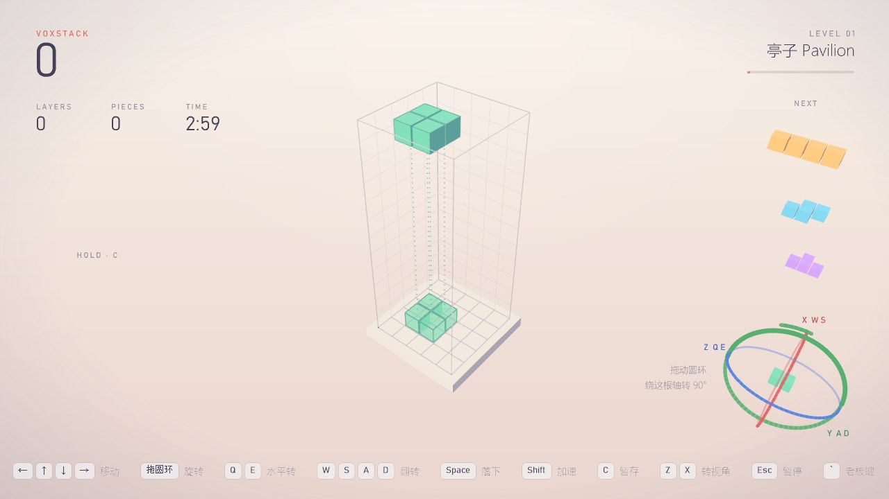

开局很慢：第 1 级 2.4 秒落一格，每级只快 8 %（第 10 级 1.13 秒、第 15 级 0.75 秒，最快 0.15 秒），落地后有 1.2 秒缓冲才锁定（第 11 级起 0.6 秒）；前两级内置积木只发扁平的，第 3 级才混进立体的，自定义积木一开始就有。

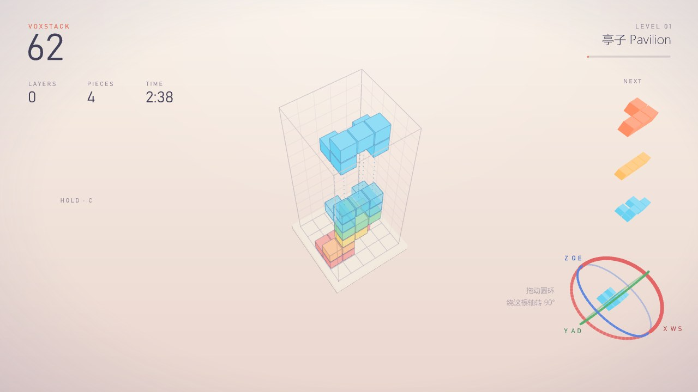

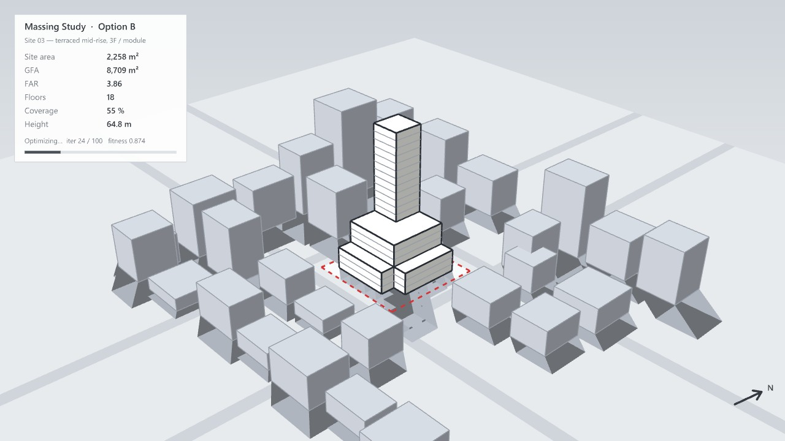

- **老板模式**：体素画成白模体块（一格 = 7.2 m 柱跨 × 3 层），带场地红线、周边体块、日照阴影和按体素算出来的指标；命令行打一行 `MassingStudy: Option B updated …`；GH 上的组件和 Metrics 面板都显示 "Option B"。井里体素太少时换成一个假体块，画面不会空。
- 视口矮于约 620 px 时，NEXT 列显示的待发积木少于三块（下面的预览被去掉），HOLD 预览位置更高。
- 结算画面的用时超过一小时后显示 h:mm:ss。
- 自定义积木的颜色给成完全透明的黑色（ARGB 0）时按不透明黑色画。
- Gumball 拖动要求积木做不了的转动时，圆环被放开（重新按住再试），不会悄悄记一次转动。
- 闪电模式：最后一小段时间里刚好完成的一层，在结算画面之前就被消掉。
- 最高分存在 `%APPDATA%\Moyu\voxstack-scores.txt`。
- 方案与设计说明：[docs/voxstack-plan.md](docs/voxstack-plan.md)。

## Landscape 面板：Serpentine 蜿蜒

曲面上的贪吃蛇：接任意一个曲面，蛇沿曲面的 UV 网格一格一格走。曲面在某个方向闭合（圆管、环面、球）就能绕过去，开放的边是墙，修剪掉的洞是障碍；下坡快、上坡慢，曲面形状本身就是关卡。面板伪装成景观的流线研究。

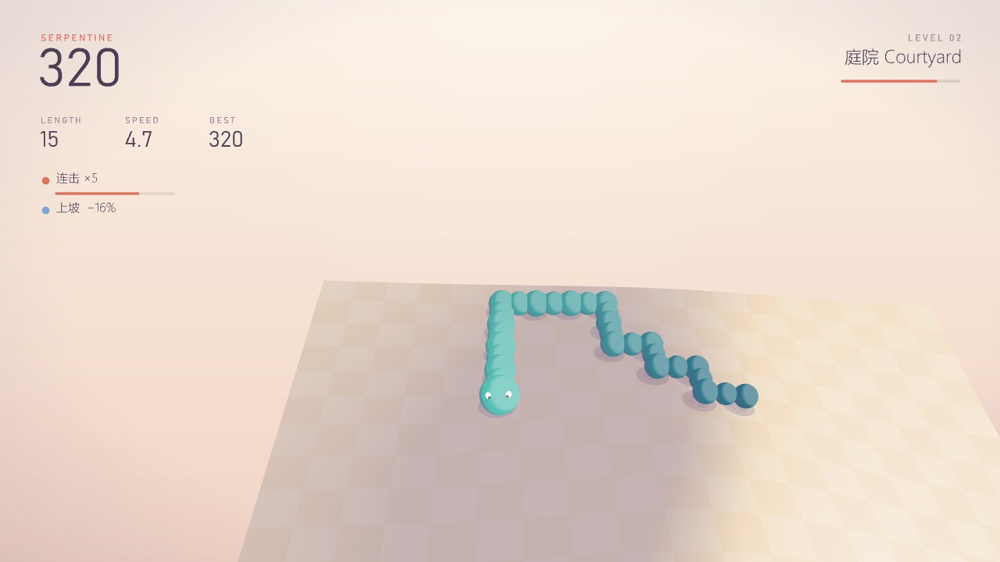

| 组件 | 缩写 | 作用 |
|---|---|---|
| Path Study | Path | 游戏本体，组件下方 **▶ Run / ■ Stop**。输入：Surface（不接就用内置起伏地形；修剪面可以）、Cells（长边格数，默认 28）、Mode（0 经典 / 1 三分钟闪电 / 2 禅：撞墙停住、不会咬死、没有炸弹）、Level、Slope（坡度影响速度）、Language。输出只在暂停、老板模式、结束时刷新：State、Score、Length、Best、Route（蛇身平滑曲线）、Metrics（路线长度、爬升、坡度等） |
| Site Surface | Site | 一键生成场地曲面：0 起伏地形、1 环面、2 圆管（S 形，绕一圈）、3 马鞍屋面、4 球面；Size（默认 40 m）、Seed |

| 道具 | 效果 |
|---|---|
| 苹果 / 葡萄 / 西瓜 | +1 / +3 / +5 段，10 / 30 / 80 分；西瓜 8 秒后消失。4 秒内连吃有连击倍率（最高 ×5） |
| 炸弹 | 第 3 级起出现（前两级只有水果），−3 段、−50 分，身体不够长就结束；最后 3 秒闪烁，不会刷在蛇头附近 |
| 冰块 / 幽灵 | 6 秒内速度 ×0.6 / 6 秒内可以穿过自己 |

每吃 5 个水果升一级，速度从每秒 3.4 格起步（上手容易），每级 +0.55，最多 15 格；关卡分五章（庭院、草坡、丘陵、峡谷、山脊），每章一套配色，升级时有章节卡片。

**操作**：

| 键 | 作用 |
|---|---|
| ← / A · → / D | **以蛇头为准**左转 / 右转（不管镜头朝哪） |
| 按住 ↑ / W / Shift | 冲刺 ×1.8 |
| C | 两种视角切换：**第一人称**（默认，镜头锁在蛇头后上方，蛇转弯镜头跟着转，前方永远在屏幕上方）/ **自由视角**（看整个模型，鼠标拖动转模型） |
| 鼠标左键或右键拖动 | 只在自由视角里转模型；第一人称时镜头锁定 |
| Esc / P | 暂停；暂停时 Esc 继续，Shift + Esc 退出。结束后 Enter / 空格再来一局 |
| `` ` ``（1 左边的键） | **老板键**，和 VoxStack 同一套（失焦自动切、3-2-1 回来） |

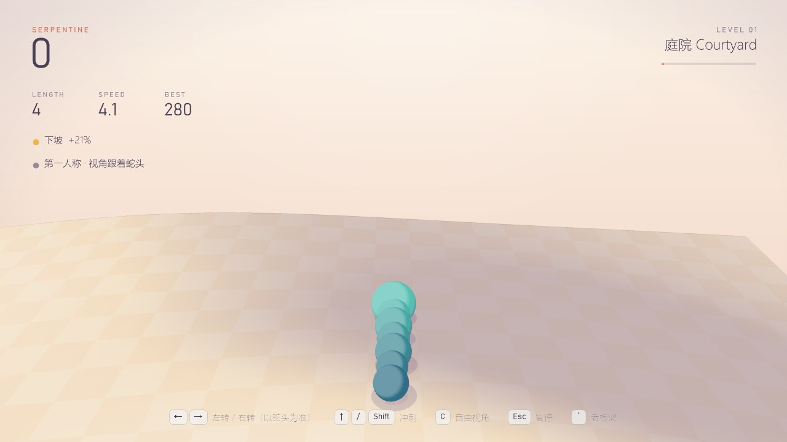

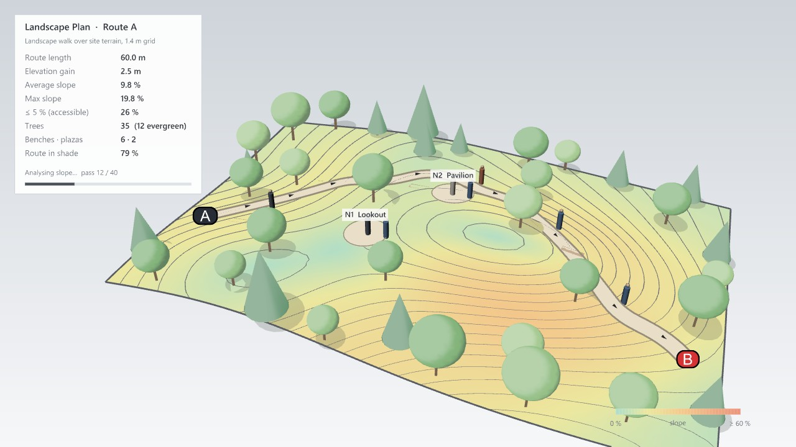

- **老板模式**：一张景观设计图：曲面画成坡度分析（配色图例 0 % … ≥ 60 %）加等高线；蛇身变成一条约 1.3 m 宽的铺装步道（A → B，带方向箭头），旁边每隔几米一张长椅；场地边缘一圈林带、步道两侧行道树、空地上几棵孤植树（落叶树圆冠 + 常绿树锥形，带投影，不种在步道上和陡坡上）；步道和节点上有比例人；道具变成小广场（N1 Lookout、N2 Pavilion……）。指标（路线长度、爬升、坡度、无障碍比例、树的数量、长椅和广场、步道遮阴比例）按蛇身和布置实算。命令行打一行 `CirculationStudy: Route A updated · L = … m · avg slope … %`。蛇太短时换成一条假路线。
- 修剪过的曲面按修剪后的范围划格（Cells 数的是修剪面的长边），从大地形里切出来的小场地也有合适的格子尺寸。至少有两个角点在修剪区外的格子算墙；老板模式里的场地边界跟着格子走（封闭曲面上没有接缝线）；环面 / 球背面的广场名称不显示。
- 细长的条带曲面（一个方向很长、另一个方向很窄）也能玩。
- 老板模式里的坡度最高报到 100 %。
- 炸弹同时会清掉刚吃的水果还欠着的生长（切掉之后蛇不会再长回来）。
- 最高分存在 `%APPDATA%\Moyu\serpentine-scores.txt`（按模式和网格尺寸分开）。
- 方案：[docs/serpentine-plan.md](docs/serpentine-plan.md)；画面风格：[docs/visual-style.md](docs/visual-style.md)。

## Facade 面板：Rebound 回弹

立面打砖块：砖墙立在视口里，按真实砌法排（顺砌、通缝、英式、荷兰式、花墙、拱），一关一种；玻璃 1 下、砖 2 下、混凝土 3 下，钢打不坏。面板伪装成立面研究。

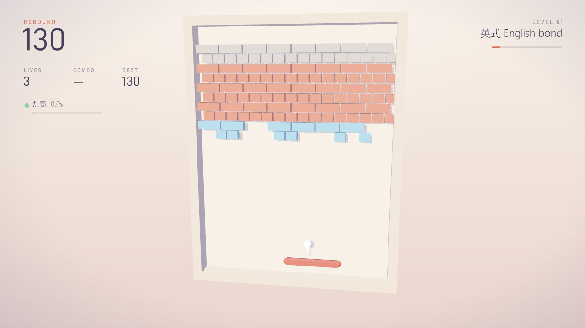

| 组件 | 缩写 | 作用 |
|---|---|---|
| Facade Study | Facade | 游戏本体，组件下方 **▶ Run / ■ Stop**。输入：Wall（Brick Bond 的输出，不接就六种砌法逐关轮换）、Mode（0 经典 3 条命 / 1 三分钟闪电 / 2 禅：不掉命）、Level、Plane（立面所在平面，默认 World XZ）、Size（一个模数的长度，默认 2.4 m）、Language。输出：State、Score、Level、Best、Panels / Windows（板块和窗洞轮廓）、Metrics |
| Brick Bond | Bond | 砌法：Type（−1 轮换，0–5 六种砌法）、Courses（皮数）；或者 Curves 接闭合曲线当板块（按大小分成玻璃 / 砖 / 混凝土）。太小没法打的板块会被跳过：缩放后窄于约 0.3 个场地单位的板块被忽略，并警告 “N panel(s) too small to play”；自定义墙一块能打的都没有时，Facade Study 改为铺砌法序列。平面图在 Y 方向比 X 方向高时现在也读对了（u 取 X，v 取 Y）。从第 4 关起，会把一块能打的砖围死的钢砖改铺成混凝土，每面墙都能打光。Bricks 输出第一关的预览 |

**操作**：← → / A D 或直接移动鼠标（挡板跟着走）；空格发球、松开粘住的球；鼠标拖动转视角；Esc / P 暂停（暂停时 Esc 继续、Shift + Esc 退出）；结束后 Enter / 空格再来一局；`` ` ``（1 左边的键）老板键。道具：加宽、多球、慢速、粘板、穿透、+1 命，以及坏的"缩短"。第一面墙碎砖有 36 % 的机会掉道具（第二面 24 %，之后 15 %），而且开局头六个道具正好是六种好道具各一个，一上来就能都试到；拿到时挡板上方会写一行它的作用。增益按次数用完就失效（不按时间）：加宽 8 次接球、慢速 6 次、缩短 5 次、粘板粘 3 次、穿透 6 块砖；左侧状态行显示还剩几次。粘板最少见（掉落里约 7 %）。两次碰挡板之间连续打砖有连击倍率（最高 ×8）。

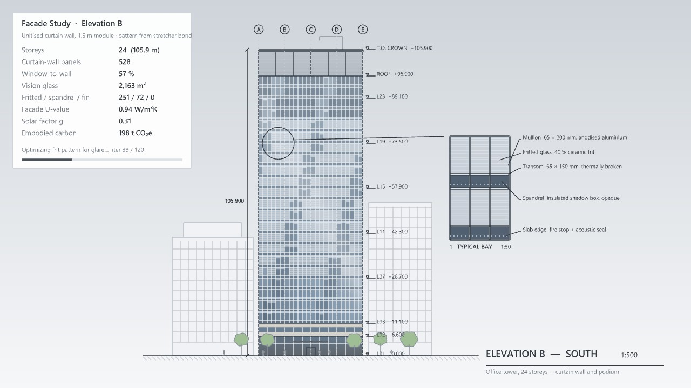

- **老板模式**：一栋 24 层办公塔楼的南立面，单元式玻璃幕墙（1.5 m 模数，22 个标准层，每层一条窗槛墙带）。每块幕墙板取它背后的那块砖：打掉的 = 透明玻璃（后面有百叶）、玻璃砖 = 着色玻璃、砖 = 印釉玻璃、混凝土 = 不透明窗槛板、钢 = 铝板加翼片，所以砌法就是幕墙图案，打得越多透明玻璃越多。玻璃带天空反射、云的高光和邻楼倒影；双层通高大堂、石材裙房层、百叶屋顶设备层；轴网、标高、总高尺寸、邻楼、行道树，右边一个 1:50 标准开间大样。指标（层数、幕墙板数、窗墙比、视野玻璃面积、幕墙 U 值、太阳得热系数、隐含碳）按当前墙实算。命令行一行 `FacadeStudy: Elevation B updated · WWR … % · … panels · U …`。
- 丢球之后下一次发球从本关的基础速度开始；粘板接球后同样会出现“空格 发球”提示；结果行超过一小时显示 h:mm:ss。
- 最高分存在 `%APPDATA%\Moyu\rebound-scores.txt`。方案：[docs/rebound-plan.md](docs/rebound-plan.md)。

## Section 面板：Swift 雨燕

单键飞行：一只雨燕在一条无尽的建筑剖面里飞（地板、顶板、带高窗的内墙，迎面一道道开了门窗洞的横墙），按空格扇一下翅膀往上蹿，不按就往下掉，穿过每堵墙的开口得 1 分；碰墙或落地就结束。开头几堵墙的开口很高、都在中间附近、速度慢，越往后开口越小、越快、高低差越大，第 26 堵墙起还有上下滑动的窗扇；墙之间有羽毛可以捡。每 10 分升一层，每 3 层换一章配色（门厅、回廊、中庭、天井、黄昏）。面板伪装成剖面通风采光研究。

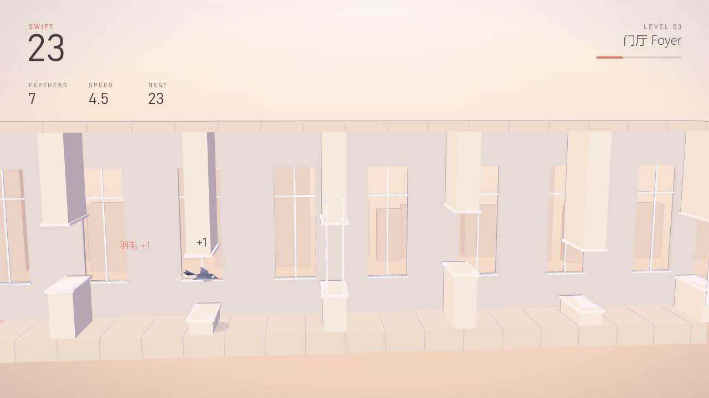

| 组件 | 缩写 | 作用 |
|---|---|---|
| Airflow Study | Airflow | 游戏本体，组件下方 **▶ Run / ■ Stop**。输入：Grid（Storey Grid 的输出，不接就是普通风压、经典模式）、Plane（默认 World XZ）、Size（一个场地单位的长度，默认 0.75 m，场地 9 m 高）、Language。输出：State、Score、Best、Path（最近一段飞行路径）、Section（剖面切线轮廓）、Metrics |
| Storey Grid | Grid | 设置：Exposure（0 避风 / 1 普通 / 2 迎风，越大越快越窄）、Mode（0 经典 / 1 Zen：撞墙穿过、落地弹起，不结束）、Opening（开口高度系数 0.8–1.4）、Bay（开间系数 0.8–1.5）、Seed（固定关卡，0 = 每次随机）。Section 输出前几堵墙的预览 |

**操作**：空格 / ↑ / W / 鼠标左键 扇一下翅膀；右键拖动转视角；Esc / P 暂停（暂停时 Esc 继续、Shift + Esc 退出）；`` ` ``（1 左边的键）老板键。结束后 Enter / 空格再来一局，Esc 退出。

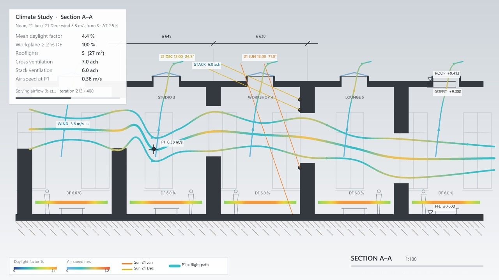

- **老板模式**：就是游戏里那个剖面，画成建筑师的图：地板、屋面板和每堵横墙按游戏里的位置涂黑剖切，开口在原来的高度，后墙的高窗画在剖切线后面；每个开间加一个天窗。叠加分析：冬至 / 夏至正午的太阳从天窗照进来（冬天斜着打到横墙上）、工作面的采光系数色带、穿堂风和热压通风的气流线——主气流线就是雨燕刚才飞过的路线，雨燕所在的位置是测点 P1。指标（平均采光系数、工作面达标比例、天窗、穿堂风 / 热压换气次数、P1 风速）按画面上的墙和开口实算。镜头和游戏几乎同一个位置，所以一按老板键只像是"换了一种画法"。命令行一行 `AirflowStudy: Section A-A updated · cross … ach · stack … ach · mean DF … % · P1 … m/s`。
- 老板键的剖面按 0.1–5 m 每场地单位的范围夹住比例，所以 Size 取极端值时画出来的是夹住后的比例，不是字面的 Size。
- 撞墙后 1.2 秒的坠落期间按 Esc 和老板键不起作用：雨燕先落地，再出结算画面。
- Storey Grid 的 Opening / Bay 收到 NaN 时按 1 处理并给出提示。
- 每个难度用一个简单的自动驾驶在五个种子上飞满 150 秒来测，保证关卡总能飞过去。最高分存在 `%APPDATA%\Moyu\swift-scores.txt`，按 Mode + Exposure + Opening + Bay 分开记。方案和数值：[docs/swift-plan.md](docs/swift-plan.md)。

## 安装

只想用插件的话不用编译。需要 **Windows 版 Rhino 8**（.NET Core 和 .NET Framework 两种运行时都行；没有在 Mac 上测过）。三种装法任选一种：

1. **包管理器（推荐）**：在 Rhino 里运行 `_PackageManager`，搜索 **moyu**，Install，重启 Rhino。
2. **.yak 文件**：从 GitHub Releases 或 food4rhino 下载 `moyu-<版本>-rh8_0-win.yak`，拖进打开的 Rhino 窗口（或 `_PackageManager` → *Install from file*），重启 Rhino。
3. **手动复制 .gha**：新建 `%APPDATA%\Grasshopper\Libraries\Moyu\`，把发布包里对应运行时的那一个 `Moyu.gha` 复制进去（Rhino 跑在 .NET Core 上用 `net7.0\Moyu.gha`，跑在 .NET Framework 上用 `net48\Moyu.gha`；`_SetDotNetRuntime` 能看到当前是哪种）。文件被 Windows 标成"已阻止"的话先右键 → 属性 → 解除锁定，再重启 Rhino。

装好后组件在 Grasshopper 工具栏的 **Moyu** 页签下（2D、3D、Massing、Landscape、Facade、Section 六个面板）。卸载：`_PackageManager` → Installed → moyu → Uninstall，或删掉 `Libraries\Moyu` 文件夹；最高分在 `%APPDATA%\Moyu\`，可以一起删。发布包里也带一份 [packaging/INSTALL.md](packaging/INSTALL.md)（中英双语）。

## 构建与加载

需要 .NET SDK 8 或更高，以及 Rhino 8。**编译前先关掉 Rhino**（以及 Hops 的 `compute.geometry`）：正在运行的 Rhino 锁着 `Moyu.gha`，编译会失败。

```bash
dotnet build src/Moyu -c Release
```

产物：`src/Moyu/bin/Release/net7.0-windows/Moyu.gha`（Rhino 8 默认的 .NET Core 运行时）；`net48/` 给以 `/netfx` 启动的 Rhino。

加载方式（二选一）：

- **开发调试**：在 VS / VS Code 里用模版自带的 **Rhino 8 - netcore**（或 **netfx**）启动配置，它通过 `RHINO_PACKAGE_DIRS` 直接加载构建目录。VS 的配置（`Properties/launchSettings.json`）启动 MSBuild 属性 `RhinoExe` 指向的 Rhino（默认 `C:\Program Files\Rhino 8\System\Rhino.exe`）；VS Code 的 `src/Moyu/.vscode/launch.json` 不读 `RhinoExe`，固定写默认路径，Rhino 装在别处时在 VS Code 用户设置的 `"launch"` 里加一份带自己路径的配置，不要改这个文件。VS 下 Rhino 装在别处时，在 `src/Moyu/Moyu.csproj.user`（git 忽略）里改：

  ```xml
  <Project>
    <PropertyGroup>
      <RhinoExe>D:\Rhino 8\System\Rhino.exe</RhinoExe>
    </PropertyGroup>
  </Project>
  ```

- **手动**：在 Grasshopper 里运行 `GrasshopperDeveloperSettings`，把上面的输出目录加进库路径，或把 `Moyu.gha` 复制到 `%APPDATA%\Grasshopper\Libraries\Moyu\`，重启 Rhino。

开发流程（游戏的做法、图标生成、开发用时统计）见 [docs/contributing.md](docs/contributing.md)。

## 测试

```bash
dotnet run -c Release --project tests/Moyu.Core.Tests
```

不依赖 Rhino 的核心测试：2D / 3D 均匀拉伸 patch test（与解析解误差 < 1e-8）、多重网格与直接解对比、等值线 / 等值面闭合、运行中修改问题、MBB 梁与 3D 悬臂基准。加 `--bench` 输出各网格尺寸的每步耗时。

```bash
dotnet run -c Release --project tests/Moyu.RhinoTests -- --images docs/images
```

Rhino 集成测试：用 Rhino.Inside 在无界面的 Rhino 8 里加载真实 Grasshopper 和插件，2D、3D 各连成 4 个场景（2D：悬臂、XZ 立面桥、带孔 L 形支架、错误输入；3D：悬臂、雨棚、带孔支架、错误输入）逐项检查，并把结果图写到 `docs/images/`。需要本机装有已授权的 Rhino 8，先用 Release 构建插件。Rhino.Inside 测试进程崩溃（通常是第三方插件的原生库）的排查方法见 [docs/testing.md](docs/testing.md)。

### 测试用 GH 文件

[tests/gh/Moyu2D-Test.gh](tests/gh/Moyu2D-Test.gh) 是可以直接在 Grasshopper 里打开的 2D 测试定义，三组例子：

| 组 | 内容 | 位置（Rhino 视口） |
|---|---|---|
| A | 悬臂梁：Width / Height / Load Y 滑块驱动的矩形、左边线支座、右端点荷载 | World XY，原点起 |
| B | 立面桥：XZ 平面，顶边线荷载、铰 + 滚动支座、实心桥面、空心洞口（半径可调）、钢材 E | XZ 平面，y = −60 |
| C | L 形支架 + 螺栓孔：嵌套边界曲线，平滑显示 | World XY，x = 120…220 |

每组都已接好 Timer（Trigger）、Run 开关和 Reset 按钮，保存时 Run 是关的。打开前先让 Grasshopper 加载 `Moyu.gha`（见上面"安装"或"构建与加载"），然后把某组的 Run 拨到 True 就开始迭代；运行中拖滑块可看实时响应。

[tests/gh/Moyu3D-Test.gh](tests/gh/Moyu3D-Test.gh) 是 3D 测试定义，几何全部由原生 GH 组件和滑块生成：

| 组 | 内容 | 位置（Rhino 视口） |
|---|---|---|
| A | 3D 悬臂梁：Domain Box，x = 0 端面（Boundary Surfaces）固定，自由端底边线荷载 | World XY，原点起 |
| B | 雨棚：顶面面荷载、四角铰支、实心屋面板、下方空心通道 | x = 60…100 |
| C | L 形支架：挤出的 L 形板 + 嵌套圆柱孔，顶面固定，端部水平荷载 | x = 120…220 |

[tests/gh/MoyuStack-Test.gh](tests/gh/MoyuStack-Test.gh) 是 VoxStack 的测试文件，打开就能玩：

| 组 | 内容 |
|---|---|
| A | 一个 Massing Study，点 ▶ Run 就玩（标准 8 块）；接了 Height 15、Mode 1（三分钟闪电）、Level 1（起始等级）三个滑块。旁边的面板只显示状态和指标，不显示分数 |
| B | 自定义积木：Sketch 参数里存着 3 个手画的盒子（两根柱子一根梁）→ Voxel Unit（5 格 U 形 "Pavilion"），Pattern 面板 `#.#/#.#\|###` → Voxel Unit（7 格 "Gate"）→ Unit Library（Preset 2 困难）→ Massing Study（Mode = 1，三分钟闪电；井尺寸滑块） |

> 从 Rhino 里选物体塞进 Sketch（Set One / Set Multiple Breps），GH 文件里只记物体的 ID，换个 Rhino 文档这个积木就没了。想让它跟着 GH 文件走，右键 Sketch → **Internalise data** 再保存。

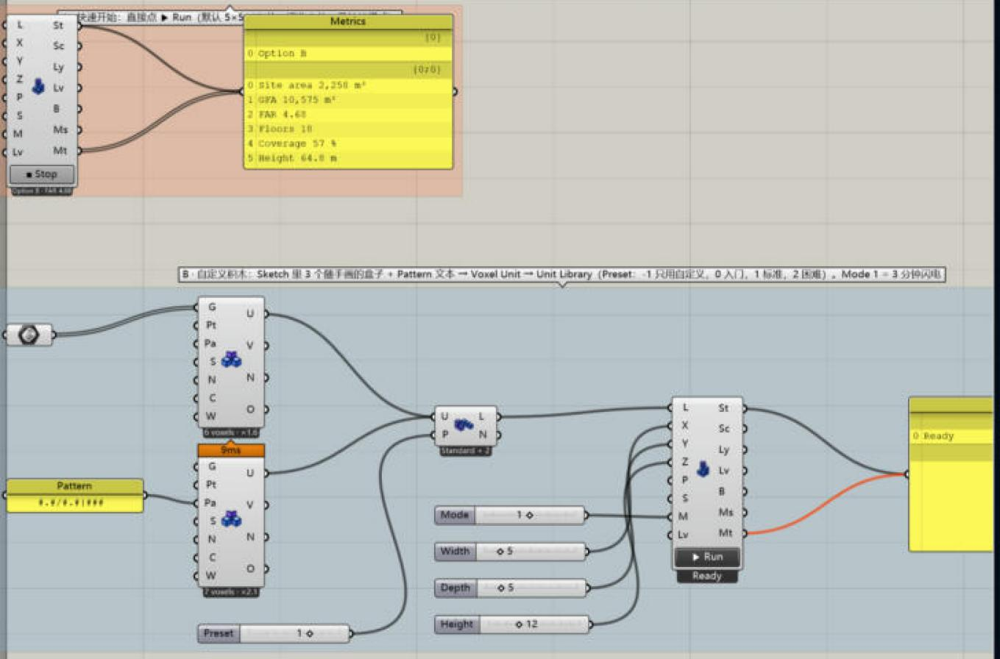

三个文件都由代码生成，插件改动后重新生成并自检（重新打开文件、确认每组都能收敛或就绪、画布无重叠）：

```bash
dotnet run -c Release --project tests/Moyu.RhinoTests -- --write-gh
```

[tests/gh/MoyuSnake-Test.gh](tests/gh/MoyuSnake-Test.gh) 是 Serpentine 的测试文件：

| 组 | 内容 |
|---|---|
| A | 一个 Path Study，什么都不用接，点 ▶ Run（内置起伏地形、28 格、经典模式） |
| B | Site Surface（Type 滑块 0–4、Seed）→ Path Study（Cells、Mode、Level 滑块）。Site Surface 的预览关着，游戏画面干净 |
| C | GH 原生 Sphere（Radius 滑块）→ Path Study：任意曲面都能玩，球的两极当墙 |

[tests/gh/MoyuBreakout-Test.gh](tests/gh/MoyuBreakout-Test.gh) 是 Rebound 的测试文件：A 直接点 ▶ Run；B 是 Brick Bond（Type、Courses 滑块）→ Facade Study（Mode、Level 滑块）；C 是一组闭合矩形当自定义立面分格。[tests/gh/MoyuSwift-Test.gh](tests/gh/MoyuSwift-Test.gh) 是 Swift 的测试文件：A 直接点 ▶ Run；B 是 Storey Grid（Exposure、Mode、Opening、Bay、Seed 滑块）→ Airflow Study。两个文件里 Brick Bond 和 Storey Grid 的预览都关着。

只重新生成 VoxStack 文件用 `--write-gh-stack`，只重新生成 Serpentine 文件用 `--write-gh-snake`，Rebound 用 `--write-gh-breakout`，Swift 用 `--write-gh-swift`（自检会把 Site Surface 的 5 种曲面都切一遍）。注意 `--write-gh` 会覆盖全部测试文件，包括你自己在 `MoyuStack-Test.gh` 里画的东西。Serpentine 的规则（网格拓扑、绕圈、转向队列、撞墙 / 咬自己、道具、连击、炸弹、坡度、升级、闪电、回放、路线指标）也在 `Moyu.Core.Tests` 里测。VoxStack 的规则（旋转姿态、消层、计分、锁定延迟、踢墙、袋子发牌、回放、闪电计时、体块指标）在 `Moyu.Core.Tests` 里测；键盘、渲染和老板键需要在 Rhino 里实际玩一下。

## 发布

版本号只写在 `src/Moyu/Moyu.csproj` 的 `<Version>` 里（当前 1.0.0），程序集、`manifest.yml` 和包名都从它来；Grasshopper 库对话框里显示的版本就是 `<Version>` 原样（预发布后缀如 `1.0.1-beta` 也保留）。发布包由一个脚本生成：

```bash
python tools/package.py            # 关掉 Rhino 后：Release 构建（要求 0 警告）→ 打包
python tools/package.py --no-build # 只用已有的 Release 产物打包
```

已推上去的 yak 版本永远不能替换，所以脚本在打包前检查两个 `Moyu.gha` 是不是用当前 `<Version>` 编出来的（读文件的产品版本，去掉 `+提交号`），Yak 报 “Content version doesn't match manifest” 时也再核一次；对不上就停下并提示 “build first”，不会把旧产物打成新版本号（预发布清单 `1.0.1-beta` 配 `1.0.1` 的程序集算对得上）。

产物在 `dist/`（git 忽略）：

| 文件 | 内容 | 用途 |
|---|---|---|
| `moyu-<版本>-rh8_0-win.yak` | `net48/Moyu.gha` + `net7.0/Moyu.gha`、`manifest.yml`、`icon.png`、`LICENSE.txt`、`QUICKSTART.md`、`Moyu-Guide-ZH.pdf` / `Moyu-Guide-EN.pdf`（图文手册）、`examples/`（6 个示例 .gh），一个包同时装两种运行时 | Rhino 包管理器：`yak push`，或在 food4rhino 上作为附件 |
| `Moyu-<版本>-food4rhino.zip` | 上面的 .yak、两个裸 `.gha`、`examples/`、两份手册 PDF、`QUICKSTART.md`、`INSTALL.md`、`LICENSE.txt` | food4rhino 的下载包 |
| `SHA256SUMS.txt` | 两个包的校验和 | 发布说明里贴 |

示例 .gh 由 `dotnet run -c Release --project tests/Moyu.RhinoTests -- --examples packaging/examples` 生成（不碰 `tests/gh`）。图文手册的源文件是 `packaging/guide/guide.html`（中英文写在一起），`python tools/make_guide.py` 用 Edge / Chrome 无界面打印出两份 PDF（加 `--preview` 另存每页 PNG 检查排版），图片取自 `docs/images`。打包前脚本会检查每个文件里有没有本机路径或用户名，有就拒绝；插件用 `PathMap` 编译，`.gha` 里只留 `/_/Moyu/...`。

脚本用 Rhino 自带的 `Yak.exe` 打包，依次找 `C:\Program Files\Rhino 8\System\Yak.exe`、`E:\Rhino 8\System\Yak.exe`，装在别处用环境变量 `YAK_EXE` 指定。打包的源文件都在 `packaging/`：`manifest.yml`（包管理器的清单，`{version}` 由脚本填）、`icon.png` / `icon-512.png`（包图标）、`INSTALL.md`（随包发的安装说明）、`food4rhino/listing.md`（food4rhino 页面的文案）。许可证是 MIT（仓库根目录的 [LICENSE](LICENSE)），作者 Ming，主页 https://github.com/ChenmingHe0126/moyu。

## 目录

```
src/Moyu/
  Core/            不依赖 Rhino 的算法：像素 / 体素网格、Q4 / H8 单元、带状 Cholesky、多重网格 CG、过滤、
                   SIMP 优化器（2D、3D 共用基类）、Marching Squares、Surface Nets
  TwoD/ ThreeD/    Rhino 几何 ↔ 网格：设计域、条件数据、问题构建、结果网格化、视口符号
  Components/      GH 组件基类、求解器基类、Goo、图标、Run 按钮；TwoD/ 和 ThreeD/ 下各 7 个组件，Massing/ 下 3 个，Landscape/、Facade/、Section/ 下各 2 个
  Games/Common/    游戏共用：会话基类（老板键、失焦、倒计时、暂停、镜头、鼠标转视角）、绘制基类（极简风格：背景、
                   平涂着色、软投影、字体、键帽提示、暂停 / 结算画面、HUD 缩放）、配色、本地最高分、线程级键盘钩子、60 Hz 帧时钟
  Games/Stack/     VoxStack：Core/（不依赖 Rhino 的规则、积木、体块指标）、会话、视口绘制、老板模式体块
  Games/Snake/     Serpentine：Core/（不依赖 Rhino 的网格、规则、道具、路线指标）、曲面 → 网格、会话、视口绘制、老板模式流线研究
  Games/Breakout/  Rebound：Core/（不依赖 Rhino 的砌法、球与砖的碰撞、道具、塔楼幕墙映射与指标）、会话、视口绘制、老板模式塔楼立面
  Games/Swift/     Swift：Core/（不依赖 Rhino 的飞行物理、关卡生成、住宅剖面的日照 / 采光 / 通风模型）、会话、视口绘制、老板模式剖面分析
  Icons/           24 个 24×24 透明 PNG：7 个 2D + 7 个 3D + 3 个 Massing + Landscape / Facade / Section 各 2 个组件图标 + Moyu 插件 / 页签图标
tests/             Moyu.Core.Tests（纯算法）、Moyu.RhinoTests（Rhino.Inside 集成测试）
docs/              工作流说明、游戏方案、图标提示词、开发记录与用时统计、结果图；contributing.md（开发流程）、testing.md（测试排查）
packaging/         发布包的源文件：manifest.yml、icon.png、INSTALL.md、QUICKSTART.md、examples/（示例 .gh）、guide/（图文手册源文件和 PDF）、food4rhino/listing.md
tools/package.py     构建并打包 .yak 和 food4rhino zip（见"发布"）
tools/make_icons.py  把图标表切成 24×24 图标（--set 2d / 3d / massing / landscape / facade / section；--source-out 存原分辨率切图，--preview 出实际尺寸预览）
tools/codex_image.py 用本机 Codex 命令行生图（图标用，见 docs/contributing.md）
tools/dev_time.py    导出开发用时时间线（见 docs/contributing.md）
```

## 图标

图标是 `src/Moyu/Icons/` 里的 **24×24 透明 PNG**，按组件类名命名（`BoundaryComponent.png` ……），`Moyu.png` 同时用作插件和 Ribbon 页签图标，现在是一条圆角体素块拼成的鱼（摸鱼），放大版 `packaging/icon.png` / `icon-512.png` 是包管理器和 food4rhino 的图标，设计和导出见 [docs/icon-prompts-plugin.md](docs/icon-prompts-plugin.md)；csproj 把整个文件夹嵌进程序集，重新编译即可生效。原图在 `docs/images/moyu-icons-*-source.png`，从原图重新切：`python tools/make_icons.py <图标表> --set <面板>`（2d / 3d / massing / landscape / facade / section）。编译后可以在无界面 Rhino 里检查 23 个组件和 Moyu 页签都拿到了图标：

```bash
dotnet run -c Release --project tests/Moyu.RhinoTests -- --icons
```

图标的生成流程和各面板的提示词见 [docs/contributing.md](docs/contributing.md)。
