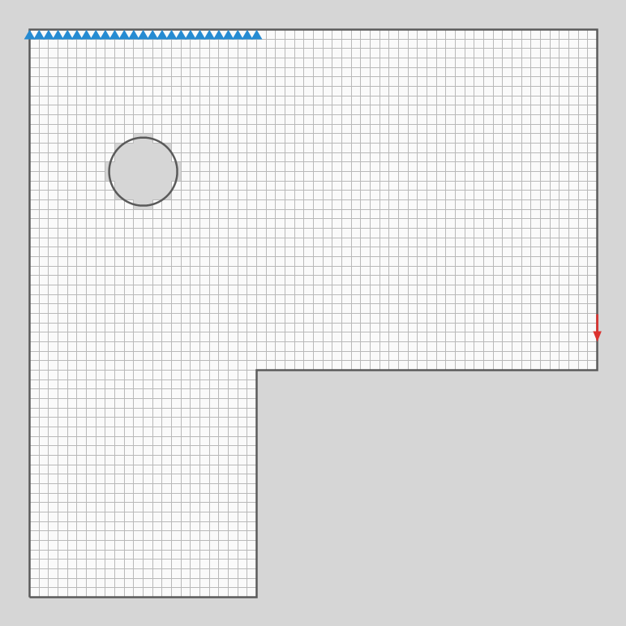
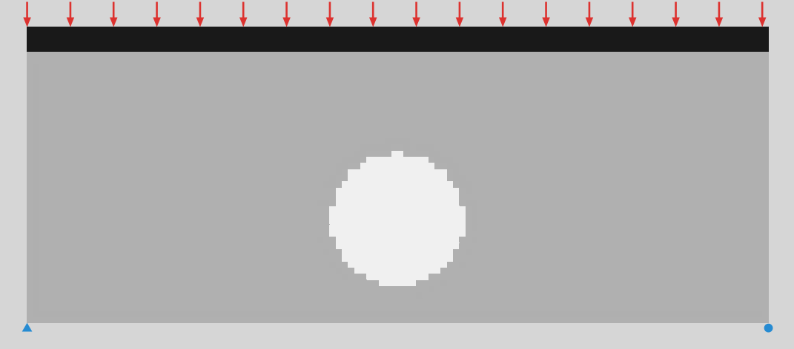
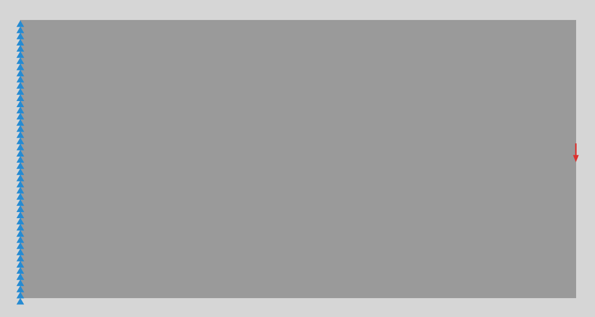
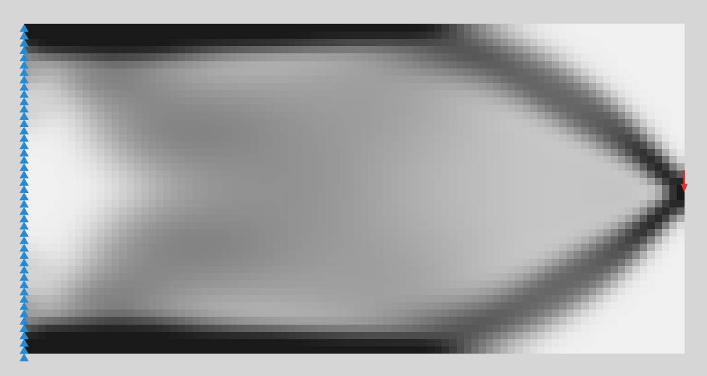
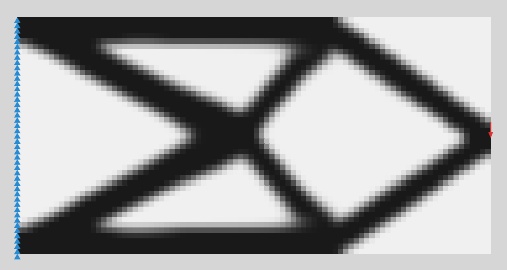
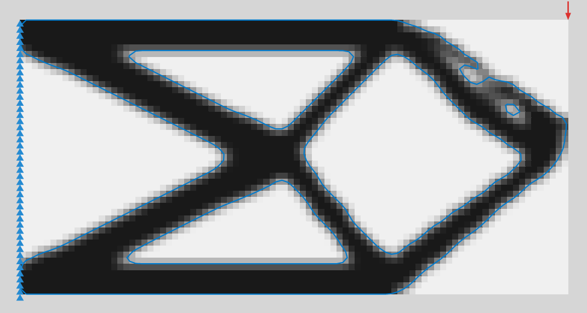
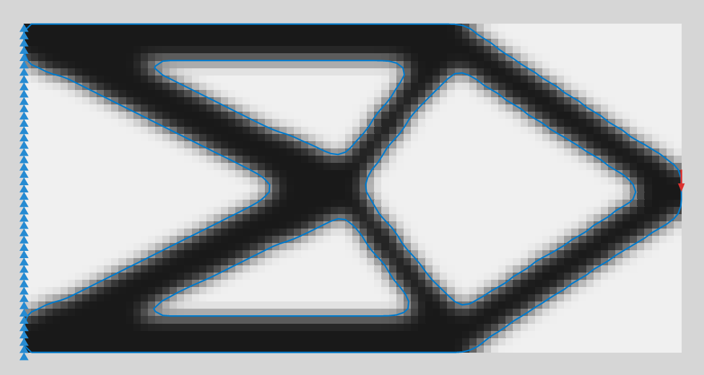

# Moyu 2D 拓扑优化 · 第一版说明

> 网页版报告是这份文档的图文版；此 Markdown 是仓库里的源文件。图片都是插件在 Rhino 8 里真实算出来的输出（由 `tests/Moyu.RhinoTests` 生成）。

## 一页结论

- **已建成**：用 Rhino 官方 `dotnet new grasshopper` 模版（Rhino 8）建了插件 **Moyu**。Ribbon 页签 `Moyu › 2D` 下 7 个组件，分三行：
  条件（Boundary / Load / Support / Area / Material）→ 求解（SIMP Solver，Timer 驱动）→ 显示（Visualize）。
- **算法自写**：纯 C#，没有参考 TorchSharp 论文代码。Q4 平面应力有限元 + 带状 Cholesky 直接求解 + 密度过滤 + OC 更新（经典 SIMP）。
- **实测**：在 Rhino 8.36 里（无界面）加载真实 Grasshopper，跑悬臂、XZ 立面桥、带孔 L 形支架、错误输入 4 个场景；核心算法测试 22 项 + 集成测试 35 项全部通过。均匀拉伸 patch test 与解析解误差 < 1e-9。
- **速度**：90×45 像素 11 ms/步，71 步收敛共 0.7 s；200×100 像素 178 ms/步。
- **图标**：7 个 2D 组件的 24×24 PNG 在 `src/Moyu/Icons/`，提示词和切图脚本见第 10 节。

## 1. 整体工作流

```
Boundary 2D ─┐
Load 2D ─────┤
Support 2D ──┼─► SIMP Solver 2D ──► Visualize 2D
Area 2D ─────┤        ▲
Material 2D ─┘        └── Timer（Params › Util，昵称 Trigger）+ Toggle→Run，Button→Reset
```

条件组件只产出数据，并在视口里画出自己（红箭头 = 荷载，蓝三角 = 支座，虚线 = 空心区）。
Solver 每被触发一次就推进 `Steps` 步；Grasshopper 自带的 **Timer** 每隔一段时间触发一次，所以接上 Timer 就会自动一直算到收敛。

## 2. Boundary 2D — 设计域



*L 形外轮廓 + 圆孔，分辨率 60。像素中心落在边界里的才是设计像素；圆孔是第二条嵌套曲线，按奇偶规则成为孔。*

| 输入 | 说明 | 默认 |
|---|---|---|
| Boundary | 闭合平面曲线（可多条，嵌套 = 孔） | — |
| Resolution | 长边方向像素数 | 80 |
| Plane | 可选网格平面 | 自动 |

输出 `Domain`（给 Solver）和 `Pixel Size`。平面自动识别：曲线在 XY → World XY；在 XZ（立面）→ X 向右、Z 向上；在 YZ → Y 向右、Z 向上；其它斜平面用曲线自身平面。

**坑**：分辨率翻倍，每步耗时约涨 6–8 倍（见第 7 节性能图）；弧形边界会变成锯齿，靠提高分辨率改善。上限 600，超过 4 万像素会提示变慢。

## 3. Load 2D — 荷载



*XZ 立面桥，第 0 步。红箭头是顶边曲线荷载（总力平均分到经过的节点），灰色是初始密度 0.3。*

- **Geometry**：点 → 吸附到最近的“可承载节点”（挨着设计或实心像素的节点）；曲线 → 每半个像素采样，各自吸附，力平均分配，总力 = 向量长度。
- **Force**：世界坐标向量，默认 (0, −1, 0)。只取域平面内的分量。

**坑**：立面（XZ）上“向下”是 (0, 0, −1)。若力与平面垂直，Solver 报 “No usable load”（已测）。

## 4. Support 2D — 支座

- **Fix X / Fix Y**：域平面的局部 X / Y。两向都固定 = 铰支（视口里画蓝三角），只固定一向 = 滚动支座（蓝圆）。组件下方显示 Pin / Roller X / Roller Y。
- 点或曲线都可以；曲线会固定它经过的每个节点。

**坑**：只有一个滚动支座时结构能滑动/转动，Solver 报 “Unstable”（已测）。至少：一个铰 + 一个滚动，或一整条边固定。

## 5. Area 2D — 实心 / 空心区

见第 3 节图：黑色顶带是 **Solid** 区（桥面始终满），白色圆是 **Void** 区（洞口始终空）。

- 只作用在边界内，不会扩展设计域；后连入的区域覆盖先连入的。
- 体积分数的分母 = 边界内面积 − 空心区面积；实心区算进材料用量。

**坑**：实心区面积超过 体积分数 × 可用面积 时，剩下的设计区会全空。

## 6. Material 2D — 材料

- **E**（默认 1）、**Nu**（默认 0.3），平面应力。不连 Material 时用默认值。
- 线性问题里 E 只按 1/E 缩放柔度，不改变拓扑；ν 对形态影响很小。用真实单位（MPa + N + mm）时柔度才有物理意义。

## 7. SIMP Solver 2D — 求解器

| 第 0 步 | 第 5 步 | 第 20 步 | 第 71 步（收敛） |
|---|---|---|---|
|  |  |  |  |

*悬臂 60×30（90×45 像素），左边固定，右中点向下荷载，体积分数 0.4。*

**算法**：每个像素密度 x ∈ [0, 1]，刚度 E(x) = Emin + xᵖ(E₀ − Emin)。p = 3 让灰色“不划算”，结果趋向黑白（SIMP）。
目标是最小化柔度 c = Fᵀu（荷载做的功，越小越刚），约束总材料量；用 OC（最优准则）更新密度；
密度过滤在半径 R 像素内加权平均，防止棋盘格并控制最细构件（约 2R 像素）。

| 输入 | 默认 | 说明 |
|---|---|---|
| Domain / Loads / Supports | — | 必连 |
| Areas / Material | — | 可选 |
| Volume Fraction | 0.4 | 可用面积里材料的占比 |
| Penalty | 3 | SIMP 惩罚指数 |
| Filter Radius | 2 | 像素，限制在 [1, 12]（输入说明里写的是最大值） |
| Max Iterations | 200 | 每次改输入后重新计数 |
| Steps | 5 | 每次触发推进的步数，最多 50；每次触发算满约 1.5 秒就停在当前步（剩下的留给下一跳），按 Esc 停得更早 |
| Run / Reset | false | Toggle / Button |

Volume Fraction、Penalty、Filter Radius 收到 NaN 或无穷大时按默认值算，并给出警告。

输出：Result、Iteration、Compliance、Volume、Converged、History。组件下方状态：Ready / Running @ n / Paused @ n / Converged @ n / Max iter n / Unstable / Error。输入缺失（荷载 / 支座没接上）显示 Waiting；机构显示 Unstable；其他拒绝显示 Error，原因在运行时消息里。过滤半径的邻居表超过 1 亿项时报 “Filter radius R is too large for this grid; lower it or the resolution”；刚度矩阵分解超过 1.5 GB 时报 “The stiffness matrix would need X GB; lower the resolution (the shorter side of the domain drives the cost)”（近似正方形的域短边超过约 390 像素；Boundary 2D 上限仍是 600）；内存不够显示 “Out of memory: lower the resolution or the filter radius.”。

**Trigger 驱动**：Timer 每跳一次 → Solver 推进 Steps 步 → 输出刷新 → Visualize 重画。收敛后继续跳也不会再迭代（Visualize 有缓存，不重建网格）。只有文档里完全没有 Timer 时组件才提示 “No Timer drives this solver”。

**收敛判据**：最大密度变化 < 1%，或柔度连续 10 步每步变化 < 0.01%。只用前者时悬臂要 330 步，而第 71 步的柔度已与第 330 步相差 0.4%。

**运行中修改**：



*在第 71 步把荷载从右中点移到右上角，继续算到第 125 步。密度从旧结果出发，所以会在旧拓扑上局部修正（右上角出现小孤岛）。想要全新结果就按 Reset。*

**性能**（每步耗时，Release）：

| 网格 | 像素 | ms/步 |
|---|---|---|
| 60×30 | 1 800 | 3 |
| 90×45 | 4 050 | 11 |
| 120×60 | 7 200 | 29 |
| 100×100 | 10 000 | 103 |
| 160×80 | 12 800 | 78 |
| 200×100 | 20 000 | 178 |
| 250×125 | 31 250 | 446 |
| 300×150 | 45 000 | 937 |

方形域比同等像素数的长条域慢：带状矩阵的带宽由短边决定。

## 8. Visualize 2D — 显示

| Mode 0 密度像素 | Mode 1 实心像素 | Mode 2 平滑 |
|---|---|---|
|  |  |  |

- 输出 **Mesh**（顶点着色）、**Contour**（阈值处的闭合多段线，可直接 Boundary Surfaces / Offset / Extrude）、**Density**（逐像素数值，从左下角逐行）。
- 输入 Threshold（0.5）、Solid / Void Colour、Conditions（是否画荷载与支座）。
- 轮廓用 Marching Squares 在像素中心的密度上取等值线（边界外的像素按 0 计，四周补零保证闭合）；0.5 时正好沿实心和空心像素之间的边，一像素宽的细杆也保留轮廓（2026-11-08 起，以前在节点平均密度上取，会抹掉细杆）。Smooth 显示仍用节点平均。

## 9. 验证

- 核心（不需要 Rhino）22 项：patch test、等值线闭合、运行中修改问题、迭代预算续期、MBB 梁基准（敏度过滤 78 步 c = 203.4；密度过滤 74 步 c = 220.1）。
- Rhino 8.36 集成 35 项：Ribbon 布局、Timer 式步进、运行中移动荷载、Reset、三种显示模式、XZ 平面识别、实心/空心区、嵌套孔、条件组件视口包围盒、Solver 失败时 Visualize 清空、单滚动支座 / 垂直荷载 / 开放曲线三类报错。

## 10. 图标

见 [icon-prompts.md](icon-prompts.md)：一段生成整套 4×2 图标表的 prompt、单个重画用的 prompt、全局风格，以及 `tools/make_icons.py` 切图到 `src/Moyu/Icons/<组件类名>.png`。

## 11. 约定

- **体积分数的分母**是"边界内面积 − 空心区面积"（另一种常见定义是整个边界面积）；实心区算进材料用量。
- 还没做的：Heaviside 投影（更黑白）、多工况荷载、直接输出 Brep。大网格提速（多重网格预条件 CG）已在 3D 里做了。
