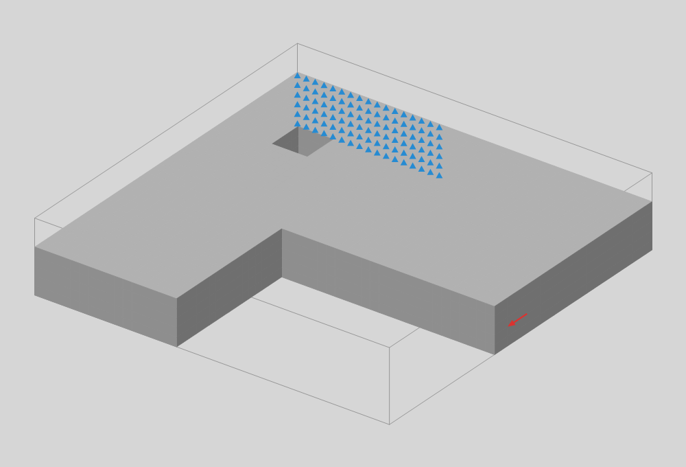
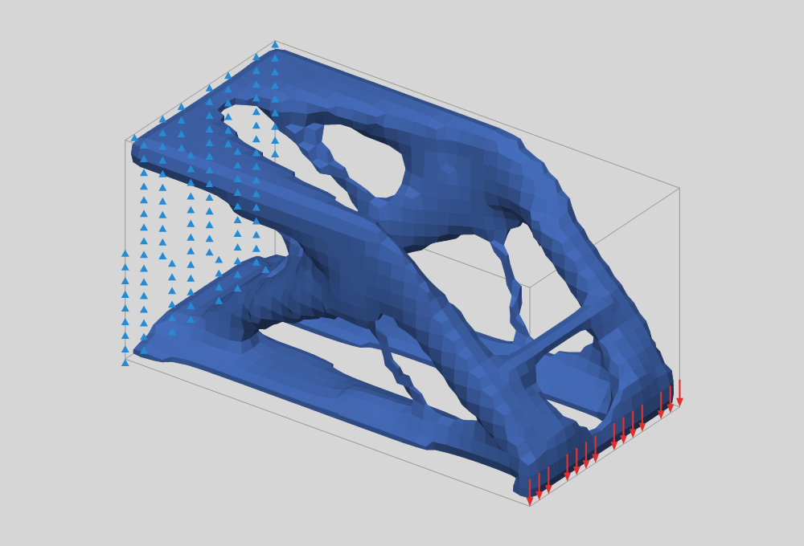
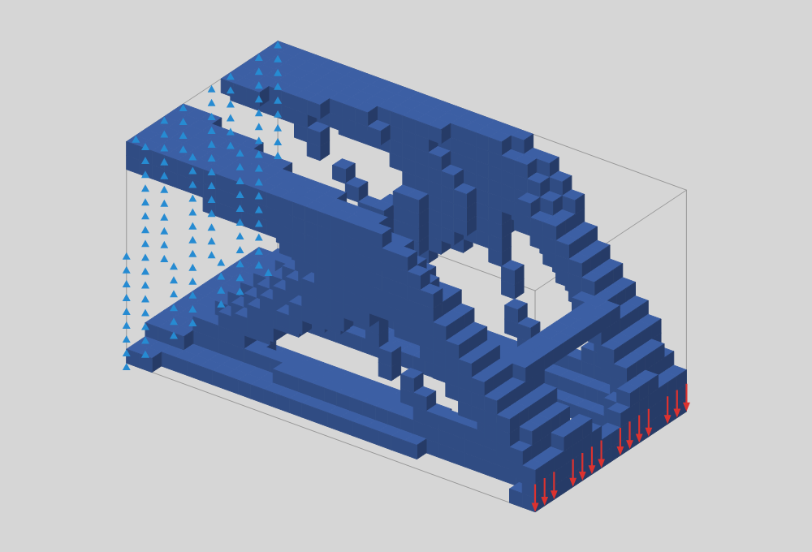
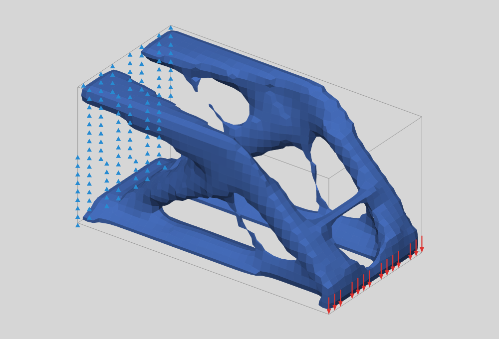

# Moyu 3D 拓扑优化 · 第一版说明

> 网页版报告是这份文档的图文版；此 Markdown 是仓库里的源文件。图片都是插件在 Rhino 8 里真实算出来的输出（由 `tests/Moyu.RhinoTests` 生成，3D 图由测试里的软件渲染器画出）。

## 一页结论

- **已建成**：Ribbon `Moyu › 2 | Topo3D`（原 3D）下 7 个组件，结构和 2D 完全一致：条件（Boundary / Load / Support / Area / Material）→ 求解（SIMP Solver，Timer 驱动）→ 显示（Visualize）。
- **3D 特有的能力**：设计域用封闭 Brep / 网格定义并自动体素化（嵌套实体 = 孔）；荷载和支座除了点、线，还能加在**面**上；结果可以输出体素块，或者闭合、平滑的等值面网格，直接拿去继续建模。
- **求解器**：8 节点六面体单元 + **多重网格预条件共轭梯度**（每次分析约 10–25 次迭代）。65,536 体素（约 21 万自由度）每步 0.35 秒。
- **与 2D 共用**：优化循环（OC 更新、过滤、实心/空心区、收敛判据、迭代预算、运行中修改）抽成了公共基类，2D 行为不变。
- **测试文件**：`tests/gh/Moyu3D-Test.gh`，三组例子（悬臂、雨棚、带孔 L 形支架）。
- **图标**：7 个 3D 组件的 24×24 PNG 在 `src/Moyu/Icons/`，和 2D 同一套蓝紫＋冰白风格；prompt 在 `docs/icon-prompts-3d.md`。

## 1. 工作流

```
Boundary 3D ─┐
Load 3D ─────┤
Support 3D ──┼─► SIMP Solver 3D ──► Visualize 3D
Area 3D ─────┤        ▲
Material 3D ─┘        └── Timer（Trigger）+ Toggle→Run，Button→Reset
```

## 2. Boundary 3D — 体素化



- **Boundary**：一个或多个封闭 Brep / 网格。沿 X 方向发射射线、按奇偶规则判断体素中心是否在内，所以套在里面的实体会成为孔。
- **Resolution**：最长边的体素数（默认 32），体素一律是立方体。
- **Plane**：可选，用来旋转体素网格；默认 World XY。
- 每个方向的体素数补齐到 4 的倍数（分辨率 > 64 时补到 8 的倍数），补出来的体素在设计域外，只为了让多重网格能逐级减半。

**坑**：体素数约随分辨率的三次方增长，分辨率翻倍，每步耗时约涨 8 倍。不封闭的输入会给出警告，射线可能从缝里漏过去。超过 15 万体素提示“每步要几秒”；超过 100 万体素给警告（每步几十秒到几分钟、数 GB 内存）。

## 3. Load 3D / Support 3D — 点、线、面

- **点**：吸附到最近的可承载节点。
- **曲线**：每半个体素采样一次，各自吸附。
- **面**（曲面、Brep、网格）：取离该面 0.6 个体素以内的所有可承载节点；如果一个都没有，就把面的顶点吸附过去。
- 荷载的总力平均分给吸附到的节点；支座分别控制 X / Y / Z（相对 Boundary 的平面）。

**坑**：只有一个点支座时结构可以绕它转动，Solver 报 `Unstable`（已测）。

## 4. Area 3D — 实心 / 空心区

封闭实体围出的区域，始终实心（屋面板、连接件）或始终空心（通道、设备空间）。规则同 2D：只在边界内生效，后连入的覆盖先连入的。

**新增保护**：实心区如果已经接近或超过材料预算（体积分数 × 可用体积），Solver 会给出警告。否则所有设计体素都会被清空，结构"浮"在 Emin 上，柔度暴涨却显示收敛。

## 5. Material 3D

E（默认 1）和 Nu（默认 0.3），三维各向同性线弹性。E 只缩放柔度，不改变拓扑。

## 6. SIMP Solver 3D

- 有限元：每个体素一个 8 节点六面体单元，刚度用 2×2×2 高斯积分算。
- 线性方程组：共轭梯度，用一次几何多重网格 V 循环做预条件。粗网格算子由细网格单元逐个 Galerkin 投影得到，最粗一层用带状 Cholesky 直接解；每一步用上一步的位移作初值。
- 默认值：体积分数 0.2、过滤半径 1.5 体素、每跳 2 步、最多 150 步。过滤半径限制在 [1, 6]（输入说明里写的是最大值）。每跳步数最多 50，每跳算满约 1.5 秒就停在当前步（剩下的留给下一跳），按 Esc 停得更早；体积分数、惩罚指数、过滤半径收到 NaN 或无穷大时按默认值算，并给出警告。
- 工作量太大时直接报清楚的错误：邻居表超过 1 亿项（“Filter radius R is too large for this grid; lower it or the resolution”）；一级多重网格存储超过 1.5 亿个 double（约 128³ 的立方体，160×160×40 没问题，Boundary 3D 上限仍是 160）；内存不够显示 “Out of memory: lower the resolution or the filter radius.”。
- 状态：输入缺失显示 Waiting，机构显示 Unstable，其他拒绝显示 Error（原因在运行时消息里）；只有文档里完全没有 Timer 时才提示 “No Timer drives this solver”。
- 运行中调高体积分数：材料每步按约移动限制增加，直到达到新目标。
- 分析不收敛时提示 “The analysis did not converge (residual … after N CG iterations): the structure may be unstable (add supports), or press Reset”。
- 收敛：最大密度变化 < 1%，或柔度连续 10 步每步变化 < 0.05%（2D 是 0.01%；3D 后期每步只改善零点几个百分点，放宽后约 100 步收敛，柔度与多算 50 步的结果差约 0.6%）。

### 实测（Rhino 8.36，无界面）

| 例子 | 网格 | 收敛 | 说明 |
|---|---|---|---|
| 悬臂 40×20×20 | 32×16×16 | 91 步，约 0.1 s/步（含显示） | 端面固定 289 个节点，柔度 267.1 → 13.30（2026-11-08 起刚度按体素边长缩放，数值是以前的 1/1.25，形状不变） |
| 雨棚 40×40×16 | 32×32×16 | 35 步 | 实心屋面板保持满，空心通道保持空 |
| 带孔 L 形支架 | 40×40×8 | 42 步 | 体素数 6000（解析估计约 5990） |

| 网格（核心基准） | 体素 | ms/步 | 平均 CG 次数 |
|---|---|---|---|
| 24×12×12 | 3,456 | 33 | 11.3 |
| 32×16×16 | 8,192 | 88 | 11.5 |
| 48×24×24 | 27,648 | 155 | 15.0 |
| 64×32×32 | 65,536 | 346 | 14.5 |



## 7. Visualize 3D

| Mode 0 体素 | Mode 1 光滑 |
|---|---|
|  |  |


- **Mode 0 体素**：密度 ≥ 阈值的体素，只画外表面。
- **Mode 1 光滑**：在体素中心的密度场上用 Surface Nets 提取阈值等值面，再做 Taubin 平滑（不缩小体积）。
- 输出 **Mesh**（当前模式）、**Surface**（始终是闭合的光滑等值面，可直接用于后续建模或 3D 打印前处理）、**Density**（逐体素密度，x 最快，然后 y，然后 z）。

等值面最初用 8 邻域节点平均，细杆件被削瘦（只包住实心体素的 65%）；改为在体素中心采样后，0.5 等值面正好落在实心/空心体素之间。

## 8. 验证

- 核心（不需要 Rhino）34 项：2D 全部旧测试；3D 均匀拉伸与解析解一致到 1e-10；多重网格 CG 与直接解差 1.6e-12（40% 体素刚度 1e-9 的随机场）；Surface Nets 闭合、法向朝外；3D 悬臂收敛且等值面闭合。
- Rhino 8.36 集成 57 项：2D 回归 35 项全部通过；3D 悬臂（端面支座 17×17 节点、Timer 式步进、两种显示模式、运行中改荷载）、雨棚（面荷载、四点支座、实心/空心区）、带孔支架（体素数）、报错（单点支座 → Unstable，开放曲面 → 警告）。
- 测试文件 `tests/gh/Moyu3D-Test.gh`：重新打开无警告、三组都收敛、画布无重叠。

## 9. 开发中踩到的坑

- **实心区吃光材料预算**：屋面板 2 层厚（12.5%）配 12% 的体积分数，设计体素全被清空，结构浮在 Emin 上，柔度从 916 跳到 1.6×10⁹ 却显示收敛。现在 Solver 会在实心区接近预算时警告。
- **3D 收敛判据**：用 2D 的 0.01% 时 32×16×16 悬臂要 152 步（刚好超过默认上限 150），第 100 步的柔度与最终只差 0.6%。3D 改为 0.05%。
- **GH 原生 Cylinder 是开口的**：作孔时射线判断不受影响，但会触发"不封闭"警告；测试文件里接了 Cap Holes。

## 10. 图标

见 [icon-prompts-3d.md](icon-prompts-3d.md)，只描述每个组件的作用；`python tools/make_icons.py docs/images/moyu-icons-3d-blue-violet-source.png --set 3d` 切图。

## 11. 约定与待做

- 3D 默认值：体积分数 0.2、分辨率 32、每跳 2 步、收敛阈值 0.05%。
- 还没做的：对称面、多工况荷载、输出转 SubD、更大网格。
