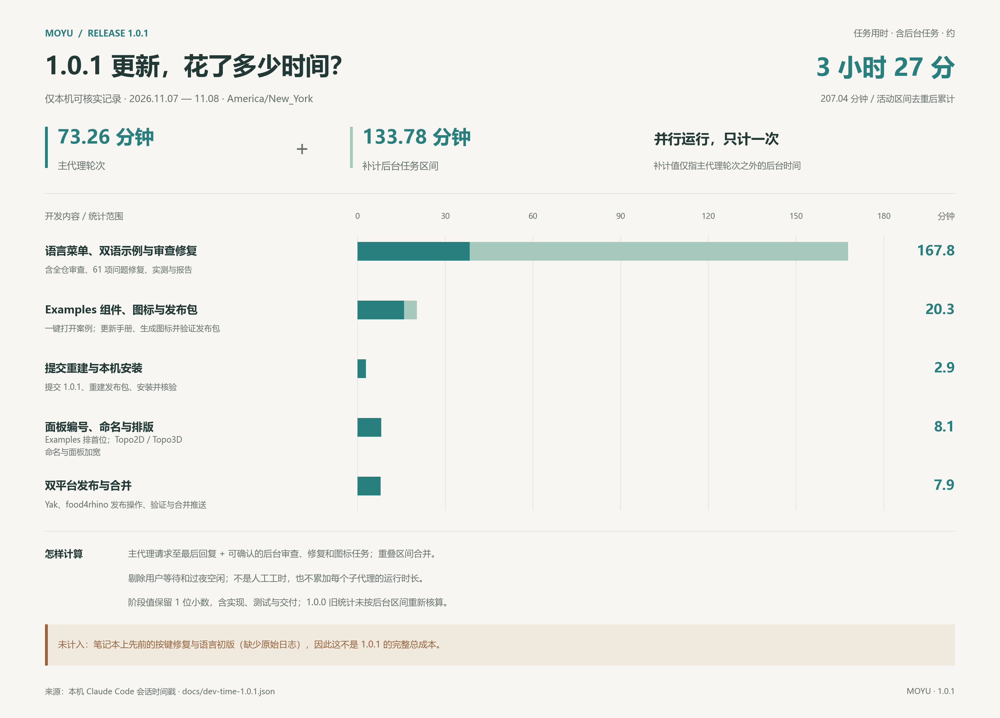

# Moyu 开发用时统计

> 数据来自 Claude Code 的会话记录（每条消息都带时间戳），更新至 2026-11-08。1.0.0 保留原有逐轮统计；1.0.1 补核了主代理回复之间仍在运行的后台任务，见下。时间使用 America/New_York（本次 11-07、11-08 均为 UTC−05:00）。

## 1.0.1 更新：本机可核实用时约 3 小时 27 分钟

**207.0 分钟**，覆盖 2026-11-07 晚至 11-08 发布完成的本机会话。其中主代理轮次 **73.3 分钟**，补计轮次之外仍在运行的后台任务 **133.8 分钟**。总数由未取整的时间戳相加；两项分别保留一位小数会有 0.1 分钟的舍入差。

**范围限制：不含笔记本上先前的按键修复与语言初版。**会话第一条请求说明这两项已在笔记本完成，但本机没有对应原始日志，不能用提交间隔估算，因而 207.0 分钟不是 1.0.1 的完整开发成本。



[高清 PNG](images/moyu-1.0.1-development-time.png) · [矢量 SVG](images/moyu-1.0.1-development-time.svg) · [时间戳与计算结果](dev-time-1.0.1.json)

| 阶段 | 去重后任务用时 | 其中主代理轮次 | 范围 |
|---|---:|---:|---|
| 语言菜单、双语示例与审查修复 | 167.8 分 | 38.4 分 | 语言右键菜单、六个双语示例、全仓审查、61 项问题修复、验证与报告；有重叠，合在一个阶段 |
| Examples 组件、图标与发布包 | 20.3 分 | 15.9 分 | 一键打开案例、图标生成与接入、中英手册、1.0.1 打包与核验 |
| 提交重建与本机安装 | 2.9 分 | 2.9 分 | 提交后重新构建发布包、本机安装并验证 |
| 面板编号、命名与排版 | 8.1 分 | 8.1 分 | Examples 排首位、Topo2D / Topo3D 命名、面板加宽、重建及实测 |
| 双平台发布与合并 | 7.9 分 | 7.9 分 | Yak、food4rhino 发布操作、版本核验、合并推送；不计用户登录和手动上传的等待 |
| **合计** | **207.0 分** | **73.3 分** | **3 小时 27 分 2 秒，展示为约 3 小时 27 分** |

### 这次怎样计算

- 主代理：沿用 `tools/dev_time.py` 的逐轮计时，从请求或后台完成通知开始，到下一轮之前最后一条回复结束，共 26 个记录轮次（含零时长中断记录）。
- 后台：逐项配对 5 个审查／修复工作流和 1 个图标任务的工具发起时间、完成通知时间，和主代理区间**取并集**。多个代理并行只计一次；图标生成与主代理重叠的部分也只计一次。
- 后台结束点是完成通知到达的时刻，因此统计的是可观察的任务历时，不是精确 CPU 时间或所有代理的人时。六路 Codex 审查从 22:57:38 启动、23:05:22 已确认结束，完全落在夜间已覆盖区间内，不再加时间。
- 夜间 `11-07 22:52:18.479 → 11-08 01:40:07.432` 一直有主代理或后台任务运行，共 167.8159 分钟。`01:40 → 10:49` 过夜空闲不计；次日 Examples 阶段 `10:49:59.660 → 11:10:15.159` 共 20.2583 分钟，其余只累加实际回复轮次。
- 首次请求至最终合并回复跨越约 13 小时 59 分；其中过夜、验收、登录、手动上传、等待合并的空闲不算工作。本次统计与制图也不计入。
- **与 1.0.0 的关系：**原图的 588 分钟（9 小时 48 分）保留旧的逐轮统计，尚未重新核查后台空档，不能直接与 207.0 分钟混加。只按旧脚本统计，1.0.1 会得到 73.3 分钟，漏掉约 133.8 分钟已确认的后台任务区间。

### 后台区间复核

以下区间互有重叠，也与主代理重叠，**不能把这一列时长直接相加**：

| 任务 ID | 任务 | 开始 → 完成通知（纽约时间） | 区间长度 |
|---|---|---|---:|
| `wrehp6njr` | 第一轮审查与核查 | 11-07 22:58:49.682 → 23:54:48.746 | 56.0 分 |
| `wnyi9wmc0` | 第二轮审查与核查 | 11-07 23:56:45.232 → 11-08 00:23:58.920 | 27.2 分 |
| `w4tjdw1a4` | 第一轮修复与复查 | 11-07 23:57:43.313 → 11-08 00:27:35.714 | 29.9 分 |
| `w82i7ttfb` | 第二轮修复与复查 | 11-08 00:28:53.522 → 01:12:33.796 | 43.7 分 |
| `w2m9z6as0` | 最终集成审查 | 11-08 01:13:43.123 → 01:36:20.802 | 22.6 分 |
| `bhjzyxwxc` | Examples 图标生成 | 11-08 10:56:58.692 → 11:04:10.445 | 7.2 分 |

原始来源为本机 Claude Code 会话 `6bd43864-dad5-4f28-91f3-28bf914a1a93`；数据文件仅保留事件 ID、时间戳及阶段归类，不复制对话正文。复算并生成图片：

```powershell
python tools/dev_time_101.py
python tools/render_dev_time_101_chart.py
```

## 1.0.0 一页结论（原有统计，做视频用）

| 项目 | Claude 实际开发用时 | 墙钟时间（含你看结果、测试、想下一步） | 剔除的 Rhino 故障时间 |
|---|---|---|---|
| 拓扑优化插件（2D + 3D，14 个组件） | **1 小时 54 分**（2D 54 分钟，3D 1 小时 01 分） | 16:00 → 19:56，3 小时 55 分 | 27 分钟 |
| VoxStack 叠楼（方案 + 可玩的第一版） | **1 小时 13 分**（方案 31 分钟，开发到 v1 42 分钟） | 20:12 → 21:40，1 小时 28 分 | 5 分钟 |
| VoxStack 含后续（图标 prompt、接入图标、讲解、提交合并） | 1 小时 23 分 | 20:12 → 22:41，2 小时 29 分 | — |
| Serpentine 蜿蜒（方案 + v1 + 两个游戏画面重做 + 交付） | **1 小时 10 分**（做到能玩 37 分，画面重做 19 分，验证与交付 14 分） | 11-01 23:00 → 23:58，11-02 09:18 → 09:33（中间你离开过夜，不算） | 0 |
| Rebound + Inkline（两个游戏：方案 + v1 + 图标 + 实测 + 交付） | **56 分钟**（两个游戏做到能玩 30 分，图标 8 分，实测与修复 6 分） | 11-03 17:50 → 18:50（中间 2 分钟上下文压缩不算） | 2 分钟 |
| Swift 雨燕（替换 Inkline）+ 两个老板画面重做（剖面分析、塔楼幕墙） | **53 分钟**（做到能玩 29 分，实机调画面 6 分，实测 2 分） | 11-03 20:48 → 21:42 | 0 |
| 第二轮调整：三个游戏开局变简单、Rebound 道具按次数失效、Swift 老板画面改成游戏同一剖面 | **26 分钟** | 11-03 21:43 → 22:10 | 0 |
| 第三轮：拱砌法 bug、开局道具、贪吃蛇两种视角 + 景观老板画面、体素 gumball | **27 分钟** | 11-03 22:23 → 22:50 | 0 |
| 第四轮：VoxStack 再慢、自定义积木照发、gumball 固定到右下角（4K 实测） | **40 分钟** | 11-03 23:02 → 23:43 | 0 |
| 发布准备：多代理审查（70 条确认问题全部修复）、Codex 画的体素鱼插件图标、Yak 与 food4rhino 发布包 | **约 82 分钟**（179 个审查 / 核查代理和 11 个修复代理在后台并行） | 11-04 09:34 → 14:50（中间等你选图标约 3.6 小时不算） | 0 |
| 图文手册 PDF（中英两份、12 页）、上架文案改写（研究与教学、Claude Code、各部分用时）、去掉 Swift 老板画面里的城市名 | **约 37 分钟** | 11-04 16:05 → 16:42 | 0 |

- 一句话版本：**拓扑优化插件约 114 分钟，3D 消层小游戏从想法到能玩约 73 分钟**（其中写方案 31 分钟、写代码到能玩 42 分钟）。
- 游戏的规则引擎连单元测试只用了 4 分钟；最花时间的是在真 Rhino 里试玩和修按键问题（约 17 分钟）。

## 1.0.0 怎么算的（原有口径）

- **Claude 实际开发用时**：每次你发出请求，到 Claude 这一轮最后一条回复为止的时间，逐轮相加。你读结果、自己试、想下一步的时间不算。
- **墙钟时间**：第一条请求到最后一条回复的总跨度，包含你那边的时间，给视频做对比用。
- **剔除的 Rhino 故障**：Rhino 本身或第三方插件的问题（启动崩溃、第三方库导致的崩溃、自动化连接卡死），共 32 分钟，明细见下。我们自己代码的 bug（比如 3D 多重网格卡住、按键去重）算开发时间。
- **不包括**：Codex 生成图标的时间（在 Claude 之外），以及这次统计本身。

## 拓扑优化插件（1 小时 54 分）

| 时间 | 时长 | 内容 | 计入 |
|---|---|---|---|
| 16:00–16:17 | 17.2 分 | 2D：项目骨架、FEA / SIMP 核心、7 个组件、编译 | ✓ |
| 16:17–16:30 | 12.1 分 | Rhino 8 界面启动失败（Nature-Render 插件启动即崩溃） | ✗ Rhino 故障 |
| 16:30–16:55 | 25.7 分 | 2D：无界面 Rhino 测试工程、核心 + 集成测试、性能、文档与网页报告 | ✓ |
| 17:54–18:02 | 7.6 分 | 2D：生成测试 GH 文件 | ✓ |
| 18:13–18:24 | 11.2 分 | 打开测试文件时 Rhino 崩溃（第三方 Millipede 原生库加载错位） | ✗ Rhino 故障 |
| 18:24–18:27 | 3.0 分 | 2D：接入 Codex 图标 | ✓ |
| 18:28–18:29 | 1.4 分 | 把 Millipede 原生库复制到 DeadFish 构建目录（修崩溃） | ✗ Rhino 故障 |
| 18:43–19:42 | 59.1 分 | 3D：求解器基类重构、多重网格、7 个组件、集成测试、测试文件、报告 | ✓ |
| 19:54–19:56 | 1.4 分 | 3D：接入图标 | ✓ |

另开的一个会话（同一项目目录下）：

| 时间 | 时长 | 内容 | 计入 |
|---|---|---|---|
| 18:05–18:07 | 2.2 分 | 另开会话：Rhino 更新后打不开，定位并移除 Nature-Render 插件 | ✗ Rhino 故障 |

## VoxStack 叠楼（方案 + v1 1 小时 13 分，含后续 1 小时 23 分）

| 时间 | 时长 | 内容 | 计入 |
|---|---|---|---|
| 20:12–20:15 | 3.4 分 | 方案：读代码、构思玩法与老板键 | ✓ |
| 20:15–20:27 | 12.0 分 | 方案：在 Rhino 里做 4 张原型截图 | ✓ |
| 20:27–20:43 | 15.4 分 | 方案：Markdown + 图文网页方案 | ✓ |
| 20:53–20:53 | 0.3 分 | （中断后的系统通知） | ✓ |
| 20:53–20:58 | 4.9 分 | 开发：读代码、定架构 | ✓ |
| 20:58–21:02 | 4.1 分 | 开发：规则引擎 + 单元测试 | ✓ |
| 21:02–21:13 | 10.6 分 | 开发：键盘钩子、帧时钟、视口绘制、老板模式、3 个组件 | ✓ |
| 21:13–21:14 | 1.9 分 | 开发：测试 GH 文件生成器 | ✓ |
| 21:14–21:16 | 1.7 分 | 实机试玩：首次在 Rhino 里跑起来 | ✓ |
| 21:16–21:21 | 4.8 分 | Rhino 卡死排查：注入按键误触发命令、退出 Rhino | ✗ Rhino 故障 |
| 21:21–21:22 | 0.7 分 | 实机试玩：真实按键测老板键 | ✓ |
| 21:22–21:22 | 0.5 分 | 关掉误开的安全模式 Rhino | ✗ Rhino 故障 |
| 21:22–21:36 | 14.2 分 | 实机试玩与修复：按键去重、输入法、倒计时、老板镜头、图标初稿、截图 | ✓ |
| 21:36–21:40 | 3.7 分 | 开发：README、方案文档、网页更新 | ✓ |
| 22:00–22:01 | 1.9 分 | 图标 prompt | ✓ |
| 22:02–22:03 | 0.4 分 | 图标 prompt：只写作用 | ✓ |
| 22:04–22:04 | 0.4 分 | 图标 prompt：加游戏背景 | ✓ |
| 22:12–22:16 | 3.6 分 | 接入 Codex 图标、实机检查、讲解 Voxel Unit | ✓ |
| 22:35–22:36 | 1.6 分 | 提交并推送 | ✓ |
| 22:38–22:39 | 1.2 分 | 尝试开 PR | ✓ |
| 22:40–22:40 | 0.4 分 | 合并到 main | ✓ |
| 22:41–22:41 | 0.2 分 | 删除分支 | ✓ |

阶段小计：方案 30.9 分，开发到 v1 41.8 分（已剔除 5.3 分 Rhino 卡死），后续 9.9 分。

## Serpentine 蜿蜒（1 小时 10 分）

统计日期 2026-11-02。同一个会话里接着 VoxStack 做；中途你要求把两个游戏的画面重做成极简风格，也算在这一节。

| 时间 | 时长 | 内容 | 计入 |
|---|---|---|---|
| 23:00–23:08 | 7.7 分 | 方案：在 Rhino 里做 2 张原型截图、Markdown + 图文网页 | ✓ |
| 23:08–23:14 | 5.6 分 | 抽公共基类：会话、绘制、最高分、Run 按钮；VoxStack 迁移 | ✓ |
| 23:14–23:20 | 4.9 分 | 规则引擎 + 86 项单元测试（已扣掉 1.7 分上下文压缩） | ✓ |
| 23:20–23:32 | 11.5 分 | Rhino 端：曲面 → 网格、跟随镜头、老板模式、2 个组件、测试 GH 文件、临时图标 | ✓ |
| 23:32–23:39 | 7.4 分 | 实机试玩与修复：真实点击 Run、老板键、暂停、镜头；镜头碰撞、HUD 重叠 | ✓ |
| 23:39–23:58 | 18.5 分 | 画面重做：共用极简风格（配色、平涂着色、软投影、字体、键帽、浅色蒙版），两个游戏都换上 | ✓ |
| 23:58–09:18 | — | 你离开（过夜），会话空闲 | ✗ 不是工作 |
| 09:18–09:33 | 14 分 | 最后的微调与截图验证、文档、计时、交付报告、提交 | ✓ |

- 这次没有 Rhino 崩溃要剔除。23:37–23:41 有约 3 分钟 computer-use 发的按键落到了 Claude 窗口（Rhino 不在前台），属于我们测试方法的问题，算开发时间；之后改成在 Rhino 进程里用 `SendInput` 发键，并且每次先确认前台是 Rhino。
- 和 VoxStack 比：规则引擎更快（共用了基类和测试套路），时间主要花在 Rhino 端和画面重做上。

## Rebound 回弹 + Inkline 墨线（56 分钟，两个游戏）

统计日期 2026-11-03。同一个请求里做两个游戏："接着用同样的工作流 做打砖块 和 划线闯关的游戏 记得使用codex生成图标"。

| 时间 | 时长 | 内容 | 计入 |
|---|---|---|---|
| 17:50–17:59 | 8.4 分 | 方案：两个游戏各 2 张 Rhino 原型截图（游戏 / 老板模式）、两份 Markdown、一个图文网页 | ✓ |
| 17:59–18:00 | 1.1 分 | 共用基类：游戏鼠标钩子（悬停 / 拖动）、平面上的平涂方块和棱柱 | ✓ |
| 18:00–18:05 | 4.4 分 | Rebound 规则引擎（砌法、扫掠碰撞、道具、计分、立面指标）+ 53 项单元测试 | ✓ |
| 18:05–18:09 | 4.9 分 | Rebound Rhino 端：会话、立面伪装、绘制、2 个组件；在 Rhino 里第一次试玩 | ✓ |
| 18:09–18:17 | 7.2 分 | Inkline 规则引擎（二维物理、墨线、12 关 + 参考解、排水指标）+ 35 项单元测试；修摩擦重复计算、调 3 关 | ✓ |
| 18:17–18:20 | 3.5 分 | Inkline Rhino 端：会话、排水剖面伪装、绘制、2 个组件；命名空间和 Rhino 的 `Line` 冲突，改名 | ✓ |
| 18:20–18:28 | 8.1 分 | 图标：写提示词，本机 Codex 两张图并行生成（约 5 分钟，后台），切图、预览、`--icons`；等图期间做了两个测试 GH 文件、Inkline 首次试看、README、v1 状态 | ✓ |
| 18:28–18:32 | 1.9 分 | 最终截图（两个游戏 + 两个老板模式） | ✓ |
| 18:30–18:32 | 1.9 分 | 上下文压缩（两轮之间，本来就不算在轮次里） | ✗ |
| 18:32–18:40 | 6.1 分 | 真实按键实测（SendInput，只在 Rhino 在前台时发）；发现并修好 Inkline 老板键回来卡暂停的问题，复测 | ✓ |
| 18:36–18:38 | 2.1 分 | Rhino 故障：MCP 路由默认拉起 Rhino 9，没出主窗口，卡到超时；改成指定 Rhino 8 | ✗ |
| 18:40–18:50 | 10.0 分 | 图标接入记录、README、方案文档、计时、交付报告 | ✓ |

- 两个游戏从想法到能玩共 29.5 分钟（方案 + 基类 + 两套规则和 Rhino 端），加上实测 35.6 分钟。和前面同口径比：VoxStack 一个游戏 73 分钟，Serpentine 37 分钟。
- 快的原因：共用基类（老板键、倒计时、暂停、画面风格、Run 按钮、最高分）已经齐了，这次只加了鼠标钩子和两个画方块的函数；最费时间的是 Inkline 的关卡调参（让 12 关的参考解都真能过）。
- Codex 生成图标的 5 分钟在后台和其他工作重叠，没有单独加时间。

## Swift 雨燕 + 老板画面重做（53 分钟）

统计日期 2026-11-03。请求："划线闯关这个我以为是另外的游戏 我想做的是一只小鸟你可以按空格让它上下飞 来躲避障碍的那个游戏 你改成那个游戏 另外这个boss界面你改成在研究房屋的section 有一些光照分析 通风分析啥的 另外打砖块这个的boss界面做的不够真实……"

| 时间 | 时长 | 内容 | 计入 |
|---|---|---|---|
| 20:48–20:52 | 3.8 分 | 读工作流和现有代码、定设计；挂自动续跑 | ✓ |
| 20:52–21:01 | 8.7 分 | Swift 规则（飞行、关卡生成、窗扇、羽毛、Zen）、住宅剖面模型（日照、采光、通风）、塔楼幕墙模型 | ✓ |
| 21:01–21:06 | 5.3 分 | 核心测试；自动驾驶找出两处不公平（滑动窗扇太窄太快、俯冲时间不够）并改规则 | ✓ |
| 21:06–21:18 | 11.4 分 | Rhino 端：会话、画面、剖面老板画面、塔楼老板画面、2 个组件、测试 GH 文件；写图标提示词，Codex 后台出图 | ✓ |
| 21:18–21:23 | 5.6 分 | Rhino 8 里截图看画面并改：镜头、加内墙、鸟放大；塔楼玻璃色差和百叶；剖面取景；切图标 | ✓ |
| 21:23–21:25 | 2.0 分 | 真实按键实测（Swift 全套 + Rebound 老板键），全部通过 | ✓ |
| 21:25–21:42 | 16.5 分 | README、方案、图标记录、截图、计时、报告 | ✓ |

- 这次没有 Rhino 故障；启动 Rhino 2 次（改画面要关掉 Rhino 才能重新编译）。
- 从请求到能玩 29.2 分钟；加上实机调画面和实测 36.8 分钟。Codex 出图约 5 分钟在后台并行，没有另算。

## 第二轮调整（26 分钟）

统计日期 2026-11-03。请求："swift这个游戏有点难 你把每个游戏的起始关卡都设置简单好上手一些 后面逐渐变难……把所有增益buff都改成打几次就失效的那种……swift这个boss界面 改得和游戏本身就像截面……"

| 时间 | 时长 | 内容 | 计入 |
|---|---|---|---|
| 21:43–21:45 | 1.7 分 | 读 VoxStack、Serpentine、Swift 的难度参数和 Rebound 的道具代码 | ✓ |
| 21:45–21:47 | 2.0 分 | Rebound：道具改成按次数失效、粘板概率减半、HUD；测试重写 | ✓ |
| 21:47–21:50 | 3.0 分 | 三个游戏的开局变简单（下落 / 锁定 / 发牌、蛇速 / 炸弹、开口 / 速度 / 高低差 / 物理）；旧测试里写死的速度改成跟规则走 | ✓ |
| 21:50–21:54 | 4.0 分 | Swift 老板剖面重写：模型就是游戏的剖面（墙、开口、飞行路线、天窗、日照、采光、通风）+ 测试 | ✓ |
| 21:54–21:57 | 2.5 分 | Rhino 端绘制、编译 | ✓ |
| 21:57–22:01 | 4.0 分 | Rhino 8 里对照游戏 / 老板两帧，整理两轮（太阳只画一个天窗、气流线去掉扇翅起伏、标注加白底）；Hops 的本地计算服务锁住 .gha，关 Rhino 后释放 | ✓ |
| 22:01–22:02 | 1.0 分 | 真实按键复测 Swift 起飞、扇翅、老板键往返 | ✓ |
| 22:02–22:05 | 2.5 分 | 最终截图 | ✓ |
| 22:05–22:10 | 5.8 分 | 文档、计时、报告 | ✓ |

- 没有 Rhino 故障；启动 Rhino 3 次（改代码要关掉 Rhino 才能重新编译）。

## 第三轮（27 分钟）

统计日期 2026-11-03。请求：拱砌法画面空白（bug）、打砖块开局多给道具、贪吃蛇老板界面像景观设计 + 只留两种视角且转向以蛇头为准、体素俄罗斯方块开局太快且转轴难分 → 改成 gumball。

| 阶段 | 时长 |
|---|---|
| 找拱砌法 bug 并修好 | 1.7 分 |
| 拆需求、挂自动续跑 | 1.7 分 |
| Rebound 开局多给道具 + 测试 | 1.3 分 |
| VoxStack 更慢 + gumball | 1.7 分 |
| Serpentine 两种视角 + 景观老板画面（含布置测试） | 3.3 分 |
| Rhino 里逐个实测并调整 | 3.7 分 |
| Gumball 拖动的三个问题（换算、交叉、阈值） | 6.3 分 |
| 文档、计时、报告 | 7.3 分 |

- 没有 Rhino 故障；启动 Rhino 5 次（每次改代码都要关 Rhino 重新编译）。
- 最费时间的是 gumball 的拖动：实测发现三个问题（换算、交叉、门槛），每个都要关 Rhino、编译、再用真实鼠标测。

## 第四轮（40 分钟）

统计日期 2026-11-03。请求：体素俄罗斯方块还是太快、之前自定义的 Unit 好像没了、gumball 在运动中很难点上 → 固定在某个地方。

| 阶段 | 时长 |
|---|---|
| 诊断：读你的 GH 文件、找原因 | 3.5 分 |
| 规则：自定义积木照发、更慢、测试 | 3.5 分 |
| Gumball 固定到右下角 + 编译 | 1.5 分 |
| Rhino 4K 实测与 5 处修正 | 18.0 分 |
| 文档与报告 | 8.5 分 |
| 修测试文件：找回你画的 3 个盒子 | 5.5 分 |

- 没有 Rhino 故障；启动 Rhino 9 次（每改一处 gumball 都要关 Rhino 重新编译）。中间 1 分钟上下文压缩不算。
- 修测试文件是你点头之后做的（23:37 → 23:43）：查出 Pavilion 是你自己画的盒子，按 11-01 的检查记录存回文件。
- 实测占一半：在 4K 屏上发现 gumball 太小、倒计时里按会转视角、挨着的两个环选错、截图里看不见、默认镜头下 Y/Z 环重合，逐个修。

## 发布准备（约 82 分钟）

统计日期 2026-11-04。请求：审查代码、准备发布、做好 food4rhino 和包管理器的发布包；中途加了一项：插件图标让 Codex 重画成"摸鱼"的鱼。

| 阶段 | 时长 |
|---|---|
| 摸底、发布信息（许可、作者、版本、描述）、打包脚本、上架文案 | 30.5 分 |
| 合并第一轮修复、构建、第一次 Rhino 实测、打包 | 19.3 分 |
| 写图标提示词、启动 Codex、文档补记 | 11.4 分 |
| 接入图标、第二轮修复、合并、构建、打包、报告 | 约 21 分 |

- 审查工作流：11 个方向的审查者 + 1 个发布调研者、78 条三视角核查、1 个批评者、8 个探查，共 179 个代理；修复：两轮共 11 个代理，各在独立 worktree。代理时间在后台并行，不重复计入。
- 没有 Rhino 故障；中间一次会话重启。

## 图文手册与上架文案（约 37 分钟）

统计日期 2026-11-04。请求："你的操作说明用pdf格式 做的图文并茂一点 各种feature都concise地介绍一下"；中途加了一条："上传的说明 主要说这是研究和教学 如何用agent快速开发插件的……也注明这是主要由claude code写的 标明一下每个部分大概用时"。

| 阶段 | 时长 |
|---|---|
| 收集功能和现有截图；发现 Swift 老板画面印着城市名，改成通用的 40° N，截图里那行抹掉 | 约 9 分 |
| 上架文案、包管理器描述、插件描述改写成"用编程代理快速开发插件的研究与教学项目"，加各部分用时 | 约 6 分 |
| 手册：HTML 源文件（中英写在一起）、构建脚本（图标、连线图、工具栏、键盘、两张图表）、Edge 无界面打印 | 约 10 分 |
| 逐页看预览改排版（两页溢出、三页留白、两张图裁切） | 约 7 分 |
| 编译、351 项测试、图标测试、打包、记录 | 约 5 分 |

- 没有启动 Rhino；截图全部用 `docs/images` 里已有的实机截图。
- Edge 的启动器会立刻返回、由子进程稍后写出 PDF，脚本改成等文件写完。

## 剔除的 Rhino 故障时间

| 时间 | 时长 | 原因 |
|---|---|---|
| 16:17–16:30 | 12.1 分 | Rhino 8 界面启动失败（Nature-Render 插件启动即崩溃） |
| 18:13–18:24 | 11.2 分 | 打开测试文件时 Rhino 崩溃（第三方 Millipede 原生库加载错位） |
| 18:28–18:29 | 1.4 分 | 把 Millipede 原生库复制到 DeadFish 构建目录（修崩溃） |
| 18:05–18:07 | 2.2 分 | 另开会话：Rhino 更新后打不开，定位并移除 Nature-Render 插件 |
| 21:16–21:21 | 4.8 分 | Rhino 卡死排查：注入按键误触发命令、退出 Rhino |
| 21:22–21:22 | 0.5 分 | 关掉误开的安全模式 Rhino |
| 11-03 18:36–18:38 | 2.1 分 | MCP 路由默认拉起 Rhino 9，没出主窗口，卡到超时（Rebound + Inkline 复测时） |
| **合计** | **34.2 分** | |

## 产出

| | 拓扑优化插件 | VoxStack | Serpentine | Rebound + Inkline | Swift + 老板画面重做 |
|---|---|---|---|---|---|
| 组件 | 14 个（2D 7 + 3D 7） | 3 个（Massing Study、Voxel Unit、Unit Library） | 2 个（Path Study、Site Surface） | 4 个（Facade Study、Brick Bond、Runoff Study、Level Set） | 2 个（Airflow Study、Storey Grid），替换 Runoff Study、Level Set |
| 插件代码 | 4,455 行 / 47 个文件 | 3,030 行 / 17 个文件 | 2,218 行 / 10 个文件，另有共用基类与画面风格 1,149 行 | 3,129 行 / 18 个文件（Rebound 1,656，Inkline 1,473），共用基类 +117 行 | Swift 2,121 行 / 8 个文件；塔楼 525 行 / 2 个文件（重写立面伪装，删旧指标） |
| 测试代码 | 2,161 行 | 412 行 | 520 行 | 804 行 | 391 行 |
| 核心单元测试检查项 | 34 项 | 63 项 | 86 项 | 88 项（53 + 35） | 50 项（Swift 45 + 塔楼 5），总数 283 |
| Claude 工具调用次数 | 424 次 | 421 次（含后续） | 约 240 次 | 约 230 次 | 约 150 次 |
| 为测试启动 Rhino | 3 次 | 8 次 | 6 次 | 7 次（含 1 次卡死的 Rhino 9） | 2 次 |

代码行数是含注释和空行的原始行数（`wc -l`）。拓扑优化与 VoxStack 统计时的仓库状态为提交 `c02dda8`，Serpentine 为它自己的提交，Rebound + Inkline 为提交 fd5e9c6，Swift 为 2026-11-03 晚上的工作区。
