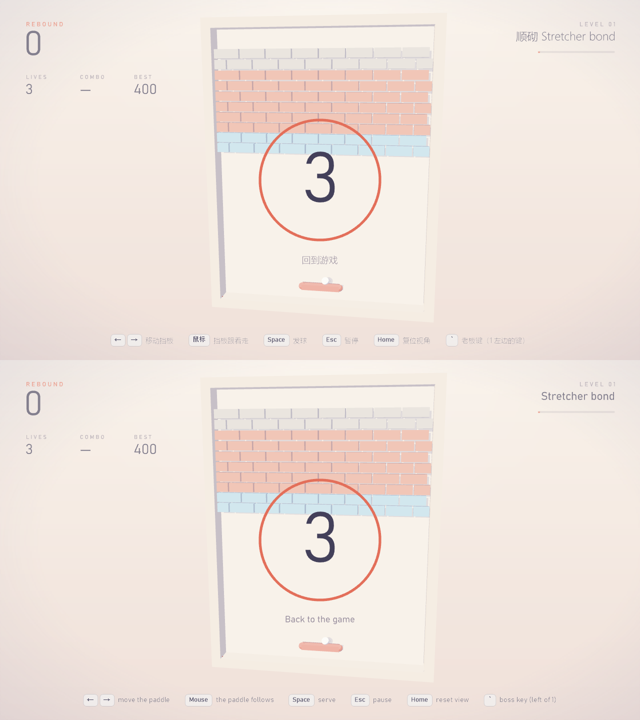
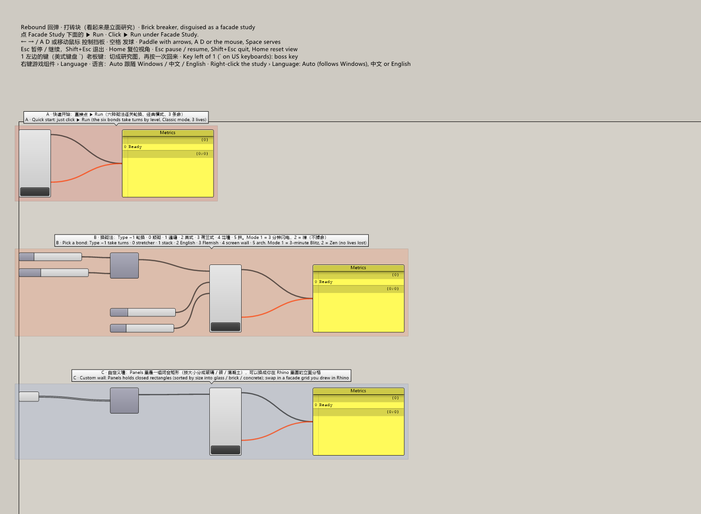
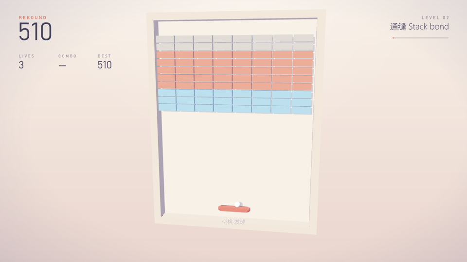
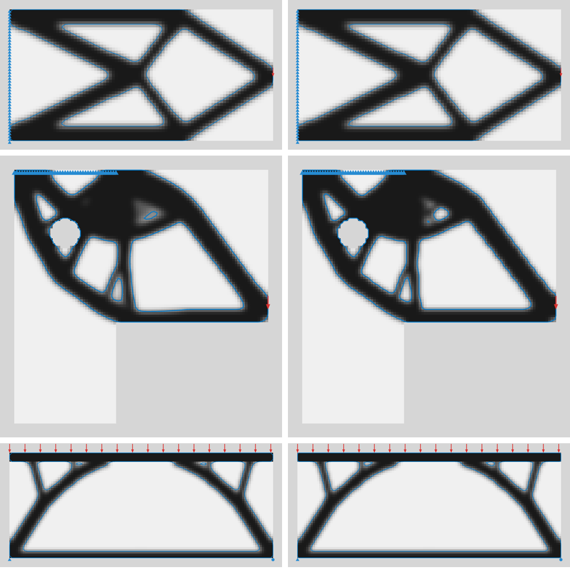

# 第五轮：语言右键菜单、示例中英双语、全仓库代码审查与修复

> 网页版报告的源文件（2026-11-08）。分支 `fix/ime-key-presses`（从笔记本推上来的两次提交签出），全部改动未提交。

## 一页结论

- **56** 个确认存在的问题（去重后），**全部修好**；其中 **1** 个会让游戏中止：就是打砖块“打完就崩”。
- 核心测试 375 → **442** 项全过；Rhino 无界面场景 53/57 → **57/57**；六个示例重新生成全过；三个目标框架编译 0 警告。
- 语言改成组件**右键菜单**（Auto · 自动 / 中文 / English），默认 Auto，随 .gh 保存、可撤销、游戏中切换下一帧生效；笔记本那版带 Language 输入端的文件能打开并自动迁移。
- 六个示例的分组标题全部中英两行，游戏标题加一行右键菜单说明。
- 审查：Codex 6 路只读 + Claude 10 个审查者（含 2 个真跑游戏核心的模糊测试），每条发现“静态追踪”和“复现”各验证一次，再补查漏洞，最后整体复查。
- 按键类修复按代码路径和模拟测试验证，**还没用真实键盘在 Rhino 里逐个试**。

| 部分 | 崩溃 | 缺陷 | 小问题 | 合计 |
|---|---|---|---|---|
| 公共：按键 / 老板键 / 组件 | 0 | 4 | 10 | 14 |
| 叠楼 VoxStack | 0 | 5 | 9 | 14 |
| 蜿蜒 Serpentine | 0 | 4 | 5 | 9 |
| 拓扑优化 | 0 | 3 | 5 | 8 |
| 回弹 Rebound | 1 | 2 | 3 | 6 |
| 雨燕 Swift | 0 | 1 | 4 | 5 |

谁找到的：只有 Claude 33 个，两边都找到 12 个，只有 Codex 11 个。

## 01 语言设置改成右键菜单

- 去掉了笔记本那版加在组件最后的 Language 文字输入端，改为右键菜单 **Language · 语言**：Auto · 自动（括号里写着 Windows 当前语言）、中文、English。默认 Auto：中文 Windows 显示中文，其他显示英文。老板键伪装画面始终英文。
- 存进 .gh（键名 `MoyuLanguage` = auto / ch / en）；撤销、重做、复制粘贴都带着；撤销时正在运行的游戏也跟着变。
- 代码：`src/Moyu/Components/GameComponent.cs`（四个游戏组件的新基类：Run 按钮 + 语言菜单 + Write/Read）、`Games/Common/ILanguageOwner.cs`（会话开始时就用组件的语言，第一帧不会闪成另一种）。
- 兼容：用 423f3da 存过的文件打开不报错，那个输入端里的 en / 中文 自动变成菜单选择（实测 en → English，中文 → 中文）；接了线的保持 Auto，命令行提示一句。

## 02 六个示例文件中英双语

`tests/Moyu.RhinoTests/GhBuilder.Group(chinese, english, …)` 把分组标题写成两行；四个游戏标题加一行“右键游戏组件 › Language · 语言”。六个文件（`packaging/examples/`）重新生成并自动检查：无警告、无重叠、拓扑收敛。

## 03 打砖块“打完就崩”

原因：`BreakoutGame.MoveBalls` 从后往前处理每个球。多球时，如果打掉最后一块砖的不是 0 号球，`Clear()` 清空了球列表，外层循环下一轮仍读 `_balls[i]` → 越界异常 → `GameSession` 接住异常后停掉整局（Rhino 本身没崩）。单球时 i 直接变成 −1，所以只是“有时候”。开局道具导览会早早给一个“多球”，第 1 关就常见。

修复：循环条件加 `&& State == BreakoutState.Playing`。回归测试：3 个球，让 1 号、2 号球（以及穿透状态下）打最后一块，期望清墙后进第 2 关。

模糊测试（挡板自动追球）：修复前默认设置约 16% 的墙清墙时崩，两球以上清墙约 63% 崩；修复后约 33,800 次清墙 0 异常。

## 04 审查流程

1. Codex 6 路只读审查（回弹、叠楼、蜿蜒、雨燕、公共、拓扑）：29 条。
2. Claude 10 个审查者（6 个分区 + 崩溃猎手 + 生命周期 + 2 个模糊测试）：46 条 → 去重 33 条。
3. 每条用“静态追踪”和“复现”两种方法各验证一次：31 确认、2 有争议、0 驳回。
4. 漏查代理列出 14 个缺口；在冻结的代码快照上做第二轮：Codex 的 29 条里 15 条是新的，7 个代理专查缺口，新发现同样两种方法验证：31 确认、2 争议、3 驳回。
5. 两轮合并去重为 56 个问题，按文件分组修复（13 组，每组修完由另一个代理复查、按意见再改），最后对全部改动整体复查。

有争议的两条：输入法下 Shift 被识别成左 / 右 Shift（验证者在本机用搜狗、微软拼音真按键 13 次都没出现，只加了防御性归一）；脚本喂空网格（罕见但存在，已修）。

## 05 全部问题与改法

### 公共：按键、老板键、组件（14）

| # | 严重 | 谁找到 | 问题 | 改法 |
|---|---|---|---|---|
| A02 | 缺陷 | 两边 | 按住老板键超过键盘重复延迟，老板模式自己切回游戏 | 老板键进入时不再重置按键记录 |
| A03 | 缺陷 | Claude | （防御）输入法接管的 Shift 被还原成左 / 右 Shift | 本机实测不会发生；仍加左右修饰键归一 |
| B00 | 缺陷 | Codex | 按着 Ctrl / Alt 时松键，游戏收不到：冲刺、软降、挡板卡住 | 按下照旧交给 Rhino，松开一律告诉游戏 |
| B15 | 缺陷 | Claude | 用输入法正拿着的键退出，退出后输入法被关掉没恢复 | 钩子已释放时不再关输入法 |
| A11 | 小问题 | 两边 | 倒数结束后 State 输出一直是 Study paused | 倒数结束时通知组件刷新 |
| A12 | 小问题 | Claude | Run 启动失败的原因约 20 ms 后被刷掉 | 保留到下次点 Run |
| A13 | 小问题 | 两边 | 撤销语言菜单时运行中的游戏不跟着变 | 撤销恢复时同步给游戏 |
| A14 | 小问题 | Claude | 老板模式下停止，组件下方一直是伪装文字 | 先判断已停止 |
| A16 | 小问题 | Claude | 切换 GH 文档停了游戏但输出不更新 | 停掉后标记重算 |
| A28 | 小问题 | Claude | 最高分文件读失败一次，整个会话当 0 分 | 只缓存成功的读取 |
| B01 | 小问题 | Codex | 高分辨率屏上按键提示被截断、重叠 | 测量和绘制用同一种不换行排版 |
| B21 | 小问题 | Claude | Size 接无穷大时游戏照样开始，画面空白 | Size 必须是有限正数 |
| B33 | 小问题 | Claude | 旧版带 Language 输入端的文件静默变回 Auto | 读取时迁移到右键菜单 |
| B34 | 小问题 | Claude | 必填输入为空时 Run 用上一次的输入开局 | 每次求解前清掉待用设置 |

### 回弹 Rebound（6）

| # | 严重 | 谁找到 | 问题 | 改法 |
|---|---|---|---|---|
| A00 | 崩溃 | 两边 | 多球清墙越界，整局中止 | 清墙后结束这一帧的球循环 |
| A08 | 缺陷 | Claude | 球困在钢砖里无限弹 | 连续 8 次只碰墙 / 钢砖后，每次 1/8 机会轻推 4° |
| B02 | 缺陷 | Codex | 旋转过的自定义板块被量歪 | 拟合曲线平面，在平面里量 |
| A09 | 小问题 | Claude | 多球无上限，可到几百个 | 最多 9 个 |
| A10 | 小问题 | Claude | 钢砖缝刚好等于球宽仍算打得到，个别墙打不完 | 缝要多 0.05，不通就改成混凝土 |
| B31 | 小问题 | Claude | 最后一块砖掉的道具被清墙吃掉 | 清墙那一下不掉道具，导览道具留给下一面墙 |

### 叠楼 VoxStack（14）

| # | 严重 | 谁找到 | 问题 | 改法 |
|---|---|---|---|---|
| A01 | 缺陷 | 两边 | 硬降 / 暂存顶死时结算没走，分数不存 | 结算抽成 NoteGameOver()，每帧、按键、鼠标后都检查 |
| A04 | 缺陷 | Claude | 文本图案行首空格被删、空行被丢 | 空格是空格子，空行保留 |
| A05 | 缺陷 | Claude | 暂存不检查放不放得下：禅模式清场、马拉松结束 | 放不下就不换 |
| B12 | 缺陷 | 两边 | Size 极小时采样数溢出，Rhino 卡死 | 浮点算格数，超过 4096 报错 |
| B13 | 缺陷 | Codex | 开始软降时一次用掉攒下的下落时间，直接掉到底 | 攒的时间限制在一格以内 |
| A18 | 小问题 | Claude | 4 格长条躺着只能往一边立 | 加向上 2 格的踢墙 |
| A19 | 小问题 | Claude | 向上踢墙让锁定计时清零，一直转永不锁定 | 回到最低高度才清零 |
| A20 | 小问题 | Claude | gumball 拖动中途锁定，余下的拖动转下一块 | 换了积木就结束拖动 |
| A21 | 小问题 | Claude | 禅模式 HUD 显示两次 PIECES | 第三个改成 TIME |
| A22 | 小问题 | 两边 | 权重 0 的积木仍会发 | 只发权重大于 0 的 |
| A23 | 小问题 | Claude | 权重无上限，极大值卡死或溢出 | 上限 20 |
| B22 | 小问题 | Claude | 锁定 / 过渡时重建积木网格不释放 | 替换前释放 |
| B26 | 小问题 | Claude | 预览每次重画新建材质 | 缓存 |
| B28 | 小问题 | Claude | 过渡时重建底座不释放 | 替换前释放 |

### 蜿蜒 Serpentine（9）

| # | 严重 | 谁找到 | 问题 | 改法 |
|---|---|---|---|---|
| A06 | 缺陷 | Claude | 冲刺中暂停再按 Esc 变成 Shift+Esc 退出 | 暂停等时把冲刺键从“按住”记录里拿掉 |
| B04 | 缺陷 | Codex | 场地被隔开时苹果刷在到不了的那块，蛇也可能被关进角落 | 开局找连通块，只在蛇所在的最大块里刷 |
| B06 | 缺陷 | Codex | 短蛇的 Metrics 描述假路线，和 Route 不符 | 用同一串格子算 |
| B07 | 缺陷 | Codex | 切 Mode 后 Best 带着别的模式的分 | 记下 Best 属于哪组输入（四个组件） |
| A24 | 小问题 | 两边 | 炸弹后新尾巴从远端滑入 | 从紧挨的那格滑入 |
| A25 | 小问题 | 两边 | 松开任一冲刺键就停冲刺 | 还有一个按着就继续 |
| A26 | 小问题 | Claude | 假路线遇修剪格就停 | 绕过修剪区 |
| A27 | 小问题 | Claude | 铺满整片场地算“咬到自己” | 新增胜利状态 |
| B29 | 小问题 | Claude | 过渡时底座每秒重建十次不释放 | 只建一次，改顶点色 |

### 雨燕 Swift（5）

| # | 严重 | 谁找到 | 问题 | 改法 |
|---|---|---|---|---|
| A07 | 缺陷 | Claude | 快速连点每第二下被当成双击丢掉 | 双击也算一次按下 |
| A15 | 小问题 | 两边 | 改 Storey Grid 后 Best 还是旧的 | 按当前设置重新取 |
| A17 | 小问题 | Claude | 每帧新建网格从不释放 | 只在变化时重建并释放 |
| B08 | 小问题 | Codex | 撞地后碰撞闪光冻结 | 结束后继续算闪光年龄 |
| B25 | 小问题 | Claude | 羽毛端盖网格每帧不立即释放 | 用完即释放 |

### 拓扑优化（8）

| # | 严重 | 谁找到 | 问题 | 改法 |
|---|---|---|---|---|
| B09 | 缺陷 | Codex | 3D 多重网格把约束很多的稳定结构判成不稳定 | 按刚体运动是否被约束精确判断（复查发现第一版会放过真机构，已改） |
| B10 | 缺陷 | Codex | 3D 刚度没乘体素边长，柔度随分辨率变 | E 乘边长；形状不变，柔度变为 1/边长 |
| B11 | 缺陷 | Codex | 2D 平滑轮廓抹掉细杆 | 按像素中心提取等值线 |
| A29 | 小问题 | Claude | NaN 荷载 / 支座点吸附到 −1，越界异常 | 丢掉并警告 |
| A30 | 小问题 | 两边 | NaN 力被接受，报成“结构不稳定” | 直接报“力不是有效向量” |
| A31 | 小问题 | 两边 | Material 接错类型静默用默认材料 | 报错 |
| A32 | 小问题 | Claude | 脚本给的空网格当边界抛空引用 | 拒绝空网格 |
| B27 | 小问题 | Claude | Area 2D 预览每次重画转多段线 | 只转一次 |

3D 柔度数值：40×20×20 悬臂（体素 1.25）原来 333.8 → 16.63，现在 267.1 → 13.30，同样 91 步，形状一样（`docs/3d-workflow.md` 已更新）。

## 06 修完之后的整体复查

两轮修复合起来后按 4 个方向（游戏核心、按键与会话、GH 组件、拓扑数值）整体复查，找到 5 个，两种方法都确认，全部修好：

| # | 严重 | 问题 | 改法 |
|---|---|---|---|
| F1 | 缺陷 | 叠楼按着 Shift 软降时暂停，再按 Esc 仍直接退出（上一轮只修了蜿蜒） | 公共的暂停里统一忘掉暂停前按着的 Shift |
| F2 | 缺陷 | 选语言后文件没标成“已修改”，直接关会丢 | 选语言时标记文档已修改 |
| F3 | 小问题 | 权重 0 的积木直接接进 Massing Study 会发，提示却说不会 | Massing Study 也给警告 |
| F4 | 小问题 | 1.0.0 的文本图案在 / 或 \| 旁有空格时静默变形 | 和 1.0.0 读法对比，变了就提示 |
| F5 | 小问题 | 2D 文档还写着节点平均取轮廓 | 已更新 |

修完后重新编译、核心 442 项、Rhino 场景 57 项、六个示例再过一遍，全部通过。

## 07 测试与实测

| 检查 | 结果 |
|---|---|
| 编译 net48 / net7.0 / net7.0-windows | 0 警告 0 错误 |
| 核心测试 | 442 / 442（之前 375） |
| Rhino 无界面场景 | 57 / 57（之前 4 项一直失败：测试要求一次求解 500 步，而求解器早已改为没有 Timer 时每次最多 50 步；测试改成像 Timer 一样反复求解） |
| 六个示例 | 6 / 6 |
| Rhino 8 实测：多球清墙 | 进第 2 关 |
| Rhino 8 实测：语言菜单、保存、撤销、游戏中切换 | 正确 |
| 旧 Language 输入文件 | 迁移正确 |
| 真实键盘逐项试 | 没做 |

## 08 需要你决定的事

1. 要不要提交 / 推送（全部在工作区；`tests/gh/MoyuStack-Test.gh` 开始前就是改过的，没碰）。
2. 要不要发 1.0.1（Yak 版本不能覆盖；先升版本，再 `tools/make_guide.py`、`tools/package.py`）。
3. 确认行为变化：多球最多 9 个；蜿蜒铺满算赢；I 形长条两边都能立；禅模式第三个数字是 TIME；文本图案空格算空格子；3D 柔度变为 1/体素边长。
4. 玩的时候顺手试按键类修复：按着 Ctrl 松方向键、长按老板键、雨燕快速连点、冲刺中暂停再按 Esc。

测试期间临时把已安装的 Moyu 1.0.0 包挪出 packages 文件夹（它会挡住开发版），测试完已放回。
