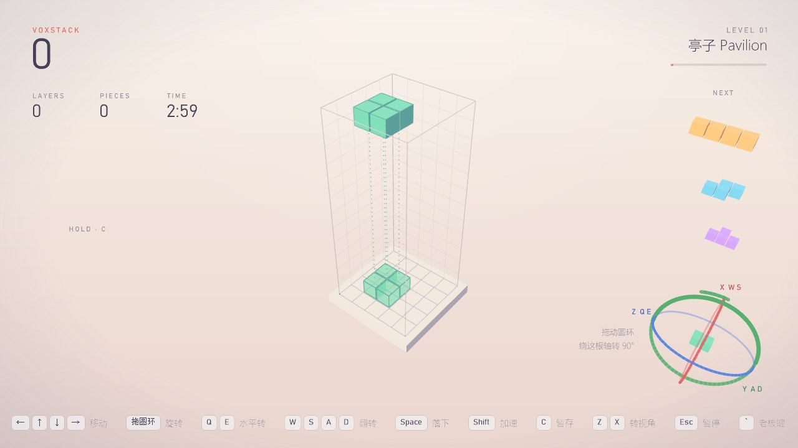
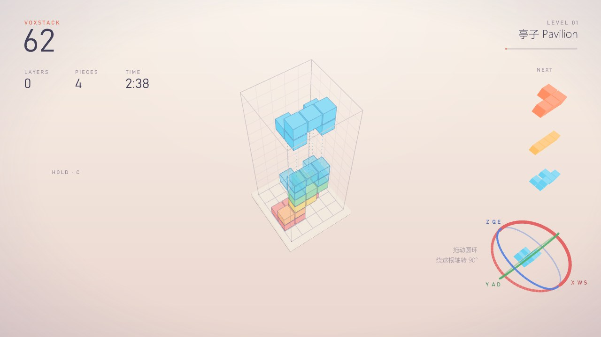

# 第四轮：VoxStack 再慢一点、自定义积木、gumball 固定在右下角

> 网页版报告的源文件（2026-11-03）。

## 改了什么

| 问题 | 原因 | 改动 |
|---|---|---|
| 自定义积木"没了" | ① 上一轮"开局先发扁平积木"把自定义的 Gate（7 格立体）也挡在第 3 级之前；② 测试文件里 Pavilion 用的是你画的 3 个盒子，但只存了 Rhino 物体 ID，新开 Rhino 就没有 | ① 开局规则只挡内置积木，自定义的第 1 块起就发；顺带修了起始等级 > 1 时第一袋按第 0 级发；② 经你同意，把 3 个盒子存进文件（Pavilion 5 格 U 形回来了），第一个 Massing Study 的 Level 15 → 1 |
| 太快 | 第 1 级 1.8 秒、每级 −13 %；测试文件第一个 Massing Study 的 Level（起始等级）是 15 | 第 1 级 2.4 秒、每级 −8 %、最快 0.15 秒；锁定缓冲 1.2 秒，第 11 级起 0.6 秒。第 15 级 0.26 → 0.75 秒 |
| gumball 难点 | 跟着积木高度上下动 | 固定在视口右下角，位置和大小不变，只随视角转；4K 按系统缩放放大 |
| 分不清轴 | 默认镜头俯角 45° 时 Y 环和 Z 环在屏幕上是同一个椭圆 | gumball 按镜头朝向、最多 28° 俯角画（透视下按实际视线算） |
| 误转视角 | 圆圈里没按到圆环、倒计时里按，会转视角 | 都不做任何事；两个环挨着时按方向 + 距离判断 |

## 验证

- 核心测试 306 项全过（新增：自定义积木第 1 级就发、起始等级高时第一袋发全套、新的速度和锁定数值）。
- 4K 屏（175 %）、Rhino 最大化、真实鼠标：积木从第 11 层落到第 3 层，gumball 一直在同一个屏幕位置；拖 9 次（三个环、交叉点、圆环另一侧、转视角后三个环）每次正好转 90° 且轴对；倒计时里按、圆圈里空按，镜头都不动；Rhino 截图里 gumball 位置正确。

## 用时

| 阶段 | 分钟 |
|---|---|
| 诊断：读你的 GH 文件、找原因 | 3.5 |
| 规则：自定义积木照发、更慢、测试 | 3.5 |
| Gumball 固定到右下角 + 编译 | 1.5 |
| Rhino 4K 实测与 5 处修正 | 18.0 |
| 文档与报告 | 8.5 |
| 修测试文件：找回你画的 3 个盒子 | 5.5 |
| 合计 | 40.5 |

## 等你决定

- 提交推送（代码、文档、修好的测试文件都还在工作区）。
