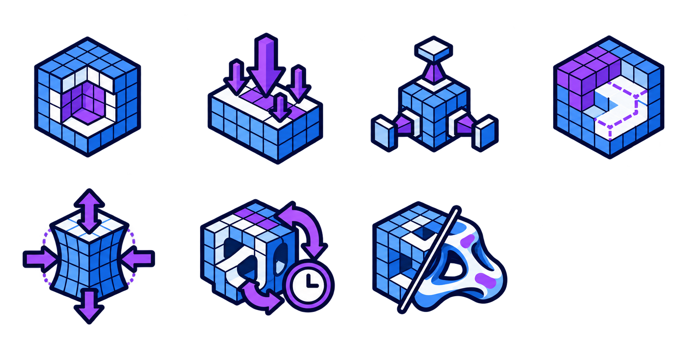
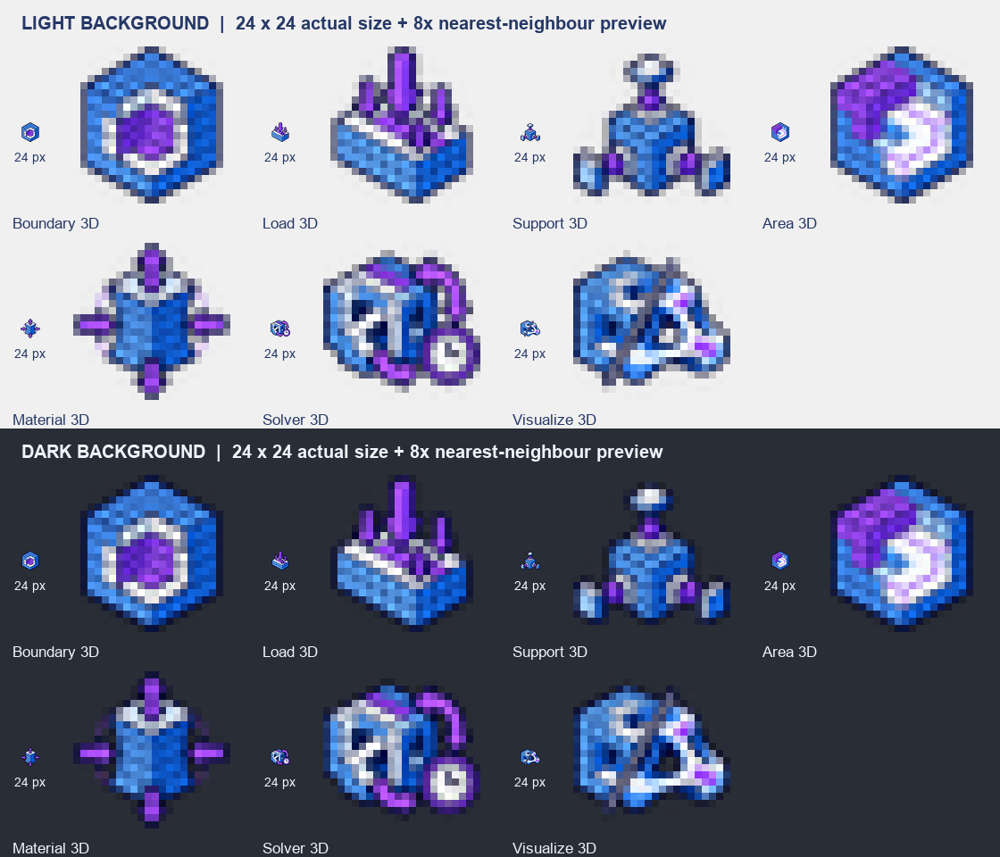

# Moyu 3D 图标资产与 Claude 接入交接

本次交付为 **7 个独立的 24×24 px、RGBA 透明背景 PNG**，已按 3D 组件类名放入 `src/Moyu/Icons/`。蓝紫＋冰白配色、线宽与现有 2D 图标保持一致，以立体体素和空间结构表达各组件功能。

下方保留最初的功能 Prompt，便于后续重画时继续按组件用途设计。Moyu 插件 / Ribbon 页签沿用原有 `Moyu.png`，本次不另做第 8 个图标。

## 原图与实际尺寸预览

- [3D 图标原图](images/moyu-icons-3d-blue-violet-source.png)：`docs/images/moyu-icons-3d-blue-violet-source.png`，实际尺寸 1774×887 px，RGBA 透明 PNG，4 列 × 2 行，右下第 8 格留空。
- [实际尺寸与放大预览](images/moyu-icons-3d-preview.png)：`docs/images/moyu-icons-3d-preview.png`，展示真实 24×24 图标及 8 倍最近邻放大效果，并对照浅色、深色背景。
- 原图用于追溯和重新导出；插件实际嵌入的是下表中的 7 个独立 PNG。

使用 Codex 内置 `imagegen`，参考现有 2D 图标的配色与线宽。完整生成与排版修订 Prompt 见 [生成记录](moyu-icons-3d-generation-prompt.txt)。





## Prompt

```text
为 Grasshopper 插件 Moyu 的 3D 拓扑优化工具栏生成 7 个组件图标，每个图标表达对应组件的作用：

1. Boundary 3D：把封闭的实体（Brep 或网格）转成体素网格，定义可以放材料的三维设计空间；套在里面的实体会成为孔洞。
2. Load 3D：在点、曲线或面上施加外力，力平均分到它接触的节点上。
3. Support 3D：在点、曲线或面上固定结构，可以分别锁住 X、Y、Z 三个方向的位移。
4. Area 3D：在设计空间里指定必须保持实心（例如楼板）或必须保持空心（例如通道）的区域。
5. Material 3D：设定材料的弹性模量和泊松比。
6. SIMP Solver 3D：在体素网格上迭代做拓扑优化，由计时器（Trigger）一下一下推动，直到结果收敛。
7. Visualize 3D：把优化结果显示成体素块或光滑曲面，并标出荷载和支座。

输出：7 个图标排成 4 列 × 2 行，第 8 格留空，透明背景。
```

## 重新导出

使用已保存的原图时，从仓库根目录运行：

```bash
python tools/make_icons.py docs/images/moyu-icons-3d-blue-violet-source.png --set 3d
```

脚本按阅读顺序切出前 7 格，跳过右下空白格，写入 `src/Moyu/Icons/`。依据 alpha 包围盒裁掉透明边，保持比例并居中缩放到 22×22 区域，四边至少保留 1 px 完全透明留白。缩放使用预乘 alpha 的 Lanczos，保留冰白细节及透明边缘，不将白色内容抠除。仅清除 alpha ≤ 8 的近乎不可见噪点，避免噪点撑大裁切范围。

允许图形边缘使用半透明抗锯齿；透明背景不要求图像内所有 alpha 都只能是 0 或 255。缩小后的细网格、计时器等辅助细节，以实际 24×24 预览及 GH 界面中的辨识度为准。

## 文件与组件对应

下表图片使用实际 24×24 PNG；文件路径以仓库根目录为准。

| 位置 | 24×24 图标 | 文件路径 | 组件 |
|---|---|---|---|
| 第 1 行第 1 个 |  | `src/Moyu/Icons/Boundary3DComponent.png` | Boundary 3D |
| 第 1 行第 2 个 |  | `src/Moyu/Icons/Load3DComponent.png` | Load 3D |
| 第 1 行第 3 个 |  | `src/Moyu/Icons/Support3DComponent.png` | Support 3D |
| 第 1 行第 4 个 |  | `src/Moyu/Icons/Area3DComponent.png` | Area 3D |
| 第 2 行第 1 个 |  | `src/Moyu/Icons/Material3DComponent.png` | Material 3D |
| 第 2 行第 2 个 |  | `src/Moyu/Icons/Solver3DComponent.png` | SIMP Solver 3D |
| 第 2 行第 3 个 |  | `src/Moyu/Icons/Visualize3DComponent.png` | Visualize 3D |

## Claude 后续接入步骤

本次已检查全部 7 张文件均为 24×24 RGBA PNG，具有完全透明的 1 px 外边和有效的半透明边缘，并查看了浅 / 深背景下的原尺寸及放大预览。通过 MSBuild 的 `EmbeddedResource` 项目求值确认了 7 个预期的 3D 资源名；原有 8 张 2D / 插件图标的文件哈希保持不变。以下编译和 GH 实际界面验证仍待执行。

现有代码已经支持这些文件名，无须另写图标加载器：

- `src/Moyu/Moyu.csproj` 通过 `EmbeddedResource Include="Icons\*.png"` 嵌入图标，逻辑资源名为 `Moyu.Icons.<文件名不含扩展名>.png`。
- `src/Moyu/Components/MoyuComponent.cs` 使用 `Icons.Get(GetType().Name)`，因此文件名必须与 3D 组件类名完全一致。
- `Solver3DComponent` 通过 `SolverComponentBase<TDomain, TProblem>` 继承 `MoyuComponent`，同样使用 `Solver3DComponent.png`。
- `src/Moyu/Components/Icons.cs` 缓存加载的位图；`Moyu.png` 仍供插件和 Ribbon 页签共用。

后续请按以下顺序验证；本次资产导出不代表已经完成构建或 Rhino / GH 实机验收：

1. 保留上述 7 个文件名，确认 24×24 尺寸和 alpha。不要把原图或预览图放进 `src/Moyu/Icons/`。
2. 运行 `dotnet build src/Moyu/Moyu.csproj -c Release`，检查新程序集包含 7 个 `Moyu.Icons.*3DComponent.png` 资源，同时保留原有 8 个 2D / 插件图标资源。
3. 按 README 的加载说明使用新构建的 `Moyu.gha`，重启 Rhino / Grasshopper，检查 `Moyu` › `3D` 工具栏和画布中的 7 个组件。替换 PNG 不会自动更新旧进程中的程序集或位图缓存。
4. 以实际工具栏尺寸检查辨识度，尤其是设计域与区域的区别、三向支承、求解器计时提示及体素 / 光滑结果。必要时针对单个图标简化辅助细节，保留功能映射和文件名。

**接入状态（2026-11-01，Claude）**：第 1、2 步完成。7 个文件均为 24×24 RGBA、外圈 1 px 完全透明，2D / 插件的 8 个图标未改动；Release 与 Debug 的全部 6 个产物（net48、net7.0、net7.0-windows）都含 15 个 `Moyu.Icons.*.png` 资源。在无界面 Rhino 8.36 的 Grasshopper 里，14 个组件都取到了各自的 24×24 图标，Moyu 页签图标也已注册（`--icons` 快速检查）。第 3、4 步需要在 Rhino 界面里目测。
