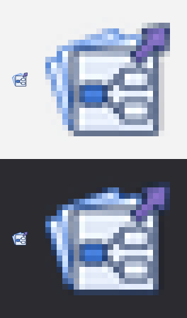

# Moyu Examples 图标资产与 Claude 接入交接

`Moyu` › `Examples` 面板只有 1 个组件 Examples（示例启动器）。它的图标由 Codex 生成：一张 1 列 × 1 行的透明图表，切成 24×24 的 GH 图标。生成记录见 [生成记录](moyu-icons-examples-generation-prompt.txt)。

## Prompt

```text
为 Grasshopper 插件 Moyu 的 Examples 工具栏生成 1 个组件图标，表达这个组件的作用。

背景：Moyu 本身是一个 2D / 3D 拓扑优化插件，另外带四个在 Rhino 视口里玩的摸鱼小游戏：叠楼 VoxStack（3D 落块）、蜿蜒 Serpentine（曲面贪吃蛇）、回弹 Rebound（立面打砖块）、雨燕 Swift（剖面里扇翅穿墙）。每个游戏都有老板键，一按就把画面切成正经的建筑分析图（体块研究、景观流线、幕墙立面、剖面采光通风），所以游戏所在的面板和组件都用了建筑设计的名字（Massing、Landscape、Facade、Section）。插件附带六个示例定义（.gh 文件），装好后藏在包管理器的安装文件夹里，很难找到；Examples 面板就是为了让人不用找文件夹也能打开它们。这个面板的名字本身是中性的。

1. Examples：示例启动器。放到画布上，组件上排着六个按钮（2D 拓扑优化、3D 拓扑优化、叠楼、蜿蜒、回弹、雨燕），点一个就在 Grasshopper 的新标签页里打开对应的示例定义；打开的是一份未命名的副本，保存时会问存到哪里，示例本身不会被改动。右键菜单里也能打开同样的示例。示例文件就在插件里，不管用哪种方式安装都能打开。

输出：1 个图标，1 列 × 1 行，透明背景。
```

## 已生成图表

[Examples 图标原图](images/moyu-icons-examples-source.png)：**1254×1254 px**，RGBA 透明 PNG，1 列 × 1 行。三张叠放的图纸，最前面一张画着一个小的电池连线图（一个蓝色节点连到两个节点），右上角一个紫色箭头往外指，表示“打开现成的定义”。Codex 内置 `imagegen`，风格参考 Section 面板的图表；完整 Prompt 见 [生成记录](moyu-icons-examples-generation-prompt.txt)。


[实际尺寸与放大预览](images/moyu-icons-examples-preview.png)（24×24 与 8 倍最近邻放大，浅 / 深背景）：



## 文件与组件对应

| 位置 | 24×24 图标 | 高清 PNG（1254×1254） | GH 文件路径 | 组件 |
|---|---|---|---|---|
| 唯一一格 |  | [ExamplesComponent.png](images/examples-icons-hd/ExamplesComponent.png) | `src/Moyu/Icons/ExamplesComponent.png` | Examples |

## 重新导出

```bash
python tools/make_icons.py docs/images/moyu-icons-examples-source.png --set examples --cols 1 --rows 1 --source-out docs/images/examples-icons-hd --preview docs/images/moyu-icons-examples-preview.png
```

**接入状态（2026-11-08，Claude）**：24×24 图标已生成并嵌入，浅 / 深背景预览在 24 px 下能认出图纸和紫色箭头。Release 构建 0 警告 0 错误（三个目标框架），`--icons` 检查通过（24 个组件各自取到 24×24 图标，Moyu 页签图标在）。在 Rhino 8 的 GH 画布里看过组件本身（按钮和标题），图标换上后再看一次见 1.0.1 发布记录。
