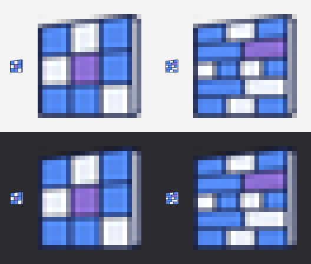

# Moyu Facade 图标提示词

`Moyu` › `Facade` 面板有 2 个组件。下面是功能提示词（只写游戏背景和组件作用）；给 Codex 的设计提示词见 [生成记录](moyu-icons-facade-generation-prompt.txt)。

## Prompt

```text
为 Grasshopper 插件 Moyu 的 Facade 工具栏生成 2 个组件图标，每个图标表达对应组件的作用。

背景：Facade 面板其实是一个摸鱼小游戏 Rebound（回弹），在 Rhino 视口里玩的"立面打砖块"——一面砖墙立在视口里，砖按真实的建筑砌法排列（顺砌、通缝、英式、荷兰式、花墙、拱），玻璃、砖、混凝土要打的次数不同，钢打不坏；用方向键或鼠标移动底部的挡板接球，把能打的砖都打掉就过关，打碎的砖会掉道具（加宽、多球、慢速、粘板、穿透）。游戏带老板键：一按就把画面切成正经的建筑立面研究（剩下的砖画成立面板块，打掉的砖变成窗，配楼层线、标高和尺寸，旁边是窗墙比、玻璃面积、传热系数、隐含碳等指标），再按一次回到游戏。为了让老板扫一眼工具栏也看不出来，面板和组件都用了立面设计的名字。

1. Facade Study：游戏本体。点组件上的 Run 按钮在 Rhino 视口里开始一局，再点一次停止；可以设模式（逐关 / 3 分钟限时 / 不掉命的休闲模式）、起始关卡、立面所在的平面和模数。老板模式下它就是一个"立面研究工具"：把砖墙当作立面，输出不透明板块和窗洞的轮廓，以及窗墙比、玻璃面积、平均传热系数、采光系数、隐含碳等指标。
2. Brick Bond：砌法生成器。生成一面砖墙的排布：顺砌、通缝、英式、荷兰式、镂空花墙、带拱形开口的墙，或者把 Rhino 里画的闭合曲线当作一块块板材；可以设砖的皮数。

输出：2 个图标排成 2 列 × 1 行，透明背景。
```

## 接入

```bash
python tools/make_icons.py docs/images/moyu-icons-facade-source.png --set facade --cols 2 --rows 1 --source-out docs/images/facade-icons-hd --preview docs/images/moyu-icons-facade-preview.png
```

| 格子 | 文件 | 组件 |
|---|---|---|
| 第 1 格 | `src/Moyu/Icons/FacadeStudyComponent.png` | Facade Study |
| 第 2 格 | `src/Moyu/Icons/BrickBondComponent.png` | Brick Bond |

## 资产

- Codex 生成的源图：[moyu-icons-facade-source.png](images/moyu-icons-facade-source.png)（1774 × 887 px，RGBA，2 列 × 1 行）
- 高清切图（每格 887 × 887，无缩放）：[images/facade-icons-hd/](images/facade-icons-hd/)
- 实际尺寸预览（浅 / 深背景，24 px 与放大）：[moyu-icons-facade-preview.png](images/moyu-icons-facade-preview.png)
- 给 Codex 的设计提示词和生成参数：[moyu-icons-facade-generation-prompt.txt](moyu-icons-facade-generation-prompt.txt)



以后换图标，用项目技能 `moyu-icons`（`.claude/skills/moyu-icons/SKILL.md`）。

**接入状态（2026-11-03，Claude）**：源图由本机 Codex 一次生成（风格参考 Landscape 图表），透明背景（alpha 最小值 0），2 个图标、无文字。按上面的命令切出两张 24×24 运行时图标和两张高清切图，看过实际尺寸预览，两个图标在 24 px 下能分开。Release 构建 0 警告 0 错误，`--icons` 检查通过（23 个组件各自取到 24×24 图标，Moyu 页签图标在）。游戏在 Rhino 8 里实测过，但没有专门截 `Moyu` › `Facade` 工具栏看图标。
