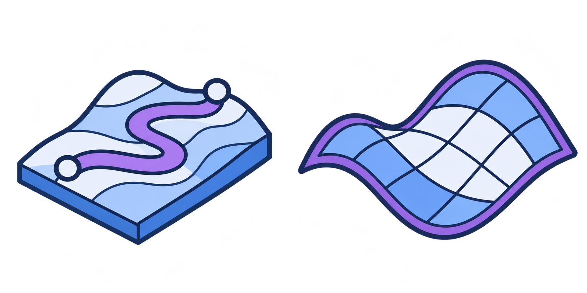
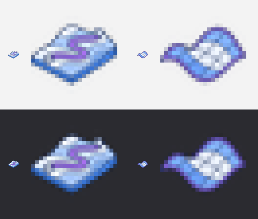

# Moyu Landscape 图标资产与 Claude 接入交接

`Moyu` › `Landscape` 面板的 2 个图标已分别保存为 **887×887 px 高清透明 PNG** 和 **24×24 px GH 透明 PNG**。高清版本保留原图像素与 alpha；GH 版本已按组件类名原位替换临时图标。下方保留初始功能提示词及正式图表的生成记录。

## 已生成图表

蓝紫＋冰白图表已保存为 [Landscape 图标原图](images/moyu-icons-landscape-source.png)，实际尺寸 **1774×887 px**，RGBA 透明 PNG，按 2 列 × 1 行排列。左侧 Path Study 用贴合地形的路线与端点表达流线研究；右侧 Site Surface 用起伏曲面与网格表达场地曲面生成。

原图使用 Codex 内置 `imagegen`，参考现有 Moyu Massing 图标的配色和轮廓风格。完整 Prompt 见 [生成记录](moyu-icons-landscape-generation-prompt.txt)。整张源图与两份高清切图均保留，插件实际嵌入的是下表中的 24×24 文件。



[实际尺寸与放大预览](images/moyu-icons-landscape-preview.png) 展示 24×24 图标与 8 倍最近邻放大效果，并对照浅色、深色背景。



## Prompt

```text
为 Grasshopper 插件 Moyu 的 Landscape 工具栏生成 2 个组件图标，每个图标表达对应组件的作用。

背景：Landscape 面板其实是一个摸鱼小游戏 Serpentine（蜿蜒），在 Rhino 视口里玩的"曲面上的贪吃蛇"——用户给一个曲面（起伏地形、环面、圆管、球……），蛇只能贴着这个曲面沿网格一格一格走，吃水果变长（苹果、葡萄、西瓜加的长度不同），碰到炸弹会掉几段身体，撞墙或咬到自己就结束；曲面闭合的方向可以绕过去，下坡变快、上坡变慢。游戏带老板键：一按就把画面切成正经的景观流线研究（曲面变成坡度分析加等高线，蛇身变成一条从 A 到 B 的步行路线，水果变成节点，旁边是路线长度、爬升、坡度等指标），再按一次回到游戏。为了让老板扫一眼工具栏也看不出来，面板和组件都用了景观设计的名字。

1. Path Study：游戏本体。接一个场地曲面，点组件上的 Run 按钮在 Rhino 视口里开始一局，再点一次停止；可以设网格密度、模式（经典 / 3 分钟限时 / 不会死的休闲模式）、起始等级和坡度是否影响速度。老板模式下它就是一个"路线研究工具"：把蛇身当作一条贴着地形的步行路线，输出这条路线的曲线和长度、爬升、平均 / 最大坡度、无障碍坡度占比等指标。
2. Site Surface：场地曲面生成器。一键生成几种可以直接拿来玩（也能当设计底图）的曲面：起伏地形、环面、S 形圆管、马鞍形屋面、球面，可以设尺寸和随机种子。

输出：2 个图标排成 2 列 × 1 行，透明背景。
```

## 文件与组件对应

高清文件位于 `docs/images/landscape-icons-hd/`，GH 文件位于 `src/Moyu/Icons/`。表内小图直接使用实际 24×24 PNG；高清链接可打开原分辨率单图。

| 位置 | 24×24 图标 | 高清 PNG（887×887） | GH 文件路径 | 组件 |
|---|---|---|---|---|
| 左侧第 1 格 |  | [PathStudyComponent.png](images/landscape-icons-hd/PathStudyComponent.png) | `src/Moyu/Icons/PathStudyComponent.png` | Path Study |
| 右侧第 2 格 |  | [SiteSurfaceComponent.png](images/landscape-icons-hd/SiteSurfaceComponent.png) | `src/Moyu/Icons/SiteSurfaceComponent.png` | Site Surface |

## 重新导出

从仓库根目录运行以下命令，同时保存原分辨率切图与 GH 图标：

```bash
python tools/make_icons.py docs/images/moyu-icons-landscape-source.png --set landscape --cols 2 --rows 1 --source-out docs/images/landscape-icons-hd
```

高清版本只按 2 列 × 1 行切分源图：每格 887×887 px，不缩放、不重新采样、不清除 alpha，保存原格内的全部像素与透明留白。使用 PNG 无损保存，便于后续编辑或生成其他尺寸。

GH 版本会清除 alpha ≤ 8 的近乎不可见噪点，按 alpha 包围盒裁边，保持比例并居中缩放到 22×22 区域，再放入 24×24 画布，四边至少保留 1 px 完全透明留白。缩放采用预乘 alpha 的 Lanczos，保留冰白内容与半透明抗锯齿边缘。图形清晰度以实际尺寸预览和 GH 中的显示为准。

## Claude 后续接入步骤

本次已逐像素校验两张 887×887 高清 PNG：RGBA 数据与源图各自格子完全一致。两张 24×24 PNG 的尺寸、透明通道和 1 px 透明外边检查通过，浅 / 深背景预览已查看。MSBuild 项目求值确认两个资源名正确；文件哈希确认仅替换 Landscape 的两张运行时图标，其余 18 张保持不变。

现有代码已支持这两个文件名，无须另写加载器或修改组件代码：

- `src/Moyu/Moyu.csproj` 通过 `EmbeddedResource Include="Icons\*.png"` 嵌入运行时图标，资源名为 `Moyu.Icons.<组件类名>.png`。
- `PathStudyComponent`、`SiteSurfaceComponent` 均继承 `MoyuComponent`；基类 `Icon` 调用 `Icons.Get(GetType().Name)`。
- 高清图和预览图保存在 `docs/images/`，不要将它们放进 `src/Moyu/Icons/`，避免被当作运行时资源嵌入。

接入步骤：

1. ✓ 保留上述两个组件文件名，运行 `dotnet build src/Moyu/Moyu.csproj -c Release`，确认两个 Landscape PNG 嵌入新程序集。
2. ✓ 运行下方图标检查命令，检查全部 19 个组件及 Moyu 页签，共 20 个图标资产。
3. 按 README 加载新构建的 `Moyu.gha`，重启 Rhino / Grasshopper，检查 `Moyu` › `Landscape` 工具栏与画布中两个图标的辨识度。磁盘 PNG 替换不会自动刷新旧进程中的程序集和位图缓存。

以后换图标或给新面板做图标，用项目技能 `moyu-icons`（`.claude/skills/moyu-icons/SKILL.md`）：它按本文件和生成记录的格式写提示词，用 `tools/codex_image.py` 调本机 Codex 出图，再切图、预览、编译、跑 `--icons`。

```bash
dotnet run -c Release --project tests/Moyu.RhinoTests -- --icons
```

**接入状态（2026-11-02，Claude）**：两份 887×887 高清透明 PNG 已保存，两个正式 24×24 图标已替换临时文件。用新图表重新切图并写了浅 / 深背景预览（两个图标在 24 px 下都能分辨），Release 构建 0 警告 0 错误（三个目标框架），`--icons` 检查通过（19 个组件各自取到 24×24 图标，Moyu 页签图标在）。还没在 Rhino / GH 界面里实际看过工具栏。
