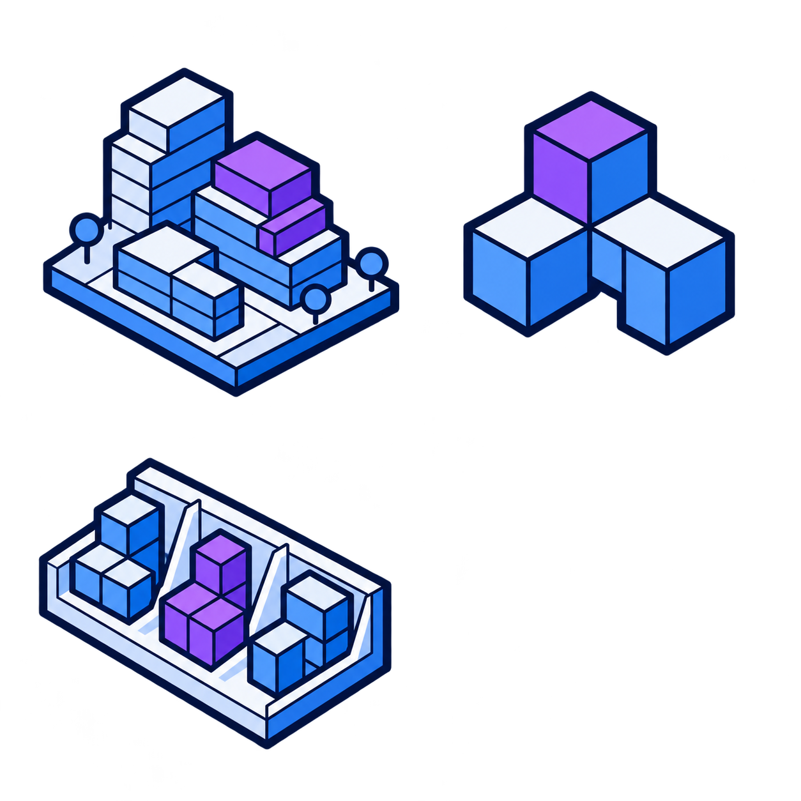
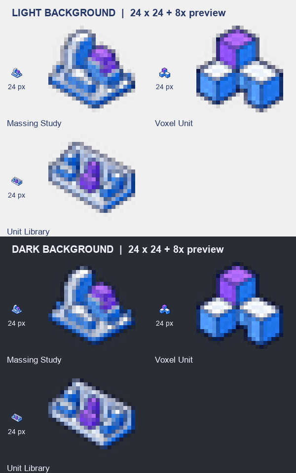

# Moyu Massing 图标资产与 Claude 接入交接

`Moyu` › `Massing` 面板的 **3 个独立 24×24 px、RGBA 透明背景 PNG** 已按组件类名导出到 `src/Moyu/Icons/`，并原位替换了现有临时图标。蓝紫＋冰白配色与 Moyu 的 2D / 3D 图标保持一致，以建筑体块、体素单元和单元集合表达功能。

## 原图与实际尺寸预览

本次蓝紫＋冰白图表已保存为 [Massing 图标原图](images/moyu-icons-massing-source.png)，实际尺寸 **1254×1254 px**，RGBA 透明 PNG。按 2 列 × 2 行排列：左上为建筑体块研究，右上为单个体素单元，左下为单元集合，右下留空。

原图使用 Codex 内置 `imagegen` 生成，参考现有 Moyu 3D 图标的配色和轮廓风格；完整 Prompt 见 [生成记录](moyu-icons-massing-generation-prompt.txt)。原图用于追溯和重新导出，插件实际嵌入的是下表中的 3 个独立 PNG。

[实际尺寸与放大预览](images/moyu-icons-massing-preview.png) 位于 `docs/images/moyu-icons-massing-preview.png`，展示真实 24×24 图标和 8 倍最近邻放大效果，并对照浅色、深色背景。





## Prompt

```text
为 Grasshopper 插件 Moyu 的 Massing 工具栏生成 3 个组件图标，每个图标表达对应组件的作用。

背景：Massing 面板其实是一个摸鱼小游戏 VoxStack（叠楼），在 Rhino 视口里玩的 3D 体素消层游戏——体素积木从上方落进一个 5×5×12 的"井"，用键盘移动、旋转，某一层铺满就消除并计分，堆到顶就结束。游戏带老板键：一按就把画面切成正经的建筑体块研究（堆好的体素画成白模体块，配场地、周边建筑和容积率等指标），再按一次回到游戏。为了让老板扫一眼工具栏也看不出来，面板和组件都用了建筑体块研究的名字。

1. Massing Study：游戏本体。点组件上的 Run 按钮在 Rhino 视口里开始一局，再点一次停止；可以设井的尺寸、模式（无尽 / 3 分钟限时 / 无重力休闲）和起始等级。老板模式下它就是一个"体块研究生成器"：把堆好的体素当作建筑体块（一格 = 一个柱跨、三层高），输出总建筑面积、容积率、层数、覆盖率、高度等指标。
2. Voxel Unit：自制游戏积木。把随手画的封闭实体（或一组体素中心点、或一段文本图案）转成一块自定义体素积木——体素中心落在实体里的格子保留；积木必须面连通、最多 10 格、每边不超过 4 格。积木越大越怪，消层得分倍率越高。
3. Unit Library：积木库。把内置积木集（入门 / 标准 8 块 / 困难）和自制积木合在一起，作为游戏发牌用的积木库，接到 Massing Study 上。

输出：3 个图标排成 2 列 × 2 行，右下第 4 格留空，透明背景。
```

## 重新导出

原图存为 `docs/images/moyu-icons-massing-source.png`，在仓库根目录运行：

```bash
python tools/make_icons.py docs/images/moyu-icons-massing-source.png --set massing --cols 2 --rows 2
```

脚本按阅读顺序切出前 3 格，跳过右下空白格，并覆盖下表中的 3 个同名文件。依据 alpha 包围盒裁掉透明边，保持比例并居中缩放到 22×22 区域，输出 24×24 画布，四边至少保留 1 px 完全透明留白。使用预乘 alpha 的 Lanczos 缩放，保留冰白内容和透明边缘；仅清除 alpha ≤ 8 的近乎不可见噪点，避免其撑大裁切范围。

允许图形边缘带半透明抗锯齿。24×24 的主体轮廓应易于区分，建筑层线和库中单元等辅助细节需结合实际尺寸预览与 GH 显示判断。

## 文件与组件对应

下表图片使用实际 24×24 PNG；文件路径以仓库根目录为准。

| 格子 | 24×24 图标 | 文件路径 | 组件 |
|---|---|---|---|
| 第 1 行第 1 格 |  | `src/Moyu/Icons/MassingStudyComponent.png` | Massing Study |
| 第 1 行第 2 格 |  | `src/Moyu/Icons/VoxelUnitComponent.png` | Voxel Unit |
| 第 2 行第 1 格 |  | `src/Moyu/Icons/UnitLibraryComponent.png` | Unit Library |
| 第 2 行第 2 格 | 留空 | 不导出文件 | — |

## Claude 后续接入步骤

本次已核对 3 个文件均为 24×24 RGBA PNG，具有 1 px 完全透明外边和半透明抗锯齿边缘，并检查了浅色 / 深色背景下的实际尺寸与放大预览。MSBuild 的 `EmbeddedResource` 项目求值确认了 3 个预期资源名。文件哈希对比确认本次只替换了这 3 张 Massing 图标，其余 15 张图标保持不变；尚未重新编译或在 Rhino / GH 中运行检查。

现有加载逻辑已经支持这 3 个文件名，不需要修改 C# 或另写图标加载器：

- `src/Moyu/Moyu.csproj` 通过 `EmbeddedResource Include="Icons\*.png"` 嵌入图标，资源名为 `Moyu.Icons.<组件类名>.png`。
- 3 个 Massing 组件均继承 `MoyuComponent`，基类的 `Icon` 调用 `Icons.Get(GetType().Name)`，因此文件名必须与组件类名完全一致。
- `src/Moyu/Components/Icons.cs` 缓存加载的位图。替换磁盘 PNG 不会刷新旧进程里已加载的程序集与图标缓存。

以下构建、加载检查和实际 GH 界面验证仍需后续执行；资产导出本身不代表已完成这些步骤：

1. 保留上表文件名。不要将原图或预览图放进 `src/Moyu/Icons/`。
2. 运行 `dotnet build src/Moyu/Moyu.csproj -c Release`，确认 3 个 Massing PNG 已嵌入新程序集，并保留现有 15 个 2D / 3D / 插件图标资源。
3. 运行下方图标检查命令。现有 `Scenarios.Icons` 会检查全部 17 个组件能读取到 24×24 位图，以及 Moyu 页签存在图标，共对应 18 个图标资产。
4. 按 README 的加载说明使用新构建的 `Moyu.gha`，重启 Rhino / Grasshopper，检查 `Moyu` › `Massing` 工具栏和画布中的 3 个图标。重点确认建筑体块、单个体素单元和单元集合在实际小尺寸下可以区分。

```bash
dotnet run -c Release --project tests/Moyu.RhinoTests -- --icons
```

**接入状态（2026-11-01，Claude）**：4 步都已完成。Release 构建无警告，`--icons` 检查通过（17 个组件各自取到 24×24 图标，Moyu 页签图标在）。在 Rhino 8 界面里打开 `tests/gh/MoyuStack-Test.gh`，画布上 Massing Study、Voxel Unit、Unit Library 三个新图标都正常显示，实际尺寸下三者能区分开。
