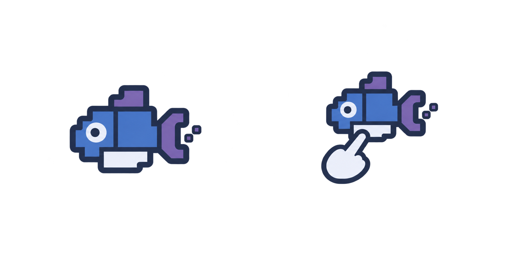
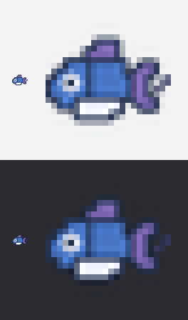

# Moyu 插件图标（页签 / 包管理器 / food4rhino）资产与接入交接

这是插件本身的图标：Grasshopper 工具栏上 `Moyu` 页签的 24×24 图标（`src/Moyu/Icons/Moyu.png`），也放大后用作 Rhino 包管理器和 food4rhino 的项目图标（`packaging/icon.png` 256 px、`packaging/icon-512.png` 512 px）。原来的图标是一个拓扑优化出来的支架加一片像素场（2D 图表的第 1 格）；用户要求换成贴合"摸鱼"、有鱼的形象，由 Codex 重新设计。

## Prompt

```text
为 Grasshopper 插件 Moyu 重新设计插件本身的图标，给出 2 个候选方案。

背景：Moyu 就是"摸鱼"——上班偷懒的意思。插件表面上是一套拓扑优化工具（2D 像素 SIMP、3D 体素 SIMP），同时在四个"研究工具"面板后面藏着四个在 Rhino 视口里玩的小游戏，每个都有老板键。这个图标出现在 Grasshopper 工具栏的 Moyu 页签上（24×24）、Rhino 包管理器和 food4rhino 的项目页上，所以要把"鱼"放在正中间点出摸鱼这个梗，同时还得和现有的蓝紫冰白图标家族是一家的。

功能：代表整个插件。方案 A 只有一条由几个圆角体素块拼成的鱼（顺便呼应体素网格）；方案 B 同一条鱼加一只伸出一根手指去"摸"它的简化手形。

输出：2 个候选排成 2 列 × 1 行，透明背景。
```

## 生成记录

完整英文提示词见 [生成记录](moyu-icons-plugin-generation-prompt.txt)。风格参考用的是最新的 Section 图表。Codex 一次出了两个候选（[候选原图](images/moyu-icons-plugin-candidates.png)，1774×887 px，RGBA 透明）：



- **A（采用）**：几个圆角体素块拼成的鱼，紫色尾鳍和背鳍，冰白眼睛和鱼肚，尾后两个小方块像散开的像素。24 px 下轮廓清楚。
- **B**：同一条鱼加一只伸出手指"摸鱼"的手；放大看最贴题，但 24 px 下手只剩鱼下面的一团白。

用户选了 **A，所有地方都用它**（页签、包管理器、food4rhino）。A 格单独存为 [源图](images/moyu-icons-plugin-source.png)（887×887）。

## 文件

| 用途 | 文件 | 尺寸 |
|---|---|---|
| Grasshopper 页签 / GH_AssemblyInfo.Icon | `src/Moyu/Icons/Moyu.png` | 24×24 |
| Yak 包的 `icon:` | `packaging/icon.png` | 256×256 |
| food4rhino 项目图标 | `packaging/icon-512.png` | 512×512 |



## 重新导出

```bash
python tools/make_icons.py docs/images/moyu-icons-plugin-source.png --set plugin --cols 1 --rows 1 --preview docs/images/moyu-icons-plugin-preview.png
```

256 / 512 px 两个包图标是同一张源图按 alpha 包围盒裁边、留 6% 边、Lanczos 缩放出来的（见 `docs/icon-prompts-plugin.md` 的提交记录）。

**接入状态（2026-11-04，Claude）**：24×24 图标、两个包图标已替换；构建和 `--icons` 检查见发布报告。
