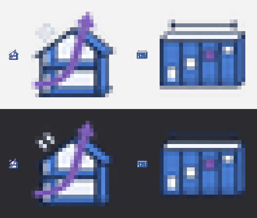

# Moyu Section 图标提示词

`Moyu` › `Section` 面板有 2 个组件。下面是功能提示词（只写游戏背景和组件作用）；给 Codex 的设计提示词见 [生成记录](moyu-icons-section-generation-prompt.txt)。

2026-11-03 起这个面板的游戏从 Inkline（划线闯关）换成了 Swift（雨燕），组件和图标一起换了。

## Prompt

```text
为 Grasshopper 插件 Moyu 的 Section 工具栏生成 2 个组件图标，每个图标表达对应组件的作用。

背景：Section 面板其实是一个摸鱼小游戏 Swift（雨燕），在 Rhino 视口里玩的"单键飞行"——一只小雨燕在一条无尽的建筑剖面里飞（地板和顶板一直延伸，中间一道道横墙，每堵墙上开一个门洞或窗洞），玩家按空格或点鼠标扇一下翅膀让它往上蹿，不按就往下掉，要穿过每堵墙的开口；撞墙或落地就结束，越往后开口越小、速度越快，后面还有上下滑动的窗扇，开口之间有羽毛可以收集。游戏带老板键：一按就把画面切成正经的住宅剖面采光 + 通风分析图（剖到的墙和楼板涂黑，楼梯、家具、人和树，冬夏至正午的太阳光线被挑檐和雨棚挡住或照进来，工作面上的采光系数色带，穿堂风和热压通风的气流线），再按一次回到游戏。为了让老板扫一眼工具栏也看不出来，面板和组件都用了建筑剖面和自然通风设计的名字。

1. Airflow Study：游戏本体。点组件上的 Run 按钮在 Rhino 视口里开始，再点一次停止；可以接 Storey Grid 的设置，选剖面所在的平面和比例。老板模式下它就是一个"剖面通风采光研究工具"：输出飞行路径曲线、剖面的切线轮廓，以及平均采光系数、工作面达标比例、冬季日照进深、夏季南窗受晒比例、穿堂风和热压通风换气次数、室内平均风速。
2. Storey Grid：剖面网格设置。设定风压等级（避风 / 普通 / 迎风，对应难度）、经典或 Zen 模式、开口高度系数、开间宽度系数和固定种子，并预览前几堵墙的剖面布置。

输出：2 个图标排成 2 列 × 1 行，透明背景。
```

## 接入

```bash
python tools/make_icons.py docs/images/moyu-icons-section-source.png --set section --cols 2 --rows 1 --source-out docs/images/section-icons-hd --preview docs/images/moyu-icons-section-preview.png
```

| 格子 | 文件 | 组件 |
|---|---|---|
| 第 1 格 | `src/Moyu/Icons/AirflowStudyComponent.png` | Airflow Study |
| 第 2 格 | `src/Moyu/Icons/StoreyGridComponent.png` | Storey Grid |

## 资产

- Codex 生成的源图：[moyu-icons-section-source.png](images/moyu-icons-section-source.png)（1774 × 887 px，RGBA，2 列 × 1 行）
- 高清切图（每格 887 × 887，无缩放）：[images/section-icons-hd/](images/section-icons-hd/)
- 实际尺寸预览（浅 / 深背景，24 px 与放大）：[moyu-icons-section-preview.png](images/moyu-icons-section-preview.png)
- 给 Codex 的设计提示词和生成参数：[moyu-icons-section-generation-prompt.txt](moyu-icons-section-generation-prompt.txt)



以后换图标，用项目技能 `moyu-icons`（`.claude/skills/moyu-icons/SKILL.md`）。

**接入状态（2026-11-03，Claude）**：Swift 版源图由本机 Codex 一次生成（风格参考 Facade 图表），透明背景（alpha 最小值 0），2 个图标、无文字：左边是带坡屋顶的两层剖面加一支从低处进、从屋脊出的紫色气流箭头，右边是一排横墙、每堵一个高低不同的开口（一个紫色）加顶上一道尺寸线。按上面的命令切出两张 24×24 运行时图标和两张高清切图，看过实际尺寸预览，两个图标在 24 px 下能分开。Release 构建 0 警告 0 错误，`--icons` 检查通过（23 个组件各自取到 24×24 图标，Moyu 页签图标在）。游戏在 Rhino 8 里实测过，但没有专门截 `Moyu` › `Section` 工具栏看图标。旧的 Inkline 图标（Runoff Study、Level Set）已删除。

