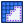
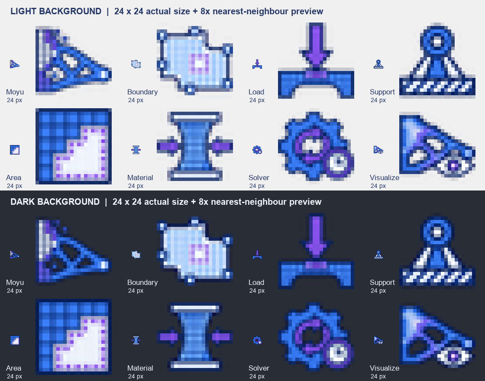

# Moyu 图标资产与 Claude 接入交接

本次交付为 **8 个独立的 24×24 px、RGBA 透明背景 PNG**：7 个 2D 组件图标，加 1 个插件 / Ribbon 页签图标。图标已按现有组件类名放入 `src/Moyu/Icons/`，供后续 Claude 构建和界面验证。

采用用户确认的 **蓝紫＋冰白** 方向，按组件功能重新设计，参考 [Grasshopper 官方图标设计建议](https://developer.rhino3d.com/guides/grasshopper/grasshopper-icons/)中的线宽、对比度和小尺寸辨识度。此方案替代早期黑灰红橙配色及固定几何、严格像素格的生成要求。

## 文件与组件对应

表内图片使用实际 24×24 文件；相对路径均以仓库根目录为准。

| 原图位置 | 24×24 图标 | 文件路径 | 用途 |
|---|---|---|---|
| 第 1 行第 1 个 |  | `src/Moyu/Icons/Moyu.png` | 插件标识、Moyu Ribbon 页签。2026-11-04 起换成体素鱼（摸鱼），见 [插件图标](icon-prompts-plugin.md)；这一格的原图只留作记录，不要再用 `--set 2d` 覆盖 Moyu.png |
| 第 1 行第 2 个 |  | `src/Moyu/Icons/BoundaryComponent.png` | Boundary 2D：定义设计域边界和孔洞 |
| 第 1 行第 3 个 |  | `src/Moyu/Icons/LoadComponent.png` | Load 2D：施加有方向的外力 |
| 第 1 行第 4 个 |  | `src/Moyu/Icons/SupportComponent.png` | Support 2D：约束位移、固定支承 |
| 第 2 行第 1 个 |  | `src/Moyu/Icons/AreaComponent.png` | Area 2D：指定始终实心或始终空心的非设计区 |
| 第 2 行第 2 个 |  | `src/Moyu/Icons/MaterialComponent.png` | Material 2D：指定弹性材料参数 |
| 第 2 行第 3 个 |  | `src/Moyu/Icons/SolverComponent.png` | SIMP Solver 2D：由 Timer 驱动的优化迭代 |
| 第 2 行第 4 个 |  | `src/Moyu/Icons/VisualizeComponent.png` | Visualize 2D：显示密度分布和拓扑结果 |

## 原图、预览与重新导出

- [生成原图](images/moyu-icons-blue-violet-source.png)：`docs/images/moyu-icons-blue-violet-source.png`，实际尺寸 **1774×887 px**，4 列 × 2 行；由 Codex 内置 `imagegen` 生成。
- [尺寸与背景预览](images/moyu-icons-preview.png)：`docs/images/moyu-icons-preview.png`，展示实际 24×24 图标及 8 倍放大效果，并对照浅色、深色背景。
- 原图用于追溯和重新导出；真正嵌入插件的是上表中 8 个 PNG。生成原图不视为严格 24×24 像素格，也不要求颜色逐像素等于提示词中的目标色值。



从仓库根目录执行以下命令可重新导出，需要 Python 和 Pillow：

```bash
python tools/make_icons.py docs/images/moyu-icons-blue-violet-source.png
```

导出器按表中顺序切分原图，依据 alpha 包围盒裁掉透明边，保持比例缩放并居中放入 22×22 区域，输出 24×24 画布，四边至少保留 1 px 透明留白。缩放采用预乘 alpha 的 Lanczos，以兼顾细节和透明边缘。保留图标中有意绘制的冰白部分，不把白色一律抠除。

裁切前仅清除 alpha ≤ 8 的近乎不可见噪点，防止生成图里的零星噪点撑大包围盒。其余 alpha 随原图保留。

缩小后的边缘允许半透明抗锯齿；“透明背景”不等于只允许 0 / 255 两种 alpha。清晰度应以实际 24×24 预览和 GH 中的显示效果判断。

## Claude 后续接入步骤

本次已核对全部 8 张 PNG 的格式、24×24 尺寸、透明通道和 1 px 透明外边，并检查浅 / 深背景预览；白色内容保留检查通过。通过 MSBuild 的 `EmbeddedResource` 项目求值确认 8 个文件均映射到预期资源名。尚未编译或启动 Rhino / GH 验证。

现有代码已经支持这些名称，不需要另写一套图标加载器：

- `src/Moyu/Moyu.csproj` 通过 `EmbeddedResource Include="Icons\*.png"` 自动嵌入文件，资源名为 `Moyu.Icons.<文件名不含扩展名>.png`。
- `src/Moyu/Components/MoyuComponent.cs` 调用 `Icons.Get(GetType().Name)`，因此 7 个组件 PNG 必须与类名完全一致。
- `src/Moyu/Components/Icons.cs` 按上述资源名读取位图，并将 `Moyu.png` 注册为 Ribbon 页签图标；`src/Moyu/MoyuInfo.cs` 同时将它用作插件图标。

后续请按以下顺序验证；本次资产导出不代表已经完成构建或 Rhino 实机验收：

1. 保留上表文件名，确认 8 个 PNG 都为 24×24 且含 alpha。不要将原图或预览图放进 `src/Moyu/Icons/`。
2. 运行 `dotnet build src/Moyu/Moyu.csproj -c Release`，确认目标程序集包含全部 8 个 `Moyu.Icons.*.png` 嵌入资源。
3. 按 README 的加载说明使用新构建的 `Moyu.gha`，重启 Rhino / Grasshopper 后检查 Moyu 页签和 7 个组件。图标缓存包含先前缺失的结果，旧进程不会因替换 PNG 自动更新。
4. 在实际工具栏、画布和常用缩放下检查辨识度，重点确认区域的实心 / 空心区别、求解器的迭代 / 时钟提示及可视化结果。若单个细节过密，再针对该图标简化，不改动整套功能映射或文件名。

**接入状态（2026-11-01，Claude）**：第 1、2 步完成。Release 与 Debug 均已重新编译，`Moyu.gha` 含全部 8 个 `Moyu.Icons.*.png` 资源；在无界面 Rhino 8.36 里，7 个组件的 `Icons.Get` 都取到了位图。同时修正了 `Icons.Get`：原先从资源流创建位图后立即释放了流，GDI+ 绘制时可能出错，现在会先复制成独立位图。第 3、4 步需要在 Rhino 界面里目测。

## 后续重画用功能 Prompt

以下是本次设计方向的精简复现 Prompt；用于保持功能与风格一致，不保证生成与现有原图完全相同。

```text
Create ONE transparent PNG sprite sheet with eight original Grasshopper / Rhino
toolbar icons in a 4-column by 2-row grid. Equal square cells, ample transparent
spacing, no text, labels, dividers or tile backgrounds. Nothing crosses a cell edge.

Design from each component's FUNCTION, with freedom to choose the best geometry.
Use compact engineering pictograms inspired by Grasshopper icons: consistent bold
line weight, distinct silhouettes, balanced negative space, readable at 24x24.
Subtle square finite-element cells connect the family; avoid excessive tiny details.
One dominant idea and at most one small secondary cue per icon.

Tasteful blue-violet and ice-white direction: deep indigo #263867 contours,
cornflower blue #477DDA primary forms, iris violet #8067C7 functional accents,
ice-white #EFF4FF light interiors. Flat clean colors; no gradients, shadows or glow.

Row 1, left to right:
1. Moyu: pixel-based topology optimisation; selective material removal produces
   an efficient load-bearing structure. A memorable compact plugin identity.
2. Boundary: the allowed 2D design domain, perimeter and internal exclusions.
3. Load: directional external force and its application point on a structure.
4. Support: displacement constraints and anchored model points.

Row 2, left to right:
5. Area: local regions that must remain solid or remain void; distinguish both.
6. Material: elastic properties and stiffness, expressed as one unified symbol.
7. Solver: iterative structural optimisation, advanced by timer ticks.
8. Visualize: inspection of the computed density distribution or topology result.

Keep all eight as a coherent family while making their silhouettes easy to tell apart.
Preserve genuine transparent alpha and intentional white parts inside the symbols.
```
