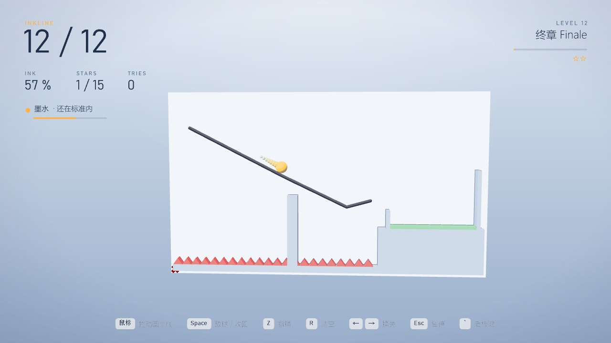
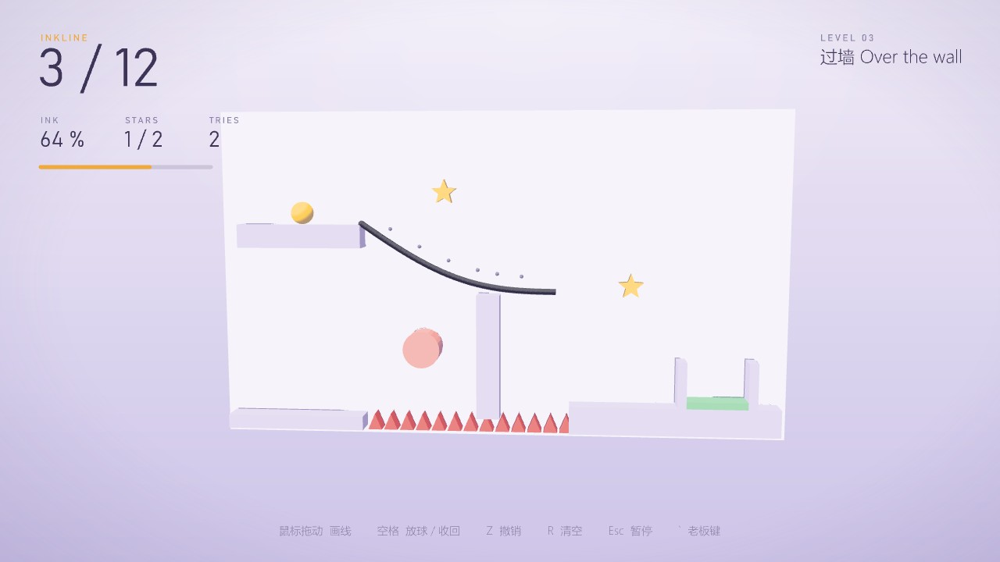
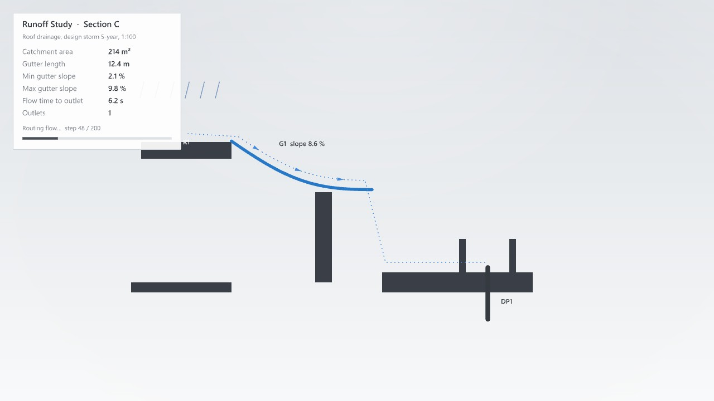

# Inkline 墨线 · 划线闯关方案

> **2026-11-03 起已停用**：按用户要求，`Section` 面板的游戏换成了单键飞行的 [Swift 雨燕](swift-plan.md)。Inkline 的代码、组件、测试和图标都已删除（在 git 历史里，提交 fd5e9c6）。下面保留原方案作记录。

> 网页版方案的源文件。两张截图是动工前在 Rhino 8 视口里用一次性 DisplayConduit 脚本画的原型，按 [visual-style.md](visual-style.md) 的极简风格。按 `docs/game-workflow.md` 的流程做。名字取自木匠弹的墨线。

## v1 状态（2026-11-03）

- 方案里的画线、放球、物理、尖刺 / 弹板 / 星星、胜负、星级、内置 12 关、自定义关卡、老板键排水剖面、两个组件都已实现。
- 每个内置关卡都带参考解，单元测试逐关跑通；另外测了采样间距、墨水预算、撤销 / 清空、滚动、弹板、各种失败、确定性回放和排水指标。
- 调试中发现并修掉一个物理问题：墨线按 0.25 采样成很多小段，球同时压着三四段时摩擦被重复计算，速度掉得很快；改成每步只算一次。跳台那一关的参考解改成平滑的弧线（尖角会损失速度，玩家画的线本来也是圆滑的）。
- 测试文件 `tests/gh/MoyuInkline-Test.gh` 自检通过（内置包 + 一关用点和曲线画的关卡）。
- 真实按键实测（Rhino 8，SendInput 发键、移动鼠标，只在 Rhino 在前台时才发）：用鼠标左键沿第 1 关参考解拖一笔（墨水 14.15），Z 撤销、再画一笔，空格放球，3.5 秒过关；过关后空格进第 2 关，← → 换关，画一笔后 R 清空，`` ` `` 进老板模式。
- 实测发现一个问题并已修好：画线时按老板键再回来，游戏停在暂停画面（会话只把"球在滚"算作进行中，回来时不倒数）。改成除了暂停都算进行中；复测时回来先 3-2-1，再回到画线状态，墨线还在。复测那次 Rhino 拿不到前台，按键都按规矩跳过了，所以这一步是直接调同一个 EnterBoss / ExitBoss 验证的（老板键本身在第一次实测里用真按键测过）。
- 代码命名空间叫 `Moyu.Games.Ink`（叫 `Line` 会和 Rhino 的 `Line` 类型冲突）。
- 图标由 Codex 生成（见 [icon-prompts-section.md](icon-prompts-section.md)）。

## 一页结论

- **玩法**：每关一个球、一个终点（盆）。你在视口里**用鼠标画墨线**，画好按空格放球；球在重力下沿墨线和场景滚动、弹跳，落进盆里就过关。墨水有限，画得越省越好。
- **关卡元素**：墙和台子、尖刺（碰到就失败）、弹板（把球弹得更高）、星星（顺路收集）。内置 12 关，分 4 章；也能在 Rhino 里**自己画关卡**（起点、终点、墙、尖刺、弹板、星星都用曲线 / 点给）。
- **评分**：每关最多 3 颗星——过关 1 颗，收集到的星星各 1 颗；墨水用得少有额外分。进度和星数存在本机。
- **操作**：鼠标左键拖动画线；Z 撤销上一笔；R 清空；空格放球 / 收回；← → 换关（已解锁的）；Enter 下一关；Esc 暂停；`` ` `` 老板键。
- **老板键**：伪装成**屋面排水研究 Runoff Study**：墙和台子画成剖面涂黑，墨线变成天沟（标坡度），球最后一次的轨迹变成雨水流线（虚线 + 箭头），终点是落水管；面板给出汇水面积、天沟长度、最小 / 最大坡度、汇流时间，都按当前关卡和墨线实算。
- **面板 `Section`**：`Runoff Study`（游戏本体，带 Run 按钮）和 `Level Set`（内置关卡包，或用 Rhino 几何组一关）。

## 1. 规则

| 项 | 规则 |
|---|---|
| 场地 | 24 × 13.5 单位的竖向平面（默认 World XZ，正面看） |
| 球 | 半径 0.45，重力每秒² 18 单位；碰墨线和墙按恢复系数 0.35 反弹、带摩擦，能贴着线滚 |
| 墨线 | 鼠标拖动采样成折线（点距 ≥ 0.25）；墨线是固定的（像坡道），不会掉；总长不能超过本关墨水 |
| 弹板 | 圆形，恢复系数 1.25，会把球弹得更远 |
| 胜负 | 球心进盆并且速度降下来停稳 0.4 秒算过关；掉出场地、碰到尖刺、或放球 15 秒还没进算失败，自动收回、墨线保留，可以改了再试 |
| 星星 | 每关 0–2 颗可收集星 + 过关 1 颗；墨水用量低于本关"标准"再加分 |

物理是自己写的二维小引擎（圆对线段，固定步长 1/240 秒），同样的墨线永远同样的结果，方便单元测试。

## 2. 关卡（内置 12 关，4 章）

| 章 | 关 | 要点 |
|---|---|---|
| 一 起步 | 1 第一笔、2 过桥、3 过墙 | 学画坡、搭桥、越过障碍 |
| 二 弹跳 | 4 回头、5 弹板、6 尖刺 | 折返坡、借弹板、避开尖刺 |
| 三 收集 | 7 双星、8 省墨、9 漏斗 | 顺路吃星、墨水很少、用线做漏斗 |
| 四 终章 | 10 跳台、11 迷宫、12 终章 | 飞跃、绕行、综合 |

## 3. 老板键：屋面排水剖面

- 墙 / 台子 = 剖到的楼板、屋面（深色涂黑）；起点所在的台子 = 汇水屋面，上方画雨线；墨线 = 天沟，逐段标坡度；最后一次放球的轨迹 = 雨水流线；终点 = 落水管 DP1。
- 指标：汇水面积、天沟总长、最小 / 最大坡度、汇流时间（球到终点用时；没跑过就按坡度估）、出水口数。
- 命令行一行 `RunoffStudy: Section C updated · gutter … m · min slope … %`；组件显示 "Section C"。

## 4. 组件（Ribbon：`Moyu` › `Section`）

| 组件 | 作用 |
|---|---|
| Runoff Study | 游戏本体。输入：Levels（Level Set 的输出，不接就用内置 12 关）、Start（从第几关开始）、Plane。输出：State、Level、Stars、Ink、Gutters（墨线曲线）、Metrics |
| Level Set | 关卡：Pack（内置包）或自定义——Start（点）、Goal（闭合曲线）、Walls（曲线；闭合的当实心块）、Spikes（曲线）、Bumpers（圆）、Stars（点）、Ink（墨水长度）、Plane |

## 5. 技术

- 规则引擎 `Games/Line/Core`：关卡、二维物理（圆 vs 线段、弹板、尖刺、星星）、墨线（采样、长度预算、撤销）、胜负判定、内置关卡；单元测试覆盖碰撞、滚动、弹板、胜负、墨水预算、确定性回放、每个内置关卡都有解（用预置的"参考解"墨线跑一遍能过关）。
- 会话基类加鼠标钩子：本游戏左键拖动画线（不再转视角），镜头固定正面（右键仍是 Rhino 自己的旋转）。

## 6. 拍板（先按推荐做）

1. 伪装：面板 Section、屋面排水剖面（推荐）。
2. 墨线固定不动（推荐，好上手、好调关卡）；会掉落的墨线留到以后。
3. 每个内置关卡都带一条参考解，测试保证可解（推荐）。
