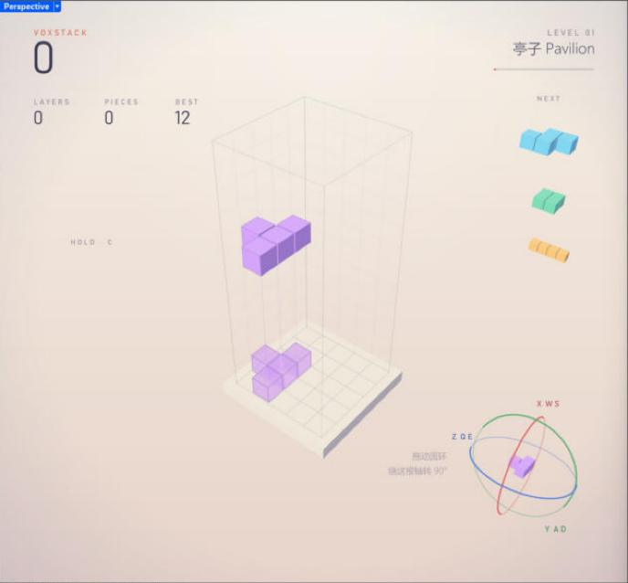
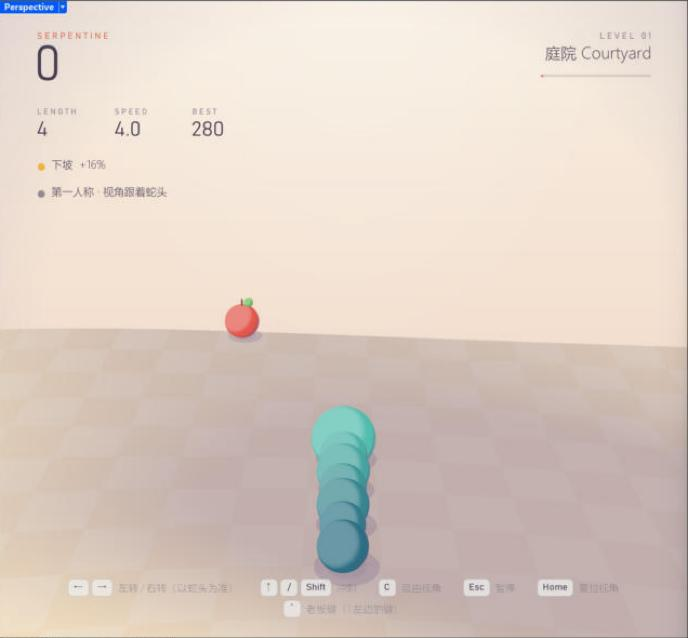
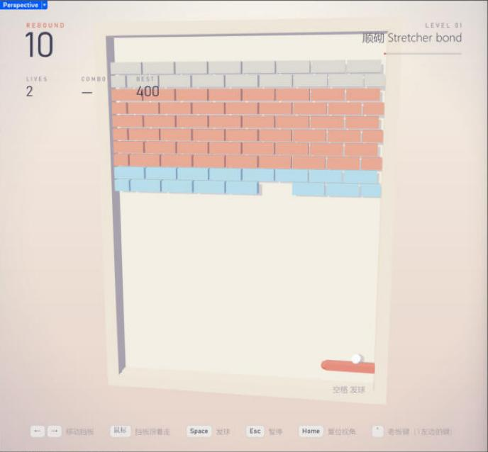
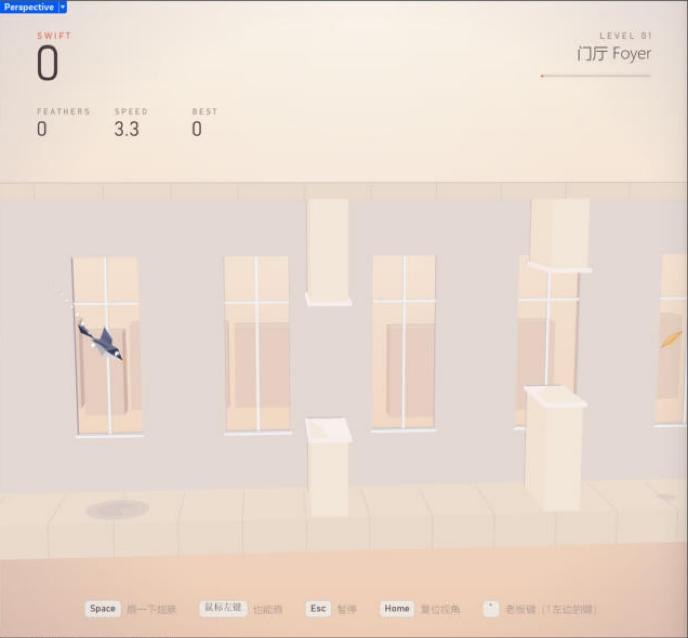
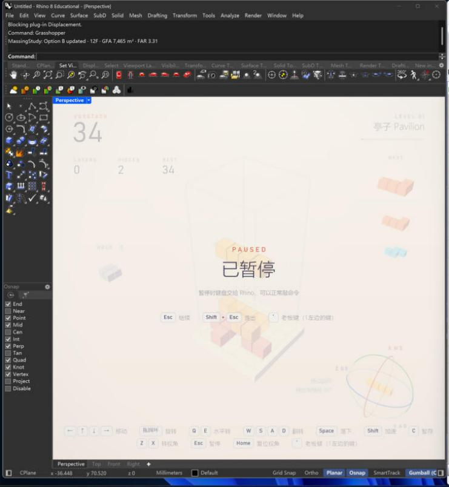
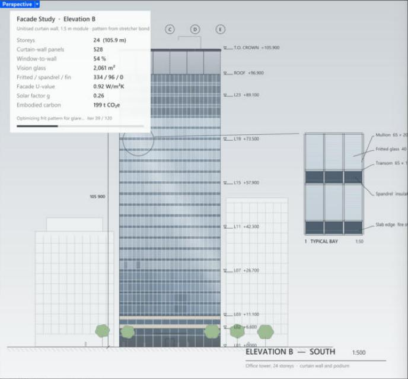

# Moyu 的 Mac 版：改了什么，GitHub 上验证了什么

2026-11-15，分支 `mac-support`。网页版报告（带图）是这份文档的主体，这里是 Markdown 源。

## 结论

- 整个插件（拓扑优化和四个游戏）改成了 Mac 也能用。拓扑优化本来就没有 Windows 专属写法；四个游戏按平台分开了九处实现，规则、画面、老板键伪装全部共用。
- GitHub 的 Mac（macos-latest，macOS 26.7，Apple 芯片）上四项检查全过：编译 Mac 版（plain `net7.0`）、468 项核心测试、39 项键盘检查（真实按键事件进 AppKit 监视器）、API 核对（插件用到的 257 个类型、1591 个方法、146 个字段，在官方 Rhino 8.36 for Mac 安装包的程序集里都存在）。
- Windows 没受影响：本机 Rhino 8.36 集成测试 71/71，Windows 版和 Mac 版两份编译都在 Windows Rhino 里跑过；四个游戏也用真实按键各玩了一局（见下面"Windows 实机回归"）。
- 没验证的：真 Rhino for Mac 里的画面和手感（要许可证，GitHub 上跑不了）。
- 没发布：没合进 main，没推 Yak，没更新 food4rhino。

## 每处平台相关的实现

| 功能 | Windows（不变） | Mac（新） |
|---|---|---|
| 游戏抢按键 | user32 线程键盘钩子 + 输入法处理 | AppKit 本地事件监视器，经 libobjc 直接调用（`src/Moyu/Platform/Mac`） |
| 帧计时器 | WinForms Timer | Eto UITimer |
| 键盘归不归游戏 | Win32 焦点窗口是 Rhino 主窗口 | 文档窗口（`RhinoEtoApp.MainWindowForDocument`）有焦点 |
| 切走时自动老板键 | 前台窗口属于 Rhino 进程 | `NSApp isActive` |
| 自动语言 | Windows 显示语言 | `NSLocale preferredLanguages` 第一个 |
| 字体 | Bahnschrift、Segoe UI、微软雅黑 | Avenir Next、Helvetica Neue、PingFang SC（家族名） |
| 最高分 | `%APPDATA%\Moyu\` | `~/Library/Application Support/Moyu/` |
| 天空背景边缘 | `ImageAttributes.SetWrapMode` | 跳过（Rhino for Mac 的 System.Drawing 没有这个方法） |
| 安装包 | `moyu-<v>-rh8_0-win.yak`（net48 + net7.0-windows） | `moyu-<v>-rh8_0-mac.yak`（plain net7.0） |

Mac 按键翻译成游戏原本认的 Windows 虚拟键（`Games/Common/Core/MacKeys.cs`）：字母按当前布局取，其他键按位置取；老板键是数字 1 左边的键（ANSI 的 `、ISO 的 §）；⌘ 当作 Windows 键，和 Ctrl、Alt 一样放行给 Rhino；修饰键自己的事件永远放行。

## GitHub 上的检查

`.github/workflows/mac.yml`，每次推送 `main`、`mac-support` 或开 PR 时运行：

1. `dotnet build src/Moyu -f net7.0`
2. `tests/Moyu.Core.Tests`：468 项，含 Mac 按键翻译
3. `tests/Moyu.MacTests`：加载 AppKit，用 CGEvent 造真实按键事件，经 `[NSApp sendEvent:]` 送进监视器；还查首选语言、三个字体家族、NSString 往返
4. 下载并挂载 `files.mcneel.com/rhino/8/mac/releases/rhino_8.36.26296.17002.dmg`（缓存），`tests/Moyu.MacCompat` 用 Mono.Cecil 把 Moyu.gha 引用的每个类型、方法、字段对照 .app 里的程序集解析；只在 Windows 上调用的成员列在 `tests/Moyu.MacCompat/windows-only.txt`
5. 上传 Mac 版 `Moyu.gha`（运行页面底部 Artifacts）

运行日志用接口读要管理员权限，所以 `.github/annotate.py` 把每步测试输出写成运行注释（公开可读）。

四次运行：第 1 次键盘检查失败（测试进程没加载 AppKit）；第 2 次 API 核对查出 `SetWrapMode` 在 Mac 上不存在；第 3、4 次全部通过（https://github.com/ChenmingHe0126/moyu/actions/runs/43736243960）。

顺带确认：Rhino 8.36 for Mac 跑在 .NET 10.0.8 上，自带 McNeel 的 System.Windows.Forms 7.0、System.Drawing.Common 7.0、Eto 2.11。

## Windows 实机回归

2026-11-15，本机 Rhino 8，`mac-support` 分支编出的 `net7.0-windows` 版（已安装的 1.0.1 包临时挪开，测完放回），用真实按键玩：

| 游戏 | 试过的 | 结果 |
|---|---|---|
| VoxStack 叠楼 | 移动、旋转、翻转、落下、暂存、老板键来回、Esc 暂停、Shift+Esc 退出 | 正常 |
| Serpentine 蜿蜒 | 左右转、C 切视角、老板键、结算画面、Esc 退出 | 正常 |
| Rebound 回弹 | 发球、按住左右移动挡板、打砖得分、老板键来回（倒计时）、暂停、退出 | 正常 |
| Swift 雨燕 | 空格和 ↑ 扇翅、老板键来回、结算画面 Enter 重开、组件上的 Stop | 正常 |

另外：切到别的程序（记事本）时自动切到老板键画面；最高分照常读写 `%APPDATA%\Moyu\`；Examples 组件能打开例子。

没有逐项试的：Ctrl / Alt 快捷键放行、中文输入法开着时的按键、鼠标转视角（这几处的 Windows 代码这次没改）。

## 朋友试用

1. 从运行页面底部下载 `moyu-mac-…`（要登录 GitHub），解压出 `Moyu.gha`。
2. Grasshopper › File › Special Folders › Components Folder，把 `Moyu.gha` 放进去，重启 Rhino。
3. Moyu 页签里的 Examples 组件，打开一个游戏例子，点 Run。
4. 试方向键、空格、Esc、老板键 `、⌘S；截一张游戏画面和一张老板键画面。

最要留意：按键是不是都进了游戏（Rhino 有没有先截走），字体和 Retina 屏上的文字大小，动画顺不顺。

## 需要决定的事

1. 先给朋友试。
2. 朋友试过后把 `mac-support` 合进 main。
3. 发 1.0.2：改版本号、重新生成手册 PDF（`packaging/guide/guide.html` 里还写着只支持 Windows）、`python tools/package.py` 打出两个 .yak、推 Yak、更新 food4rhino。
