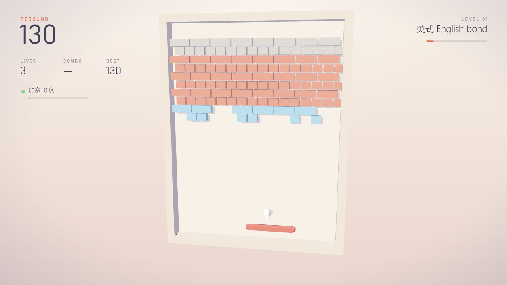
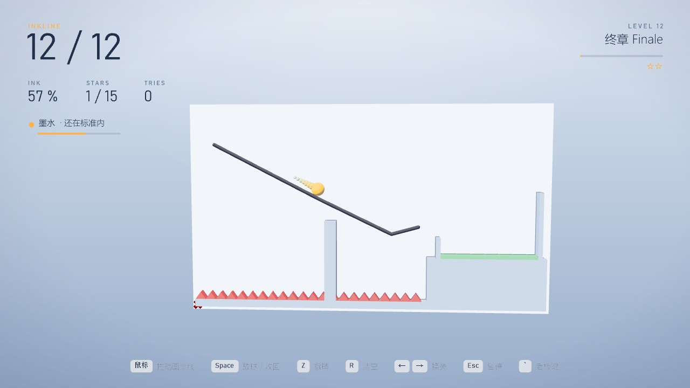
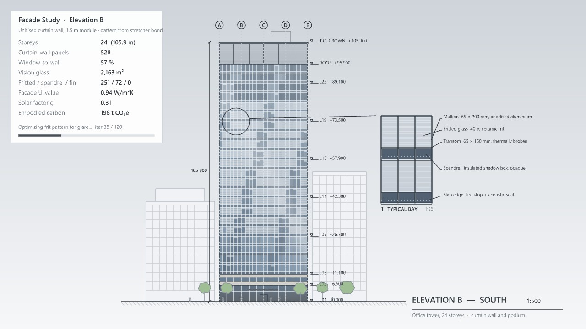
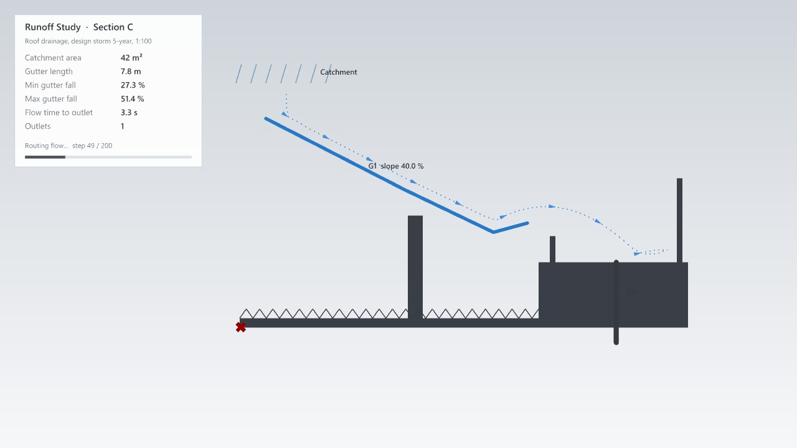
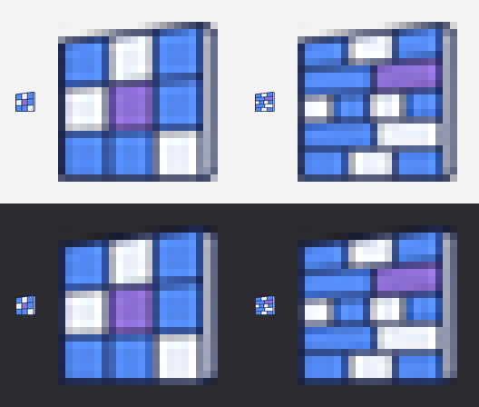
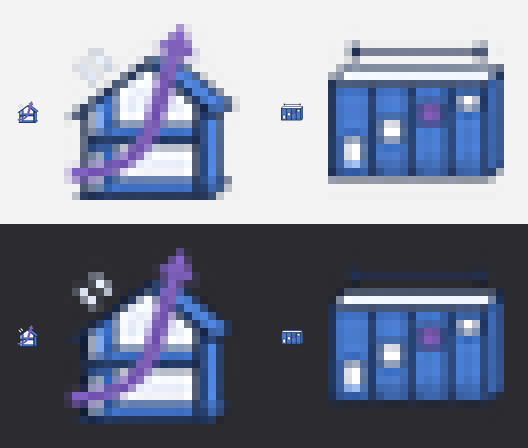

# Rebound + Inkline 交付报告

> **2026-11-03 更新**：Inkline 已按用户要求换成 [Swift 雨燕](swift-plan.md)；Rebound 的老板画面改成了塔楼玻璃幕墙立面（见 [rebound-plan.md](rebound-plan.md)）。本报告保留当时的内容作记录。

> 网页版报告的源文件（2026-11-03）。游戏画面是 Rhino 8 视口实拍。

## 一页结论

- **两个新面板**：`Facade`（Facade Study 游戏 + Brick Bond 砌法）、`Section`（Runoff Study 游戏 + Level Set 关卡）。打开 `tests/gh/MoyuBreakout-Test.gh` 或 `tests/gh/MoyuInkline-Test.gh` 点 Run。
- **Rebound 回弹**：打砖块；砖墙按真实砌法排，一关一种（顺砌、通缝、英式、荷兰式、花墙、拱）；玻璃 1 下、砖 2 下、混凝土 3 下、钢打不坏；7 种道具；经典 / 闪电 / 禅三种模式；方向键或鼠标控制挡板。
- **Inkline 墨线**：鼠标画墨线、空格放球，球滚进盆过关；12 关 4 章，每关有参考解且测试逐关跑通；可以用 Rhino 曲线自己组关卡。
- **老板键**：Rebound 变立面研究（打掉的砖变窗，窗墙比等指标实算），Inkline 变屋面排水剖面（墨线变天沟，坡度、汇流时间实算）。
- **图标**：本机 Codex 一次生成两张图表，24 px 预览可辨，`--icons` 23 个组件通过。
- **实测**：真实按键和鼠标测了两个游戏；发现并修好 Inkline 画线时按老板键回来卡在暂停的问题。
- **用时**：Claude 实际开发约 56 分钟；两个游戏从想法到能玩共 30 分钟。

## 1. Rebound

| 砌法 | 说明 |
|---|---|
| 顺砌 Stretcher | 上下错半块，第 1 关 |
| 通缝 Stack | 上下对缝，更多混凝土 |
| 英式 English | 一皮顺砖一皮丁砖 |
| 荷兰式 Flemish | 每皮里顺丁交替 |
| 花墙 Screen | 镂空，球能穿过洞 |
| 拱 Arch | 中间拱洞，拱圈是钢 |

| 材料 | 打几下 |
|---|---|
| 玻璃 | 1 下就碎，10 分 |
| 砖 | 2 下，第一下出裂纹，每下 10 分 |
| 混凝土 | 3 下，每下 15 分 |
| 钢 | 打不坏，只反弹 |

道具掉落占比（每碎一块砖 15% 机会掉道具）：加宽 20%、多球 16%、慢速 16%、粘板 14%、缩短 14%、穿透 12%、+1 命 8%。

挡板：打在边缘反弹 ±60°，中间竖直；球的竖直分量至少 0.28，不会水平来回。

老板模式：

## 2. Inkline

| 关 | 名字 | 墨水上限 | 标准 | 参考解用墨 |
|---|---|---|---|---|
| 1 | 第一笔 | 30 | 16 | 14.3 |
| 2 | 过桥 | 22 | 12 | 10.0 |
| 3 | 过墙 | 30 | 13 | 11.1 |
| 4 | 回头 | 30 | 16 | 14.9 |
| 5 | 弹板 | 30 | 16 | 12.5 |
| 6 | 尖刺 | 30 | 16 | 15.6 |
| 7 | 双星 | 30 | 13 | 11.1 |
| 8 | 省墨 | 7 | 5.5 | 6.0 |
| 9 | 漏斗 | 12 | 7 | 4.8 |
| 10 | 跳台 | 34 | 22 | 18.0 |
| 11 | 迷宫 | 40 | 34 | 31.6 |
| 12 | 终章 | 36 | 24 | 15.6 |

老板模式：

## 3. 图标

详见 [icon-prompts-facade.md](icon-prompts-facade.md)、[icon-prompts-section.md](icon-prompts-section.md)。

## 4. 测试与实测

- 核心单元测试 271 项全部通过：Rebound 53 项、Inkline 35 项、其余 183 项。
- 两个测试 GH 文件自检通过；`--icons` 23 个组件通过。
- Rebound 真实输入：挡板 x 依次 6.5 → 1.2（按住 ←）→ 8.3（按住 D）→ 发球、暂停、老板键往返 → 2.1、10.59（鼠标）。
- Inkline 真实输入：鼠标拖出第 1 关参考解（墨 14.15）→ Z → 再画 → 空格 → 3.5 秒过关 → 空格进第 2 关 → ← → → 画一笔再 R。
- 修好的问题：画线时按老板键再回来卡在暂停。原因是会话只把"球在滚"算作进行中；改成除了暂停都算。复测时 Rhino 拿不到前台，按键被安全检查跳过，所以复测是直接调同一个 EnterBoss / ExitBoss。
- 没有在真实游戏里专门玩到的：Rebound 的道具、过关换砌法、闪电和禅模式（单元测试覆盖）。

## 5. 开发用时

- 方案：4 张 Rhino 原型、两份方案、网页：8.4 分
- 共用基类：游戏鼠标钩子、平面上的方块：1.1 分
- Rebound 规则引擎 + 53 项测试：4.4 分
- Rebound Rhino 端、2 个组件、首次试玩：4.9 分
- Inkline 规则引擎、12 关参考解 + 35 项测试：7.2 分
- Inkline Rhino 端、2 个组件：3.5 分
- Codex 图标（并行：测试文件、README）：8.1 分
- 最终截图：1.9 分
- 真实按键实测、修老板键 bug、复测：6.1 分
- 文档、图标记录、计时、报告：10.0 分

合计约 56 分钟。明细见 [dev-time-stats.md](dev-time-stats.md)。

## 6. 需要你决定的

1. 提交并推送。
2. 玩过之后告诉我哪关太难或太简单。
3. Inkline 的 TRIES 现在只数失败次数，要不要改成每次放球都算。
