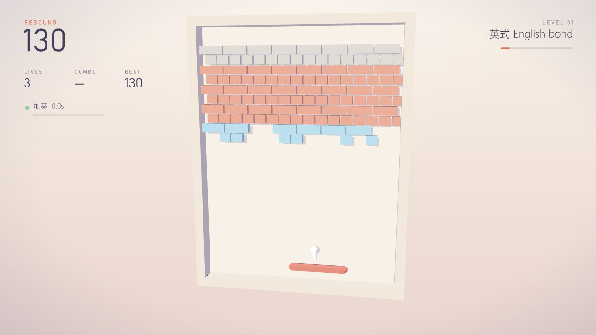
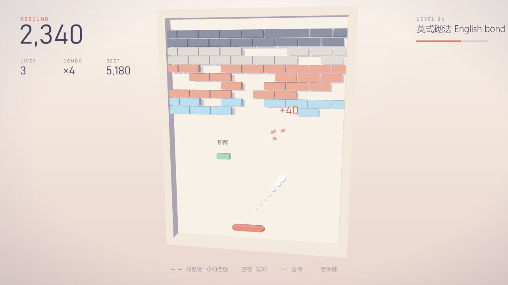
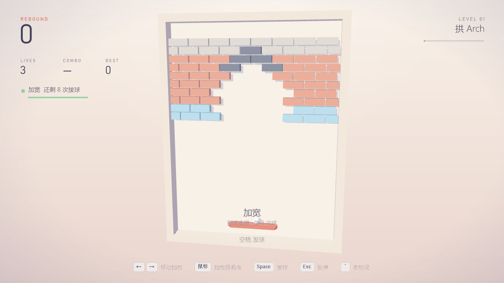
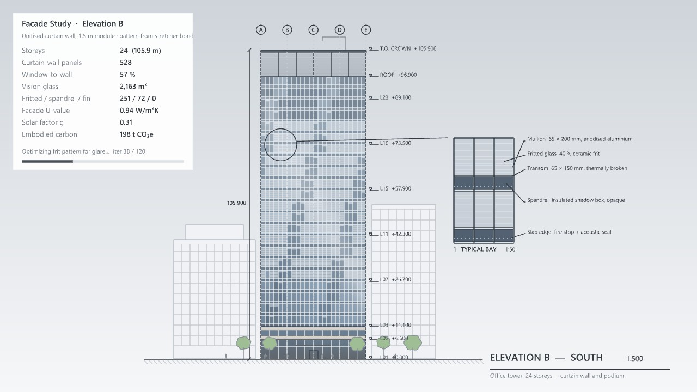
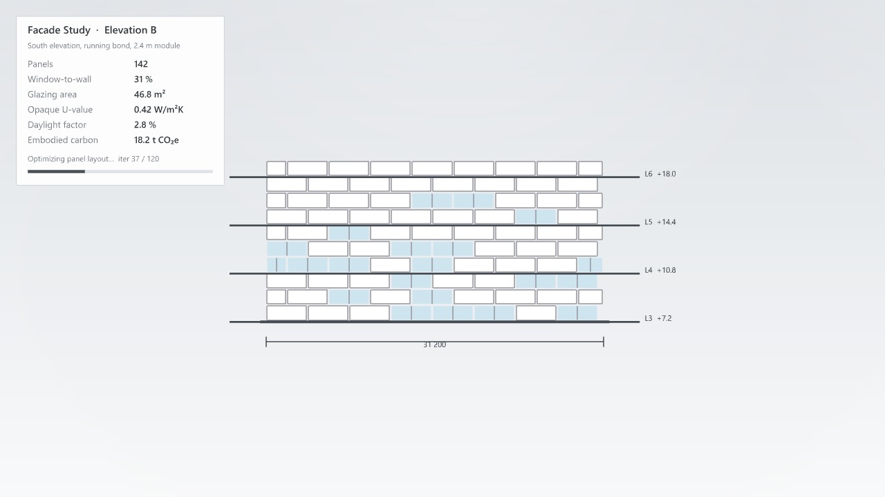

# Rebound 回弹 · 立面打砖块方案

> 网页版方案的源文件。两张截图是动工前在 Rhino 8 视口里用一次性 DisplayConduit 脚本画的原型，按 [visual-style.md](visual-style.md) 的极简风格。按 `docs/game-workflow.md` 的流程做。

## v1 状态（2026-11-03）

- 方案里的玩法、六种砌法、四种材料、道具、连击、三种模式、老板键立面研究、两个组件都已实现；规则引擎单元测试全部通过（砌法、每种材料的耐打次数、挡板反弹角、墙与陡角、命与发球、过关换砌法、连击、全部道具、快球不穿砖、闪电与回放、自定义墙、立面指标）。
- 测试文件 `tests/gh/MoyuBreakout-Test.gh` 自检通过（六种砌法 + 轮换 + 56 块自定义板块）。
- 和方案不同：立面研究的楼层从墙脚往上数（L2 起，首层 4.5 m）；鼠标悬停就接管挡板，按方向键再交回键盘。
- 真实按键实测（Rhino 8，SendInput，只在 Rhino 在前台时才发键）：按住 ← 0.45 秒挡板从 6.5 移到左墙 1.2，按住 D 移到 8.3；空格发球，1.2 秒后打中第一块砖；Esc 暂停、再按继续；`` ` `` 进老板模式、再按 3-2-1 回来；鼠标移到 x = 2.1 和 10.6，挡板跟到 2.10 和 10.59。全部正常。
- 图标由 Codex 生成（见 [icon-prompts-facade.md](icon-prompts-facade.md)）。

## 第三轮（2026-11-03 晚上）

- **Bug：砌法选"拱"（Type 5）时画面全空**。原因：画砖墙前算"墙有没有变"的签名用了 `Sum(b.Hits * 7 + 1)`，钢砖的 Hits 是 int.MaxValue，带溢出检查的 Sum 抛异常，整个 3D 画面这一帧都没画（HUD 还在）。拱的拱圈是钢砖，所以必现；第 4 关起墙里也会混进钢砖，同样会出。改成不检查溢出的哈希、钢砖算一个固定状态。在 Rhino 8 里重开拱砌法确认画面正常。
- **开局多给道具**：第一面墙碎砖 36 % 掉道具（第二面 24 %，之后 15 %）；开局头六个掉落正好是六种好道具各一个（顺序随机），之后才按概率；拿到时挡板上方写一行作用（"挡板变宽 · 接 8 次球"）。

## 老板画面改版（2026-11-03）

用户反馈原来的立面（砖块画成白色板块、打掉的变成窗）"不够真实，至少得像个 facade，比如高层的玻璃排布"。改成一栋 24 层办公塔楼的南立面：单元式玻璃幕墙（1.5 m 模数 × 24 列，22 个标准层，每层楼板处一条窗槛墙带），每块幕墙板取它背后的砖（打掉的 = 透明玻璃带百叶，玻璃砖 = 着色玻璃，砖 = 印釉玻璃，混凝土 = 不透明窗槛板，钢 = 铝板加翼片），玻璃有天空反射、云的高光、邻楼倒影和板间轻微色差；双层通高玻璃大堂、石材裙房层、百叶屋顶设备层；轴网 A–E、标高、总高尺寸、邻楼、行道树和人；右边一个 1:50 标准开间大样（竖框、横框、玻璃种类、窗槛墙、楼板边封堵）。指标卡：层数、幕墙板数、窗墙比、视野玻璃面积、印釉 / 不透明 / 铝板数、幕墙 U 值、太阳得热系数 g、隐含碳。代码：`Core/TowerFacade.cs`（映射和指标，有单元测试）、`FacadeDisguise.cs`（绘制）；旧的 `FacadeMetrics.cs` 和"打掉太少就画假窗"的逻辑删了——开局就是一栋完整的玻璃塔楼，打得越多透明玻璃越多。真实按键复测：空格发球、`` ` `` 进塔楼立面、再按 3-2-1 回到游戏，正常。

## 一页结论

- **玩法**：打砖块。砖墙就是一面建筑立面，砖按真实砌法排（顺砌、通缝、英式、荷兰式……），一关一种砌法。挡板接球，打掉所有能打的砖过关。
- **材料**：玻璃 1 下、砖 2 下（第一下出裂纹）、混凝土 3 下、钢不能打；越往后关卡越硬。
- **道具**：约 15% 的砖碎掉时掉道具——加宽、多球、慢速、粘板、穿透、加命；也有坏的（缩短）。2026-11-03 晚上按用户反馈改成**按次数失效**：加宽 8 次接球、慢速 6 次接球、缩短 5 次接球、粘板粘 3 次、穿透 6 块砖（原来是 12 / 10 / 10 / 14 / 6 秒）；粘板的掉落概率从 14 % 降到 7 %，空出来的分给加宽、多球、穿透和加命。HUD 左侧显示"还剩 N 次"。
- **操作**：← → 或 A / D 移动挡板，或者直接移动鼠标（挡板跟着鼠标走）；空格发球 / 松开粘住的球；Esc 暂停；鼠标拖动转视角。
- **老板键**：同一套（`` ` ``、失焦自动切、3-2-1 回来）。伪装成**立面研究 Facade Study**：剩下的砖画成立面板块，**打掉的砖变成窗**，配楼层线、标高、尺寸线；面板给出窗墙比（WWR）、玻璃面积、平均传热系数、采光系数、隐含碳，都按当前砖墙实算。
- **面板 `Facade`**：`Facade Study`（游戏本体，带 Run 按钮）和 `Brick Bond`（砌法图案：内置几种砌法，或者用 Rhino 里画的闭合曲线当砖）。
- **模式**：经典（逐关）/ 3 分钟闪电 / 禅（不掉命）。

## 1. 规则

| 项 | 规则 |
|---|---|
| 场地 | 13 × 17 单位（1 单位 = 立面上 2.4 m），左右上三面墙，下面是空的，球掉下去扣一条命 |
| 砖 | 顺砖 1.6 × 0.55，丁砖 0.8 × 0.55，灰缝 0.08；轴对齐矩形 |
| 球 | 半径 0.24；初速每秒 7.5 单位，每关 +0.45，最高 16；扫掠碰撞检测，快了也不穿砖 |
| 挡板 | 宽 2.4；打在挡板不同位置，反弹角在 ±60° 之间变化（经典手感）；球不会走成接近水平的死循环 |
| 计分 | 玻璃 10、砖每下 10、混凝土每下 15；连击：两次碰挡板之间连续打砖，倍率 ×1 → ×8；过关奖 500 × 关数 |
| 命 | 3 条；加命道具最多 5 条 |

## 2. 砌法即关卡

| 关 | 砌法 | 说明 |
|---|---|---|
| 1 | 顺砌 Stretcher bond | 全是顺砖，上下错半块；玻璃 + 砖 |
| 2 | 通缝 Stack bond | 上下对缝，整齐但更多混凝土 |
| 3 | 英式 English bond | 一皮顺砖、一皮丁砖交替 |
| 4 | 荷兰式 Flemish bond | 每皮里顺丁交替 |
| 5 | 花墙 Screen wall | 镂空砌法，留洞，球会穿过去 |
| 6 | 拱 Arch | 中间一个拱形开口，带几块钢砖 |
| 7+ | 以上循环，材料逐关变硬、球更快 |
| 自定义 | Brick Bond 接 Rhino 里画的闭合曲线（按包围盒当砖）或指定砌法 |

## 3. 老板键：立面研究（原方案，已被上面的塔楼幕墙方案取代）

- 打掉的砖 = 窗（浅蓝玻璃 + 竖梃），剩下的砖按材料画成立面板块；每 3 皮一条楼层线，右边标高，下边总宽尺寸线。
- 指标：面板数、窗墙比、玻璃面积、平均传热系数（按材料加权）、采光系数（按窗墙比估算）、隐含碳（按材料用量）。
- 命令行一行 `FacadeStudy: Elevation B updated · WWR … % · … panels`；组件显示 "Elevation B"。

## 4. 组件（Ribbon：`Moyu` › `Facade`）

| 组件 | 作用 |
|---|---|
| Facade Study | 游戏本体。输入：Wall（Brick Bond 的输出，不接就按内置关卡顺序）、Mode、Level、Plane、Size。输出：State、Score、Level、Best、Panels / Windows（立面板块和窗洞）、Metrics；没有游戏在跑时 Best 跟着当前输入变；运行失败显示为组件上的警告气泡（不写命令行）；被禁用的组件 Run 不起作用，Stop 照常；Internalise 的 Moyu 值无法还原，报 “X input holds an empty T; reconnect the component that made it (Moyu data cannot be internalised)”。丢球后下一次发球从本关基础速度开始，粘板接球后也出现“空格 发球”提示，结果行超过一小时显示 h:mm:ss |
| Brick Bond | 砌法：Type（−1 轮换，0 顺砌、1 通缝、2 英式、3 荷兰式、4 花墙、5 拱）或 Curves（自定义闭合曲线，缩放后窄于约 0.3 个场地单位的会被忽略并警告 “N panel(s) too small to play”；自定义墙一块能打的都没有时 Facade Study 改铺砌法序列；平面图在 Y 方向比 X 方向高时 u 取 X、v 取 Y），Courses（皮数）。从第 4 关起，会把一块能打的砖围死的钢砖改铺成混凝土，每面墙都能打光 |

## 5. 技术

- 规则引擎 `Games/Breakout/Core`：场地、砖、球（扫掠圆 vs 矩形）、挡板、道具、计分、砌法生成；单元测试覆盖碰撞、反弹角、多下砖、道具、过关、闪电、回放。
- 渲染、HUD、暂停 / 倒计时 / 结算、老板键、鼠标都走 `Games/Common` 的基类；会话基类加一个"鼠标悬停 / 拖动"钩子给挡板和划线游戏用，不影响已有两个游戏的鼠标转视角。

## 6. 拍板（先按推荐做）

1. 伪装：面板 Facade、立面研究，打掉的砖变窗（推荐）。
2. 鼠标控制挡板：默认开（推荐），键盘同时可用。
3. 视角：正面略偏右上的透视（推荐），鼠标拖动可转。
