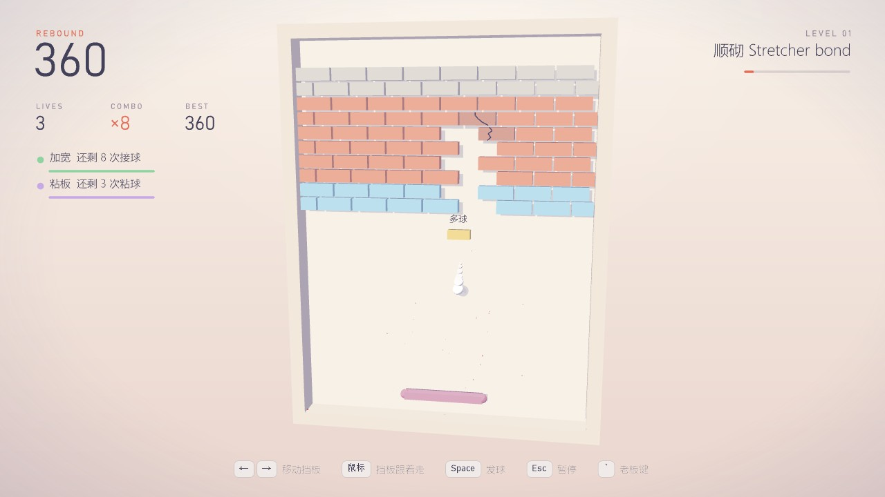
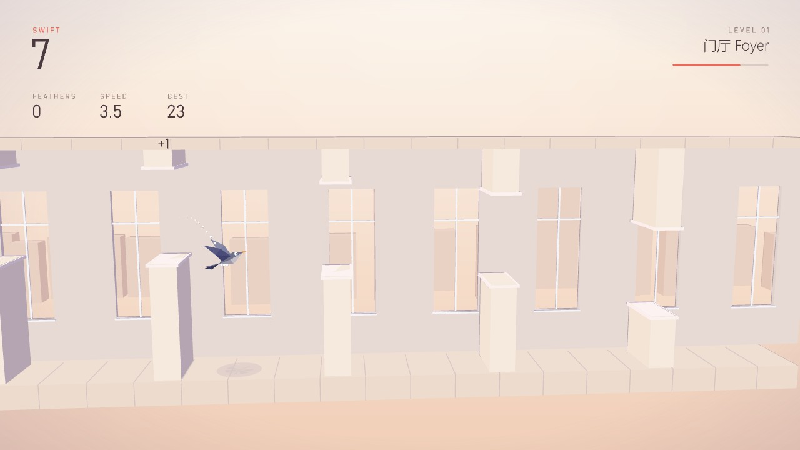
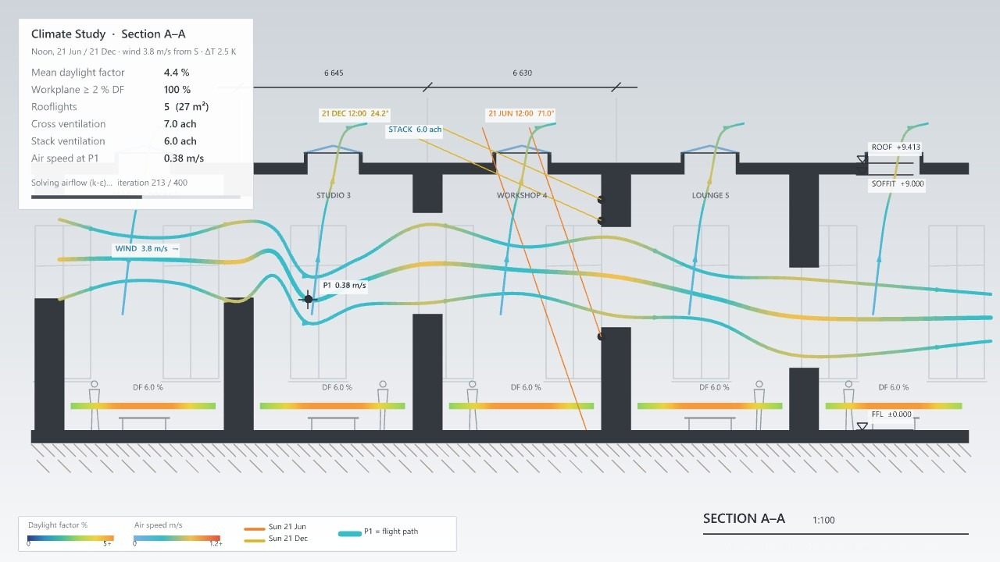

# 第二轮调整：好上手 + 道具按次数 + 老板剖面

> 网页版报告的源文件（2026-11-03）。

用户意见："swift 有点难，每个游戏起始关卡都设置简单好上手，后面逐渐变难（除了打砖块其他开局都有点难）；打砖块的粘板少一点或粘几次就失效，所有增益都改成打几次就失效；swift 的老板界面改得和游戏本身的截面像一点，硬切不突兀。"

## 开局难度

| 游戏 | 改动 |
|---|---|
| Swift | 开口 4.0 → 5.0 格（普通档），速度 5.2 → 4.4，相邻开口高低差从 ±1.6 慢慢放开（第 24 堵墙到 ±4.5），重力 30 → 27，扇翅 9.6 → 9.0，最快下落 15 → 13，滑动窗扇第 16 → 26 堵墙起 |
| VoxStack | 第 1 级 1.3 秒一格（原来 1.0），每级快 14 %（原来 18 %）；锁定缓冲第 1 级 0.9 秒，第 5 级起 0.5 秒；前两级只发扁平单元，第 3 级混进立体单元（一半概率），第 4 级全套 |
| Serpentine | 速度每秒 3.4 格起步（原来 5），每级 +0.55（原来 +0.6），最多 15；炸弹第 3 级起（原来第 2 级），每 3 级多一个 |
| Rebound | 不变 |

## Rebound 道具

| 道具 | 原来 | 现在 |
|---|---|---|
| 加宽 | 12 秒 | 8 次接球 |
| 慢速 | 10 秒 | 6 次接球 |
| 粘板 | 14 秒 | 3 次粘球 |
| 穿透 | 6 秒 | 6 块砖 |
| 缩短（坏） | 10 秒 | 5 次接球 |

多球、加命不变（一次性）；丢球时全部清零。掉落概率：粘板 14 % → 7 %，加宽 20 → 22 %、多球 16 → 18 %、穿透 12 → 13 %、加命 8 → 9 %、缩短 14 → 15 %。

## Swift 老板画面

老板画面就是游戏的剖面：横墙、开口、地板屋面、后墙高窗都在原位；每个开间一个天窗；主气流线是雨燕刚飞过的路线，雨燕位置是测点 P1；中间天窗画冬夏至正午日照；工作面采光色带。

## 验证

- 核心测试全部通过（新增：Swift 前 10 堵墙好过、VoxStack 前两级只发扁平单元和锁定缓冲、Serpentine 第 3 级前没有炸弹、Rebound 每种道具按次数失效和粘板概率、剖面与游戏逐一对应、主气流线穿过每个开口）。
- 自动驾驶在三档五个种子上照样飞满 150 秒。
- Rhino 8 里对照游戏 / 老板两帧截图；真实按键复测 Swift 起飞、扇翅、老板键往返（跳过 0 次）。
