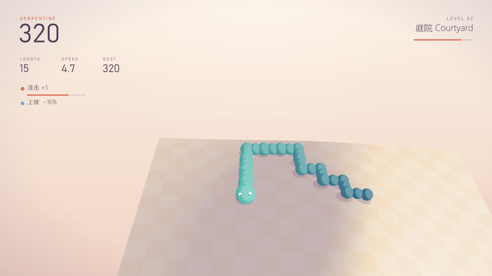
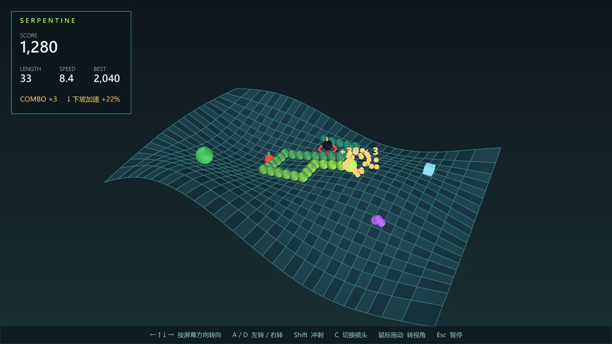
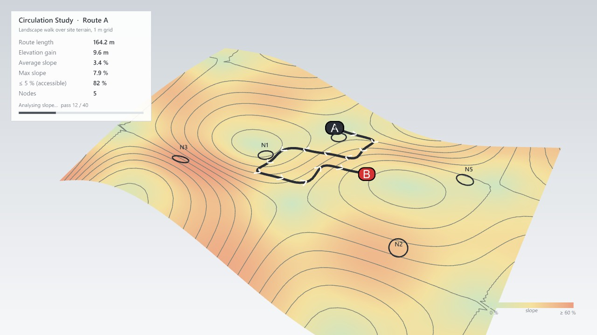

# Serpentine 蜿蜒 · 曲面贪吃蛇方案

> 网页版方案的源文件。两张截图是动工前在 Rhino 8 视口里用一次性 DisplayConduit 脚本画的原型。按 `docs/game-workflow.md` 的流程做。

## 两种视角、以蛇头为准的转向、景观设计老板画面（2026-11-03 晚上）

用户反馈："贪吃蛇的交互方式可以改成只有两种：一种就是第一人称视角锁定视角，第二种就是用户可以转动模型，但是蛇的转向只以自己为坐标原点来区分前后左右"；"Boss 界面显得不够工作，可以放一些树啥的，就像在设计景观，放一些比例人"。

- **转向**：← / A 左转、→ / D 右转，永远以蛇头自己为准（原来的"按屏幕方向转"去掉了）；↑ 或 Shift 按住冲刺。
- **第一人称**（默认）：镜头锁在蛇头后上方，蛇一转弯镜头约 0.2 秒内跟着转过去，前方永远是屏幕上方；鼠标不能转。**自由视角**（C 切换）：看整个场地，鼠标拖动转模型，转向照样以蛇头为准。HUD 左侧一行显示当前是哪种视角。
- **老板画面**：在坡度分析上画一张景观设计（`Core/LandscapePlan.cs` 布置，不依赖 Rhino、有测试）：铺装步道（约 1.3 m 宽，带边线和方向箭头）、每 7 格一张长椅、场地边缘林带 + 步道两侧行道树 + 空地孤植树（落叶 / 常绿两种，带投影，不种在步道两格以内和坡度 > 45 % 的地方）、步道和广场上的比例人、道具变成命名的小广场。指标卡加了树、长椅 · 广场、步道遮阴比例。
- **实测**：真实按键：← 让航向从 (1,0) 变成 (0,1)（左转），镜头 0.9 秒内跟着转到 (0,1)；→、D、A 都对；C 切到自由视角后按 ← 照样以蛇头左转、镜头不动；再按 C 回到第一人称；老板键往返正常；跳过 0 次。

## v1 状态（2026-11-02）

- 方案里的玩法、道具、坡度、操作、老板键、两个组件都已实现；规则引擎 86 项检查通过（`Moyu.Core.Tests` 全部 183 项也都通过），测试文件 `tests/gh/MoyuSnake-Test.gh` 自检通过（Site Surface 5 种曲面都能玩）。
- 和方案不同的地方：画面按用户要求整体换成极简风格（见 [visual-style.md](visual-style.md)），不再是原型里的深色 + 霓虹网格；开放场地立在底座上像场地模型；五个章节各一套配色。
- 跟随镜头加了"第三人称碰撞"：镜头不会钻到环面的另一边或山后面；闭合曲面上镜头更俯视。
- 真实按键实测过：Run 按钮、屏幕方向转向、A / D、老板键、失焦自动切、暂停、C 切镜头（Shift 冲刺和 Shift + Esc 走的是和 VoxStack 相同的基类代码）。
- 图标是临时的，给 Codex 的提示词在 [icon-prompts-landscape.md](icon-prompts-landscape.md)。

## 一页结论

- **玩法**：贪吃蛇在你给的曲面上走。蛇沿曲面的 UV 网格一格一格移动；曲面在某个方向闭合（圆柱、环面）就能绕过去，开放的边是墙，修剪掉的洞是障碍。吃到自己或撞墙结束。
- **道具**：苹果 +1 段、葡萄 +3、西瓜 +5（限时出现）；炸弹 −3 段（身体不够长就结束）；冰块减速 6 秒；幽灵 6 秒内可以穿过自己。连着吃有连击倍率。
- **地形会影响速度**：下坡加速、上坡减速，曲面形状本身就是关卡。可以关掉。
- **操作**：← / A、→ / D 以蛇头为准左转 / 右转；按住 ↑ / W / Shift 冲刺；C 切换镜头（第一人称 / 自由视角）；自由视角里鼠标拖动转模型。
- **老板键**：和 VoxStack 共用同一套机制（`` ` ``、失焦自动切、3-2-1 回来）。伪装成**流线研究 Circulation Study**：曲面画成坡度分析 + 等高线，蛇身变成一条平滑的步行路线（A → B，带方向箭头），道具变成节点 N1、N2……，面板给出路线长度、爬升、平均 / 最大坡度、无障碍坡度占比，都按蛇身实际算。
- **面板 `Landscape`**：`Path Study`（游戏本体，带 Run 按钮）和 `Site Surface`（一键生成几种场地曲面：起伏地形、环面、圆管、马鞍屋面、球面）。
- **技术**：把 VoxStack 里和游戏无关的会话管理（老板键、失焦、倒计时、暂停、键盘钩子、镜头保存与恢复、鼠标转视角、HUD 画法）抽成 `Games/Common` 的基类，两个游戏共用，以后的游戏也直接继承。规则引擎不依赖 Rhino，单元测试覆盖网格拓扑和规则。
- **模式**：经典（无尽）/ 3 分钟闪电 / 禅（不会死，没有炸弹）。

## 1. 曲面与网格

- 默认按曲面两个方向的实际长度切格子，格子在 3D 里接近正方形（输入 `Cells` = 长边格数，默认 28）。
- 闭合方向（`Surface.IsClosed`）首尾相连：圆柱绕一圈、环面上下左右都能穿。
- 开放边是墙；退化边（球的两极）也当墙。
- 细长的条带曲面（一个方向很长、另一个方向很窄）也能玩。
- 修剪过的面（Brep 面带洞）：格子中心落在修剪区域外就是障碍；至少有两个角点在修剪区外的格子算墙。按修剪后的范围划格（Cells 数的是修剪面的长边），小场地从大地形里切出来也有合适的格子尺寸。老板模式里的场地边界跟着格子走（封闭曲面上没有接缝线），环面 / 球背面的广场名称不显示。
- 每个格子的中心点、法向和高度在开局时算好交给规则引擎，引擎只认网格，不认 Rhino。

## 2. 操作

| 键 | 作用 |
|---|---|
| ← / A · → / D | 以蛇头为准左转 / 右转（不管镜头朝哪） |
| ↑ / W / Shift（按住） | 冲刺 ×1.8 |
| C | 切换镜头：第一人称（锁在蛇头后上方）/ 自由视角 |
| 鼠标左键或右键拖动 | 只在自由视角里转模型 |
| Esc / P | 暂停；暂停时 Esc 继续、Shift + Esc 退出。结束后 Enter / 空格再来一局 |
| `` ` ``（1 左边的键） | 老板键 |

- 转向会排队（最多 2 次），手快连按两下也不会丢；不能直接掉头。
- 跟随镜头：镜头在蛇头上方沿曲面法向，平滑跟着走。蛇绕到环面背面时镜头也跟过去。

## 3. 道具与计分

| 道具 | 效果 | 出现 |
|---|---|---|
| 苹果 | +1 段，10 分 | 场上始终有 2 个 |
| 葡萄 | +3 段，30 分 | 不时出现 |
| 西瓜 | +5 段，80 分 | 少见，8 秒后消失 |
| 炸弹 | −3 段，−50 分；不够长就结束 | 第 3 级起出现（原来第 2 级），12 秒后消失，最后 3 秒闪烁；不会刷在蛇头附近；同时清掉刚吃的水果还欠着的生长（切掉之后蛇不会再长回来） |
| 冰块 | 6 秒内速度 ×0.6 | 偶尔 |
| 幽灵 | 6 秒内能穿过自己（墙照样会撞） | 偶尔 |

- 4 秒内连着吃，连击倍率 +1（最高 ×5）。
- 每吃 5 个水果升一级，速度从每秒 3.4 格起步、每级 +0.55，最多 15 格（2026-11-03 晚上按用户反馈"起始关卡要简单好上手，后面逐渐变难"从 5 格起步改过来的）；炸弹从第 3 级才出现，数量每 3 级多一个。
- 坡度：每走一步按高差算坡度，下坡最多快 50%，上坡最多慢 40%。

## 4. 老板键

- 曲面换成坡度分析配色 + 等高线（白模底色），背景换浅灰。
- 蛇身平滑成一条步行路线，起点 A、终点 B，路线上有方向箭头；道具变成节点 N1、N2……
- 指标面板：路线长度、爬升、平均坡度、最大坡度、≤ 5% 坡度占比（无障碍）、节点数，按蛇身实际算，长度单位按文档单位换算成米。坡度最高报到 100 %。
- 命令行打一行 `CirculationStudy: Route A updated · L = … m · avg slope … %`，GH 组件显示 "Route A"。
- 蛇太短时换成一条按种子生成的蜿蜒假路线。

## 5. 组件（Ribbon：`Moyu` › `Landscape`）

| 组件 | 作用 |
|---|---|
| Path Study | 游戏本体。输入：Surface（不接就用内置起伏地形）、Cells、Mode、Level、Slope（坡度影响速度）。输出：State、Score、Length、Best、Route（蛇身曲线）、Metrics。组件下方 Run / Stop 按钮；没有游戏在跑时 Best 跟着当前输入变；运行失败显示为组件上的警告气泡（不写命令行）；被禁用的组件 Run 不起作用，Stop 照常；Internalise 的 Moyu 值无法还原，报 “X input holds an empty T; reconnect the component that made it (Moyu data cannot be internalised)” |
| Site Surface | 生成场地曲面：0 起伏地形、1 环面、2 圆管、3 马鞍屋面、4 球面；Size 控制尺寸 |

## 6. 技术架构

- `Games/Common/GameSession`：会话基类，管键盘钩子、帧时钟、老板键、失焦自动切、倒计时、暂停 / 重开 / 退出、镜头保存与恢复、鼠标转视角。游戏只实现规则相关的几个方法。
- `Games/Common/GameConduit`：绘制基类，管背景、只画自己的视口、HUD 文字、暂停 / 结束 / 倒计时画面。
- `Games/Common/GameScores`：本地最高分（每个游戏一个文件）。
- `Components/RunButtonAttributes`：组件下方的 Run / Stop 按钮，两个游戏共用。
- VoxStack 改为继承这些基类，行为不变；改完重新跑它的测试并实机过一遍。
- Serpentine：`Games/Snake/Core`（网格、规则、道具、路线指标，不依赖 Rhino）、`SnakeSession`、`SnakeConduit`、`CirculationDisguise`、`SurfaceGrid`（曲面 → 网格）。

## 7. 路线图

1. 抽公共基类，VoxStack 迁移并回归。
2. 规则引擎 + 单元测试。
3. Rhino 端：曲面网格、绘制、镜头、老板模式、两个组件。
4. 测试 GH 文件（默认地形 / Site Surface 各种形状 / 原生球面）。
5. 真实按键实测。
6. 临时图标 + 给 Codex 的图标提示词，README、文档、计时。

## 8. 拍板

你说了直接动手，下面都先按推荐做，想改随时说：

1. 伪装名：面板 `Landscape`、组件 Path Study / Site Surface、老板模式叫 Circulation Study（推荐）。
2. 转向以蛇头为准（← / A、→ / D）；原方案的"方向键按屏幕方向转"在 2026-11-03 按用户反馈去掉了。
3. 坡度影响速度默认开。
4. 默认镜头：第一人称跟随蛇头。
5. 游戏名 Serpentine 蜿蜒（占位）。
