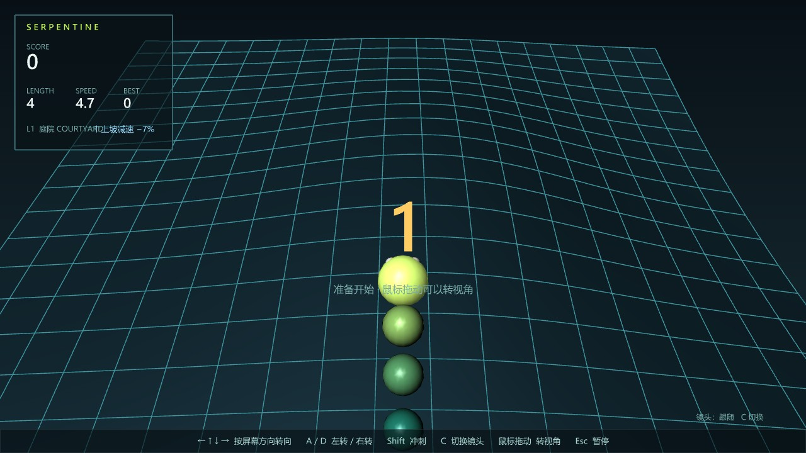
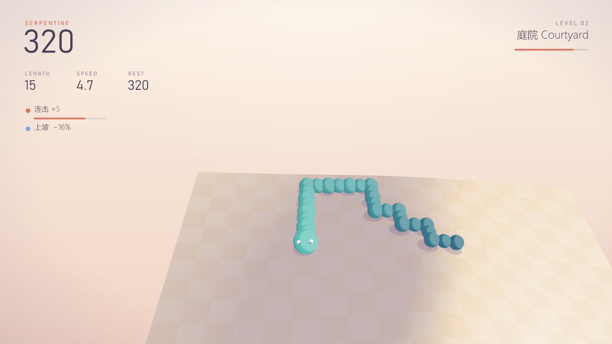
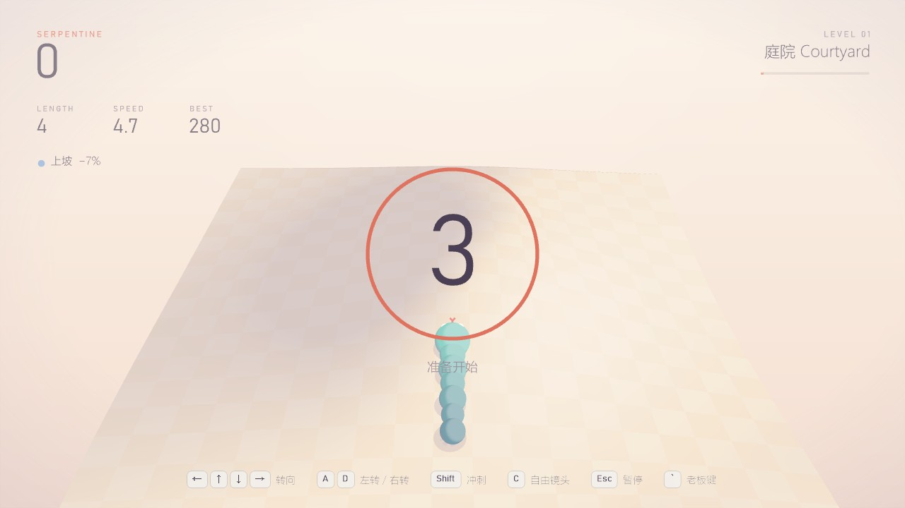
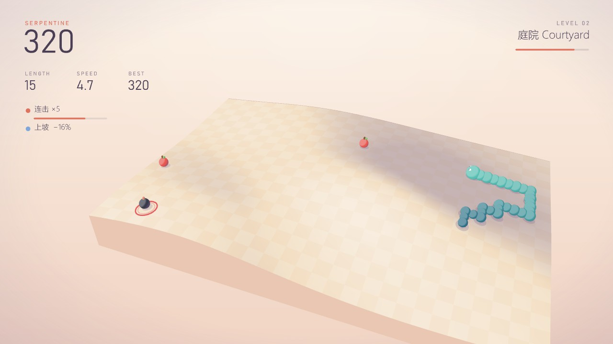
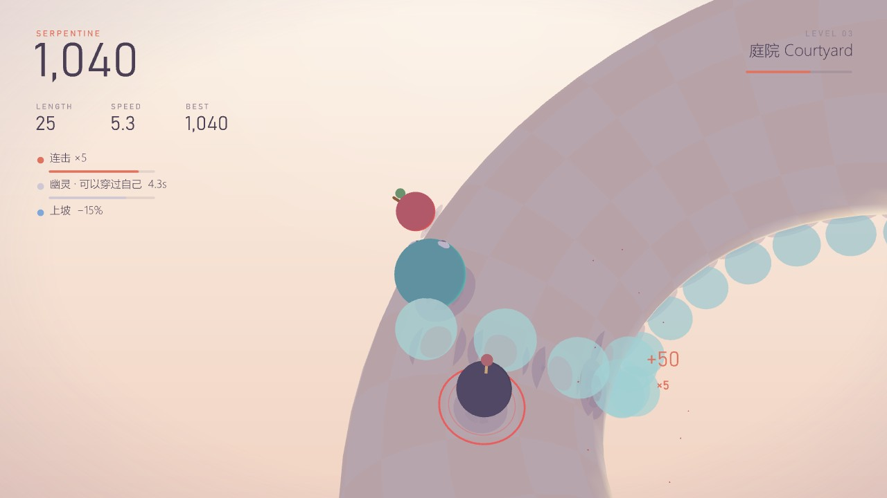
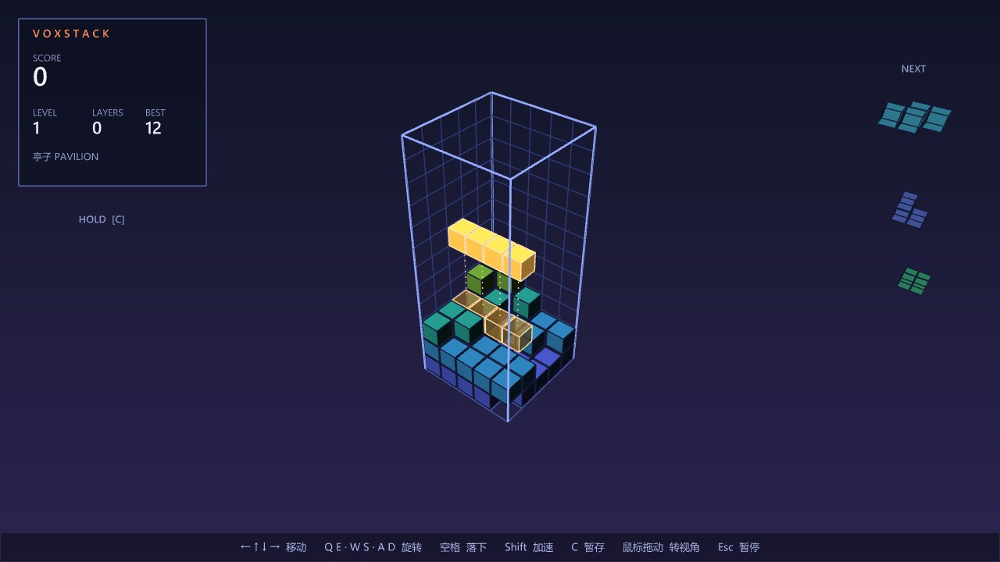
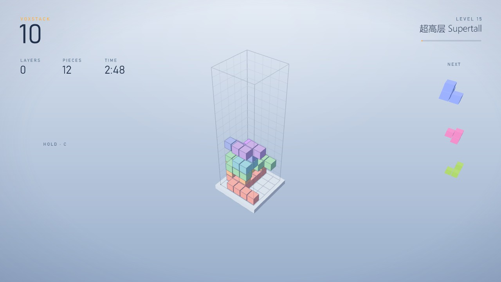
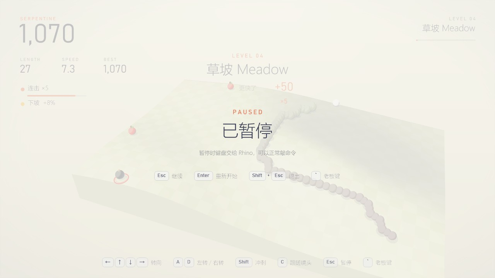
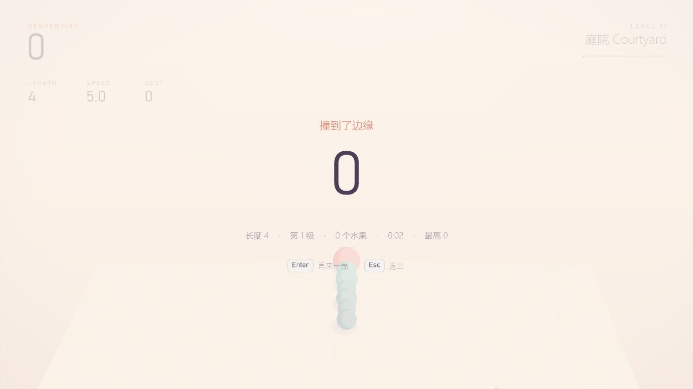
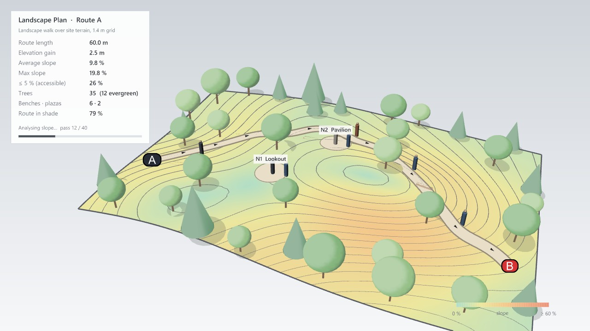

# Serpentine 蜿蜒 · 交付报告（含画面重做）

> 网页版报告的源文件。图片都是 Rhino 8 视口实拍。日期 2026-11-02。

## 一页结论

- **新游戏**：`Moyu` › `Landscape` 面板，Path Study（游戏本体，带 Run 按钮）+ Site Surface（一键生成 5 种场地曲面）。打开 `tests/gh/MoyuSnake-Test.gh` 点 Run 就能玩。
- **任意曲面**：闭合方向能绕过去（圆管、环面、球），开放边是墙，修剪掉的洞是障碍；下坡快上坡慢。
- **道具**：苹果 / 葡萄 / 西瓜加 1 / 3 / 5 段，炸弹掉 3 段，冰块减速、幽灵穿身，连吃有连击。
- **老板键**：和 VoxStack 同一套（`` ` ``、失焦自动切、3-2-1 回来），伪装成景观流线研究，指标按蛇身实算。
- **画面重做**：按你的意见，两个游戏共用一套纪念碑谷式极简风格——分章节配色、平涂着色 + 软投影、Bahnschrift 细体、键帽提示、浅色暂停 / 结算。说明见 [visual-style.md](visual-style.md)。
- **用时**：Claude 实际开发约 70 分钟，其中做到能玩 37 分钟，画面重做 19 分钟（明细见 [dev-time-stats.md](dev-time-stats.md)）。

## 1. 怎么玩

- 方向键按**屏幕方向**转向；A / D 相对蛇头左右转；按住 Shift 冲刺 ×1.8；C 切镜头（跟随 / 自由）；鼠标拖动转视角；Esc 暂停。
- 按键提示是键帽样式，开始玩 7 秒后淡出，暂停时再出现。
- 左上：分数 + 长度 / 速度 / 最高分；右上：关卡和到下一级的细进度线；左侧状态行：连击、冰冻、幽灵、冲刺、上下坡，每行下面一条随时间缩短的细线。
- 每吃 5 个水果升一级（每秒 5 格加到 15 格）；五章（庭院、草坡、丘陵、峡谷、山脊）各一套配色，升级时有章节卡片。

## 2. 曲面就是关卡

| Site Surface 类型 | 网格（测试文件自检） |
|---|---|
| 0 起伏地形 | 28 × 19，开放 |
| 1 环面 | 28 × 13，两个方向都相通 |
| 2 S 形圆管 | 28 × 12，绕一圈相通 |
| 3 马鞍屋面 | 28 × 28，开放 |
| 4 球面 | 28 × 17，绕一圈，两极当墙 |

- 跟随镜头沿曲面法向，绕到环面背面也跟着；镜头有"碰撞"，不会钻到环面另一边或山后面。
- 坑：环面内圈空间有限，镜头只能贴得比较近。

## 3. 画面重做（两个游戏）

- 不用 Rhino 光照：固定"上午的太阳"，朝光面提亮，背光面沉到本章阴影色（偏蓝紫）。方块一面一个色调，球体三档。
- 软投影：物体下方两三层半透明圆片。
- 文字：Bahnschrift Light 写数字，小标签字距拉开；中文微软雅黑 UI Light；没有方框面板。
- 倒计时是细圆环，暂停和结算是浅色蒙版 + 键帽：

## 4. 老板键：流线研究

坡度分析 + 等高线，蛇身平滑成 A → B 的步行路线，道具变成节点；指标按蛇身实算，单位换算成米。老板模式刻意保持 Rhino 分析图的样子。

## 5. 测试与验证

| 检查 | 结果 |
|---|---|
| Serpentine 规则单元测试 | 86 项通过 |
| 其余核心测试（拓扑优化、VoxStack） | 97 项通过 |
| 测试 GH 文件自检（含 5 种曲面） | 18 项通过 |
| 图标检查（19 个组件 + 页签） | 21 项通过 |
| Release 编译（3 个目标框架） | 0 警告 0 错误 |

- 真实输入（系统级按键）：屏幕方向转向、A 相对转向、老板键开 / 关、Rhino 失焦自动切老板模式。
- 真实点击 / 按键（computer-use）：Run 按钮、`` ` `` 退出老板模式并 3-2-1、方向键、Esc 暂停、C 切镜头。
- 自动驾驶脚本在地形、环面上各玩了一段（吃水果、连击、升级换章节、炸弹、幽灵）；VoxStack 新画面用自动落块跑了一局。
- 没实测：Shift 冲刺、Shift + Esc 退出（测试中途 Rhino 失去前台，被安全检查跳过；它们走和 VoxStack 同一份基类代码）。

## 6. 需要你决定的

1. **正式图标**：提示词在 [icon-prompts-landscape.md](icon-prompts-landscape.md)，Codex 生成后我来切图接入。
2. **配色**：哪一章想换颜色，告诉我章节名。
3. **环面内圈的镜头**：现在贴得较近，可以改成在内圈时自动切到俯视全景。
