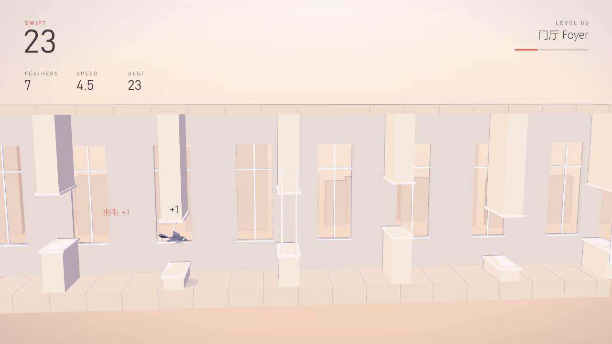
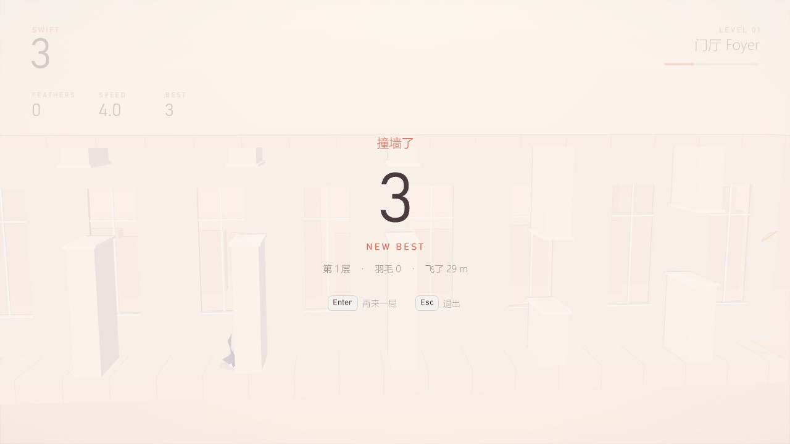
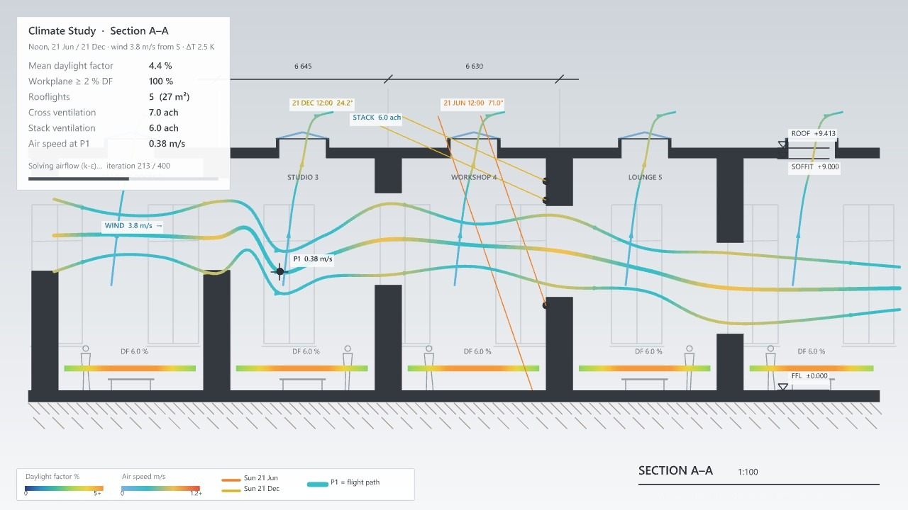

# Swift 雨燕 — 方案与 v1 状态

`Moyu` › `Section` 面板。2026-11-03 用户要求把划线闯关（Inkline）换成"一只小鸟按空格上下飞、躲障碍"的游戏，并把老板画面改成住宅剖面的采光 + 通风分析。Inkline 的代码、组件、测试文件和图标都已删除（还在 git 历史里）。

## 玩法

- 一只雨燕在一条无尽的**建筑剖面**里飞：脚下是地板，头顶是顶板，背后是带一排高窗的内墙，迎面一道道横墙，每堵墙上开一个门洞或窗洞（有窗台和过梁）。
- **空格 / ↑ / W / 鼠标左键**扇一下翅膀，往上蹿；不按就往下掉（重力）。碰到墙或落地就结束，顶板只会挡住不会死。
- 每穿过一堵墙得 1 分，墙之间有羽毛可以捡；每 10 分升一层，每 3 层换一章配色（和其他游戏一样）：门厅 Foyer → 回廊 Cloister → 中庭 Atrium → 天井 Lightwell → 黄昏 Dusk。
- 越往后开口越小、速度越快；从第 16 堵墙起（普通风压）一部分开口是**上下滑动的窗扇**。
- 模式：经典（一碰就结束）和 Zen（撞墙穿过去、落地弹起来，只记"碰撞次数"）。
- 难度用"风压等级"伪装：Sheltered 避风 / Normal 普通 / Exposed 迎风。

这不是任何现成游戏的复刻：没有水管、没有黄色小鸟，障碍是带门窗洞口的建筑横墙，画面是剖面模型。

## 数值

| 项 | 避风 | 普通 | 迎风 |
|---|---|---|---|
| 起始速度（格/秒） | 3.9 | 4.4 | 5.2 |
| 速度上限 | +2.0（每墙 +0.04） | 同 | 同 |
| 起始开口高度（格，场地高 12） | 5.6 | 5.0 | 4.2 |
| 开口最小 | 每墙 −0.03，最多 −1.4，再乘 Opening 系数，且不小于 2.8 | 同 | 同 |
| 起始墙距 | 9.6 | 9.0 | 8.4 |
| 相邻开口高低差 | 第 1 堵 ±1.6，每墙 +0.12，第 24 堵起 ±4.5 | 同 | 同 |
| 滑动窗扇从第几堵墙 | 41 | 26 | 16 |

- 物理：重力 27 格/s²，扇一下把上升速度设为 9.0 格/s（一次约升 1.5 格），最大下落 13 格/s，鸟的碰撞半径 0.38。
- **开局要好上手**（2026-11-03 晚上按用户反馈"有点难"改）：前几堵墙开口高（普通档 5.0 格，原来 4.0）、都在中间附近（高低差从 ±1.6 慢慢放开）、速度慢（4.4，原来 5.2）、手感更飘（重力 27、最快下落 13）；滑动窗扇推迟到第 26 堵墙。之后照样逐渐变难。测试里"前 10 堵墙开口 ≥ 4.7 格、高低差 ≤ 2.8、没有窗扇"。
- **公平性**：相邻两个开口中心差不超过 4.5 格（滑动窗扇的行程也算进去）；两堵墙之间至少 0.95 秒的飞行时间（速度变快时墙距跟着拉开），保证从高开口俯冲到低开口来得及；滑动窗扇的开口高 0.5 格、周期 4 秒。
- 规则 240 Hz 固定步长，同一种子同一串按键结果相同，帧率不影响。

## 组件

| 组件 | 作用 |
|---|---|
| **Airflow Study**（Run 按钮） | 游戏本体。输入 Grid（来自 Storey Grid）、Plane（默认 World XZ）、Size（默认 0.75 m/格，场地 9 m 高 = 两层住宅）。输出状态、分数、最高分、飞行路径曲线、剖面切线轮廓、采光通风指标；没有游戏在跑时 Best 跟着当前输入变；运行失败显示为组件上的警告气泡（不写命令行）；被禁用的组件 Run 不起作用，Stop 照常；Internalise 的 Moyu 值无法还原，报 “X input holds an empty T; reconnect the component that made it (Moyu data cannot be internalised)”。老板键的剖面按 0.1–5 m 每场地单位夹住比例，所以 Size 取极端值时画出来的是夹住后的比例；撞墙后 1.2 秒坠落期间 Esc 和老板键不起作用，雨燕落地后才出结算画面 |
| **Storey Grid** | 设置：Exposure 0–2、Mode 0/1、Opening 开口系数 0.8–1.4、Bay 开间系数 0.8–1.5、Seed（0 = 每次随机）；Opening / Bay 收到 NaN 时按 1 处理并提示。输出给 Airflow Study 的设置，以及前几堵墙的剖面预览 |

## 老板键：游戏同一个剖面的采光 + 通风分析

第一版是一栋独立的两层住宅剖面，用户反馈"硬切过去太突兀，最好和游戏本身的截面像一点"。现在老板画面**就是游戏里那个剖面**，换成建筑师的画法：

- 地板、屋面板和每堵横墙按游戏里的位置剖切涂黑（poché），开口在原来的高度（滑动窗扇按按键那一刻的位置）；后墙的高窗按游戏里的节奏画在剖切线后面；镜头几乎和游戏同一个位置（正对剖面、稍微拉远），所以按老板键只像是"换了一种画法"。
- 读成一条长廊式展廊：每个够宽的开间在屋面上开一个天窗（带反坎和采光罩），开间名 GALLERY / READING ROOM / STUDIO……，人和长椅当比例尺。
- **采光**：中间那个天窗画冬至 / 夏至正午的太阳（按通用的 40° N 算，26.6° / 73.4°）：夏天几乎垂直落在天窗下，冬天斜着打到下一堵横墙上；工作面（+0.85 m）一条采光系数色带，天窗下最亮（约 6 %），墙边约 3 %。
- **通风**：主气流线就是雨燕刚才的飞行路线（按约三分之一个开间做平均，抹掉扇翅的起伏），往前按还没飞到的开口接下去；上下各一条跟着它、在每个开口处收窄；每个天窗一条热压通风线。雨燕所在位置画成测点 P1，标出那里的风速。穿堂风按开口串联算（1/A² = Σ1/Aᵢ²），热压按天窗通风面积和展廊高度算。
- 指标卡：平均采光系数、工作面 ≥ 2 % 的比例、天窗数量和面积、穿堂风 / 热压换气次数、P1 风速；底部一条图例，右下图名 SECTION A–A 1:100。

## Rebound 老板画面改版（同一次修改）

用户反馈打砖块的立面"不够真实"。改成一栋 24 层办公塔楼的南立面（单元式玻璃幕墙）：

- 22 个标准层 × 24 列 1.5 m 模数的幕墙板，每层楼板处一条深色窗槛墙带；每块板取它背后那块砖：**打掉的砖 = 透明玻璃（后面有百叶）**、玻璃砖 = 着色玻璃、砖 = 印釉玻璃、混凝土 = 不透明窗槛板、钢 = 铝板 + 竖向翼片，所以砌法就是幕墙的图案；
- 玻璃有天空反射渐变、一道斜向云的高光、低处映出隔壁楼、每块板轻微色差；
- 双层通高玻璃大堂 + 石材裙房层（带条窗）+ 百叶屋顶设备层；入口雨棚、行道树、人；
- 轴网圆圈 A–E、右侧标高、左侧总高尺寸、左右邻楼、图名 1:500；右边一个 1:50 的"标准开间"大样，引线标出竖框、横框、玻璃种类、窗槛墙和楼板边防火封堵；
- 指标卡：层数、幕墙板数、窗墙比、视野玻璃面积、印釉 / 不透明 / 铝板数量、幕墙 U 值、太阳得热系数 g、隐含碳。

## v1 状态（2026-11-03）

- 规则 `src/Moyu/Games/Swift/Core/`（不依赖 Rhino）：`SwiftGame`、`SectionModel`；Rhino 端 `SwiftSession`、`SwiftConduit`、`SectionDisguise`、`FlightSpec`；组件 `Components/Section/AirflowStudyComponent`、`StoreyGridComponent`。
- Rebound：新增 `Breakout/Core/TowerFacade.cs`，重写 `FacadeDisguise.cs`，删除旧的 `FacadeMetrics.cs`。
- 核心测试 `tests/Moyu.Core.Tests/TestsSwift.cs`：飞行物理、撞墙 / 落地、开口可达与间隔、**自动驾驶在三种风压、五个种子下都飞满 150 秒**（105 / 121 / 129 堵墙）、Zen、暂停、回放、剖面几何、太阳角度、遮阳、采光衰减、换气次数随风速和开口变化；Rebound 的塔楼映射测试替换了旧的立面测试。全部通过。
- 测试文件 `tests/gh/MoyuSwift-Test.gh`（`--write-gh-swift` 生成并自检通过）；`MoyuBreakout-Test.gh` 重新生成并自检通过。
- 图标由 Codex 生成（见 [icon-prompts-section.md](icon-prompts-section.md)）。
- 真实按键实测（Rhino 8，Windows SendInput 发真按键和鼠标，只在 Rhino 在前台时才发，跳过 0 次）：倒计时后等待起飞；空格起飞，6 秒里按了 11 次空格过了 3 堵墙；↑、W、鼠标左键各扇一次（点鼠标镜头不动）；Esc 暂停并保持、再按继续；`` ` `` 进老板模式（游戏暂停，此时按空格无效）、再按 3-2-1 回来；不再按键，鸟落地，出结算画面；Enter 重开倒计时；Esc 暂停。全部正常。Rebound 的老板键也用真按键复测过。
- 实机截图：游戏 `images/swift_game.jpg`（第 23 堵墙，能看到滑动窗扇和羽毛）、结算 `images/swift_result.jpg`、老板画面 `images/swift_boss.jpg`；Rebound 塔楼 `images/rebound_boss.jpg`。
- 实测中改过的：第一版镜头太高太近（顶板压住分数）、鸟太小、远处天际线像杂物 → 镜头放低拉远、鸟放大 35%、加了一面带高窗的内墙（随场景滚动，读起来是在楼里飞）；塔楼第一版各种板颜色差太大、百叶高低不齐，像柱状图 → 统一成一层玻璃、图案减弱、百叶齐平，设备层百叶看得见；剖面老板画面拉近、冬至光线标签不再被指标卡挡住、采光色带加粗。

## 第二轮修改（2026-11-03 晚上）

- 开局变简单（见上面"数值"），老板画面改成游戏同一个剖面（见上面"老板键"）。核心测试改写：剖面里的横墙和开口与游戏逐一对应、主气流线穿过每个开口、经过测点 P1、太阳只画一个天窗、采光在天窗下最亮、换气随风速和开口变化。
