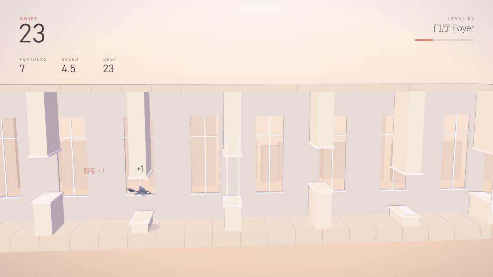
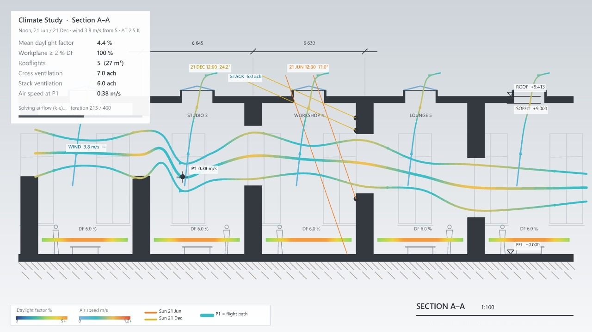
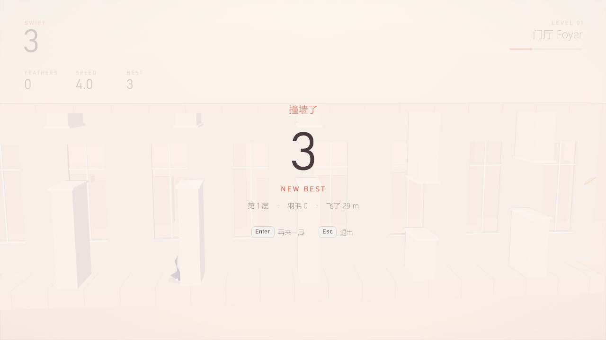
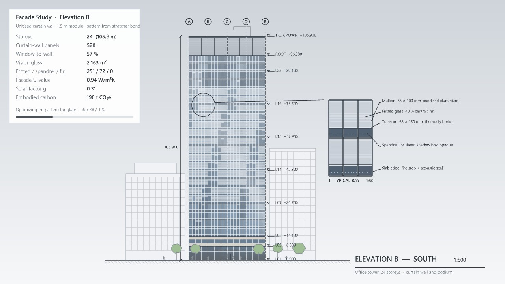
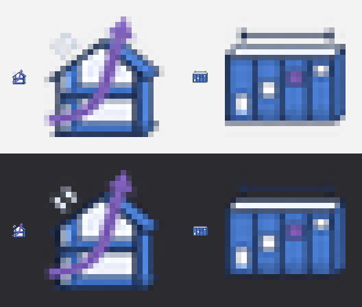

# Swift + 塔楼立面 交付报告

> 网页版报告的源文件（2026-11-03）。画面是 Rhino 8 视口实拍。

用户的三条意见：划线闯关换成"小鸟按空格上下飞、躲障碍"；它的老板画面改成住宅剖面的光照 / 通风分析；打砖块的老板画面要像真的立面，比如高层玻璃幕墙。

## 一页结论

- `Section` 面板换成 **Swift 雨燕**：Airflow Study（游戏，带 Run）+ Storey Grid（设置）。Inkline 已删除（在 git 历史里）。
- 玩法：空格 / ↑ / W / 鼠标左键扇一下翅膀，穿过横墙上的门窗洞口；越往后开口越小、越快，有滑动窗扇和羽毛；经典和 Zen。
- Swift 老板键：1:50 住宅剖面，冬夏至日照被挑檐挡 / 照进来、工作面采光系数、穿堂风和热压通风流线，数字由游戏状态算。
- Rebound 老板键：24 层办公楼南立面，单元式玻璃幕墙，砌法就是幕墙图案，打掉的砖变透明玻璃；轴网、标高、邻楼、1:50 大样。
- 公平：自动驾驶在三种风压 × 五个种子上都飞满 150 秒（105 / 121 / 129 堵墙）；第一版迎风档会被滑动窗扇卡死，已改。
- 真实按键实测全部正常；Codex 图标一次合格；核心测试 283 项、两个测试 GH 文件、`--icons` 全部通过。
- Claude 实际开发约 53 分钟（做到能玩 29 分）。还没提交。

## 1. Swift 玩法

扇一下翅膀把上升速度设成 9.6（场地高 12），重力 30，0.32 秒升到最高 1.52 格。规则 240 Hz 固定步长。五章配色：门厅、回廊、中庭、天井、黄昏（每 3 层一章，每 10 堵墙一层）。障碍是带窗台和过梁的建筑横墙，鸟是折纸风格的雨燕，不是任何现成游戏的复刻。

## 2. 难度与公平

| 风压 | 起始开口 | 起始速度 | 两墙最短时间 | 自动驾驶 150 秒 |
|---|---|---|---|---|
| Sheltered 避风 | 4.6 | 4.6 | ≥ 0.95 s | 105 堵，5 个种子全过 |
| Normal 普通 | 4.0 | 5.2 | ≥ 0.95 s | 121 堵，5 个种子全过 |
| Exposed 迎风 | 3.5 | 6.0 | ≥ 0.95 s | 129 堵，5 个种子全过 |

第一次跑迎风档在第 24–66 堵墙被滑动窗扇卡死：窗扇开口加高 0.5 格、周期放慢到 4 秒；又加了"两堵墙之间至少 0.95 秒"，保证从高开口俯冲到低开口来得及。

## 3. Swift 老板键：住宅剖面

- 南在左：剖到的墙、楼板、坡屋顶、挑檐、雨棚、条基涂黑；中间开间楼梯 + 通高中庭 + 屋脊天窗；人、家具、树。
- 日照：按通用的 40° N 算，冬至 26.6°、夏至 73.4°；夏天被挑檐和雨棚挡住，冬天斜着照进房间深处。
- 通风：穿堂风 Q = Cd·A·U·√ΔCp，开口串联 1/A² = Σ1/Aᵢ²；热压 Q = Cd·A·√(2gHΔT/T)。一楼两个格栅 2.5 ach，一门一格栅 3.3 ach，两扇门 6.3 ach（风速 4 m/s）；热压 4.3 ach 与风无关。
- 游戏 → 剖面：前方墙距 → 开间宽度；开口高低 → 门在一楼还是二楼；开口大小 → 格栅高度；游戏速度 → 风速。

## 4. Rebound 老板键：塔楼玻璃幕墙

| 砖 | 幕墙板 |
|---|---|
| 打掉的 | 透明玻璃（后面有百叶） |
| 玻璃砖 | 着色玻璃 |
| 砖 | 印釉玻璃 |
| 混凝土 | 不透明窗槛板 |
| 钢 | 铝板 + 竖向翼片 |

窗墙比随打掉的砖从 46 % 升到 64 %，g 值从 0.30 到 0.42。

## 5. 图标

## 6. 测试与实测

- 核心测试 283 项全过（Swift 45 项、塔楼 5 项）；`MoyuSwift-Test.gh`、`MoyuBreakout-Test.gh` 自检通过；`--icons` 23 个组件通过；构建 0 警告。
- 真实按键（SendInput，只在 Rhino 在前台时发，跳过 0 次）：Swift 的空格 / ↑ / W / 左键、Esc、老板键往返、结算、Enter 重开；Rebound 的发球和老板键往返。
- 没重测：失焦自动切、中文输入法（共用基类没改）；后几章配色没实际飞到。

## 7. 用时

| 阶段 | 分钟 |
|---|---|
| 读代码、定设计（含挂自动续跑） | 3.8 |
| Swift 规则 + 剖面模型 + 塔楼模型 | 8.7 |
| 核心测试，自动驾驶找出两处不公平并修好 | 5.3 |
| Rhino 端：画面、两个老板画面、2 个组件、测试文件 | 11.4 |
| Rhino 里看画面并改（镜头、内墙、塔楼玻璃） | 5.6 |
| 真实按键实测（Swift + Rebound） | 2.0 |
| 文档、截图、计时、报告 | 16.5 |
| 合计 | 53.3 |

## 8. 需要你决定的

1. 提交并推送（自动续跑标记文件不提交）。
2. 手感和难度：玩几局后告诉我。
3. 旧的 Inkline 方案、报告、截图要不要删（现在留作记录）。
