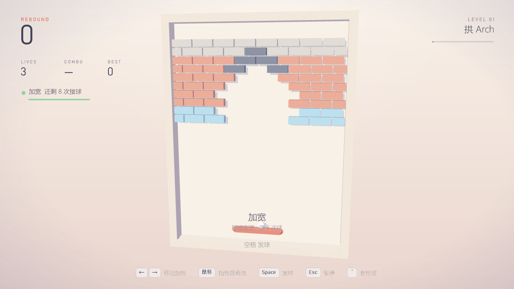
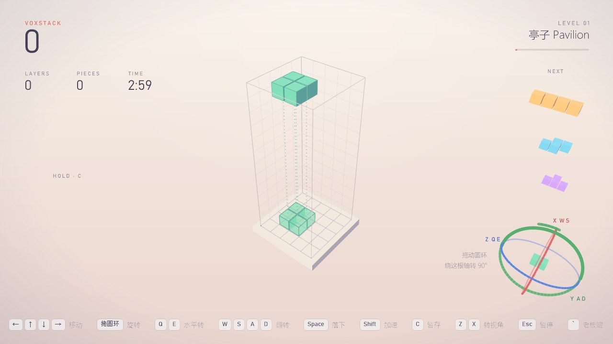
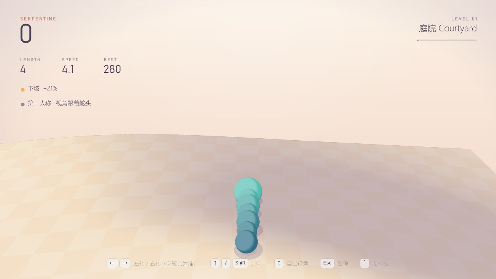
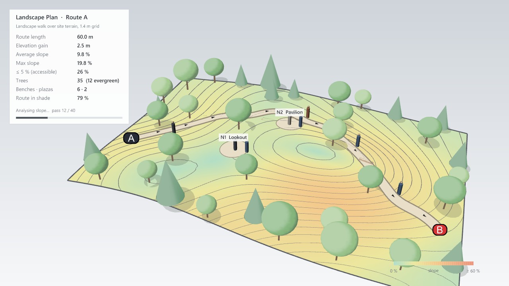

# 第三轮：拱砌法 bug、开局道具、两种视角、景观老板画面、gumball

> 网页版报告的源文件（2026-11-03）。

## 改了什么

| 游戏 | 改动 |
|---|---|
| Rebound | 拱砌法（Type 5）画面空白：钢砖 Hits = int.MaxValue，画墙签名的 Sum 溢出抛异常，整帧 3D 没画；改成不检查溢出的哈希（第 4 关起混进钢砖也会出）。开局多给道具：第一面墙 36 %、第二面 24 %、之后 15 %，头六个掉落是六种好道具各一个，拿到时显示作用 |
| Serpentine | 两种视角：第一人称（锁定在蛇头后，转弯跟着转）/ 自由视角（拖动转模型），C 切换；← / A、→ / D 永远以蛇头为准；↑ 或 Shift 冲刺。老板画面改成景观设计：铺装步道、长椅、林带 + 行道树 + 孤植树、比例人、命名小广场，指标加树、长椅、遮阴 |
| VoxStack | 开局 1.8 秒一格（每级快 13 %），锁定缓冲 1.0 秒；井旁边一个 gumball：拖红 / 绿 / 蓝圆环绕 X / Y / Z 转 90°（约 30° 转第一次、之后每 90°），中间是积木小模型，圆环交叉处按拖动方向判断 |

## 验证

- 核心测试 303 项全过（新增：道具开局巡游和概率、景观布置规则、更慢的下落和锁定）。
- Rhino 8 实测：拱砌法画面正常；贪吃蛇真实按键 ← → A D 转向和 C 切视角、老板键往返全部正确（跳过 0 次）；gumball 真实鼠标拖 5 次（Z、Y、X、X 在交叉点、Z），每次正好转 90° 且轴正确。
- Gumball 实测中修了三处：拖动角度的换算、圆环交叉、门槛低于 45° 时转了又被转回去。

## 用时

| 阶段 | 分钟 |
|---|---|
| 找拱砌法 bug 并修好 | 1.7 |
| 拆需求、挂自动续跑 | 1.7 |
| Rebound 开局多给道具 + 测试 | 1.3 |
| VoxStack 更慢 + gumball | 1.7 |
| Serpentine 两种视角 + 景观老板画面（含布置测试） | 3.3 |
| Rhino 里逐个实测并调整 | 3.7 |
| Gumball 拖动的三个问题（换算、交叉、阈值） | 6.3 |
| 文档、计时、报告 | 7.3 |
| 合计 | 27.0 |
