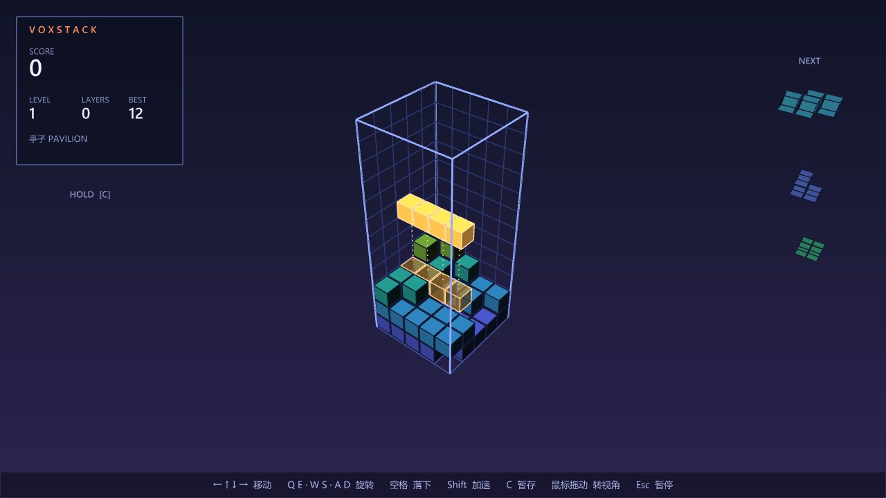
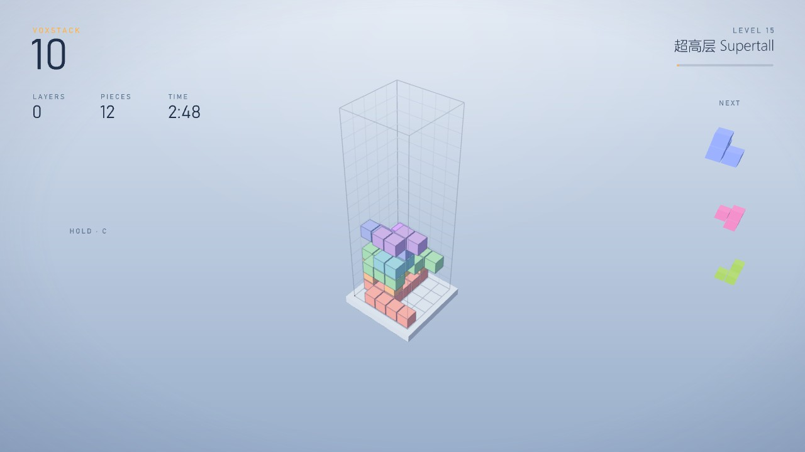
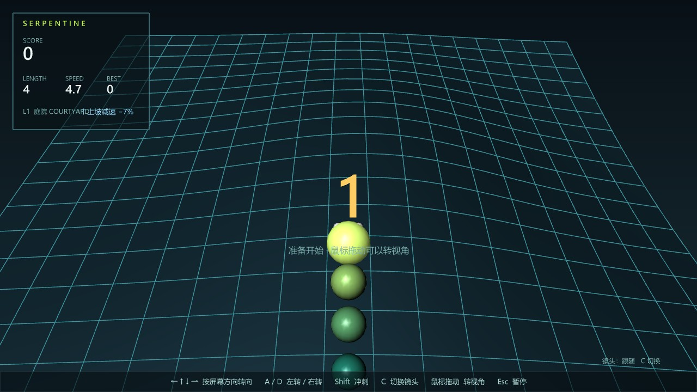
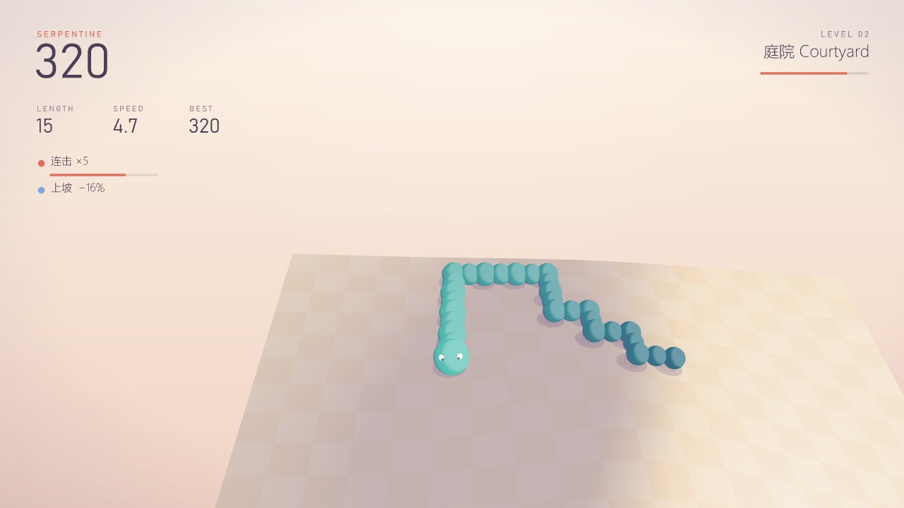

# Moyu 游戏画面风格

所有摸鱼游戏共用一套画面，代码在 `src/Moyu/Games/Common/`（`GameConduit`、`Palette`、`Toon`）。方向参考纪念碑谷和极简独立游戏：安静、柔和、像一个画出来的小模型，适合建筑师看。2026-11-01 起 VoxStack 和 Serpentine 都换成了这套。

| 之前 | 之后 |
|---|---|
|  |  |
|  |  |

## 原则

- **背景**：从天空色到地平线色的竖向渐变，顶部中间一团柔光，四角沉到阴影色。不画网格，不用 Rhino 的显示模式。
- **配色分章节**：每个游戏五章（按等级 1–3、4–6、7–9、10–12、13+），每章一套配色（天空、地平线、两种文字墨色、强调色、阴影色）。升级时 1.6 秒内平滑过渡，并弹出一张章节卡片（`LEVEL 04` + 章节名）。
- **着色**：不用 Rhino 的光照和高光。一个固定的"上午的太阳"（左前上方），朝光的面往白色提亮，背光的面往这一章的阴影色（偏蓝紫，不是灰）沉，分成柔和的几档。方块每个面一个平涂色调；球体是平滑的三档。
- **软投影**：物体下方贴着表面画两三层半透明圆片，往背光方向偏一点。
- **场地像模型**：开放的地面立在一块底座上（侧壁一直落到平底），地面做淡淡的棋盘格和夸张一点的山体阴影，让起伏在任何高度都看得出来。VoxStack 的井立在白色底板上，井壁网格只留很淡的线。
- **文字**：Bahnschrift（DIN 风格，图纸上常见）Light 写大数字，小标签用字距拉开的大写；中文用微软雅黑 UI Light。不画方框面板，文字直接浮在画面上。
- **HUD 布局**：左上是游戏名 + 大分数 + 一行三个小指标；右上是关卡和通往下一级的细进度线；左侧是状态行（彩色圆点 + 文字 + 一条随时间缩短的细线），比如连击、冰冻、冲刺、上下坡。
- **按键提示**：键帽样式（圆角小方块 + 键名 + 作用），倒计时和暂停时显示，开始玩 7 秒后淡出。
- **倒计时 / 暂停 / 结算**：浅色半透明蒙版（不是黑色），细圆环倒计时，结算是小标题 + 超大细体分数 + 一行数据 + 键帽。
- **老板模式不改**：伪装画面要像 Rhino 里的正经分析图，保持原来的白模 / 坡度分析样式。

## 新游戏怎么用

1. 绘制类继承 `GameConduit`，实现 `Theme`（当前配色，可在章节间插值）、`KeyHints`、`DrawGame` / `HudGame`、`ResultText`。
2. 3D 物体用 `Ball`（平涂球）、`Toon.AddCube`（平涂方块）、`Toon.Shade`（任意法向的颜色）和 `DrawMeshFalseColors` 画；投影用 `BeginShadows` → `ContactShadow` → `EndShadows`。
3. HUD 用 `ScoreBlock`、`LevelBlock`、`Status`、`Text` / `Label`；暂停、倒计时、结算画面和按键提示由基类画。
4. 做完在 Rhino 里截图对照这页，再交付。
