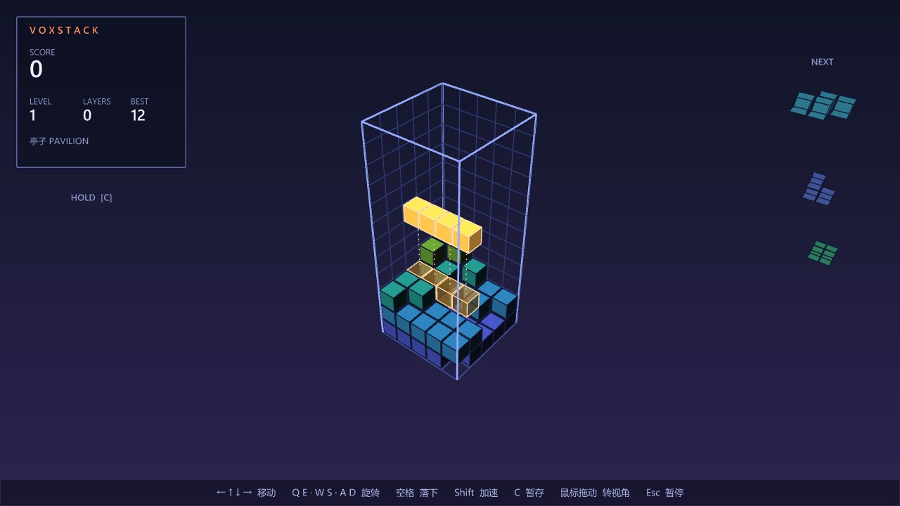
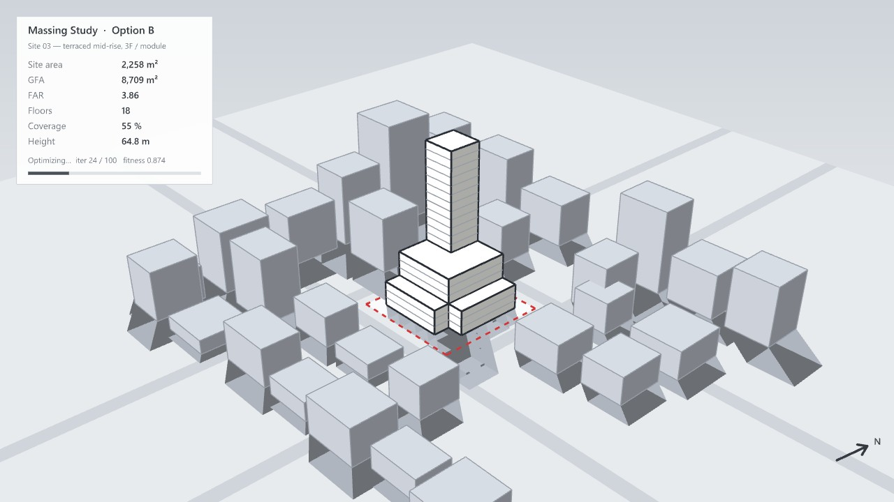
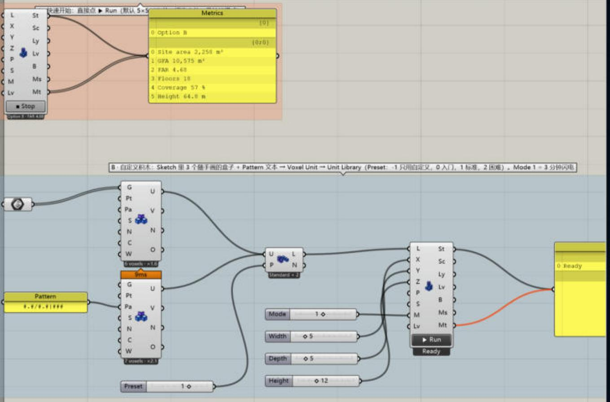
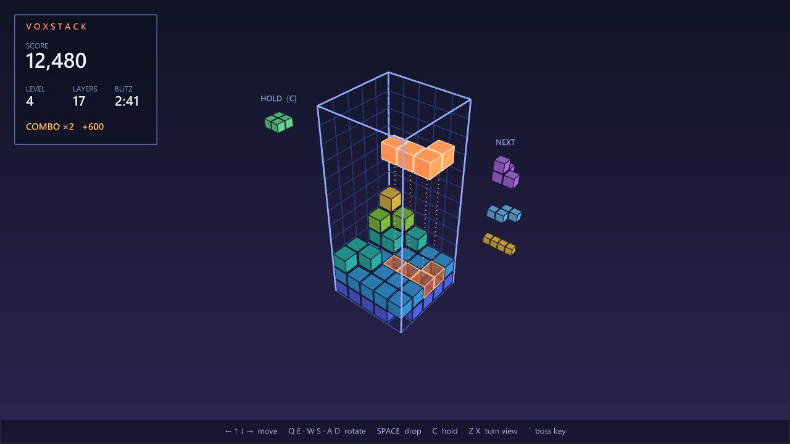
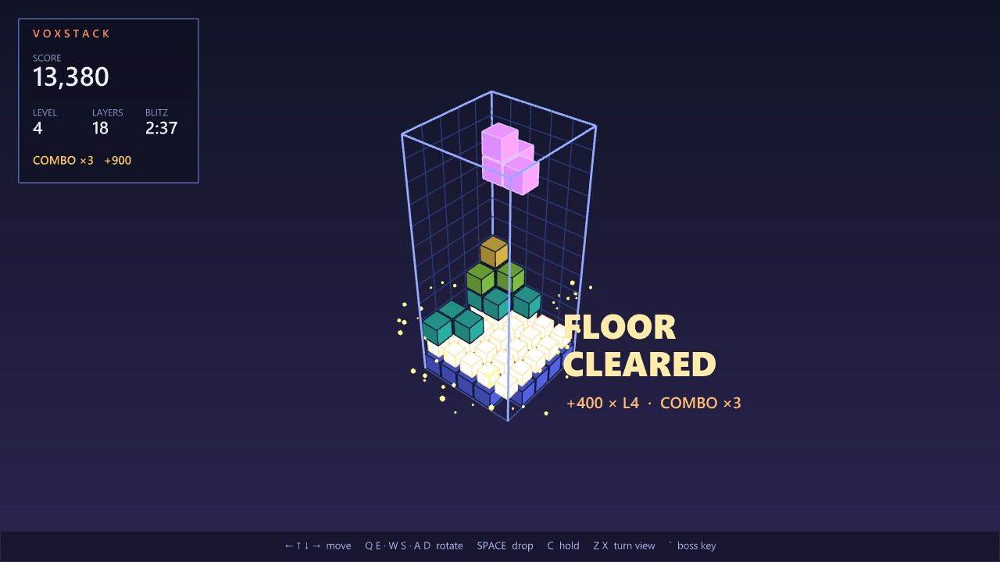
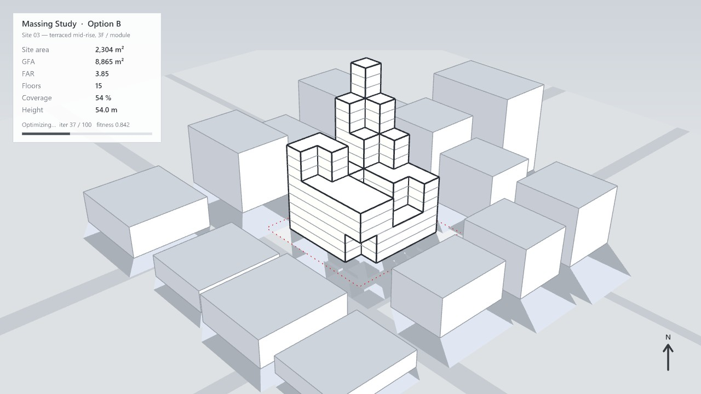
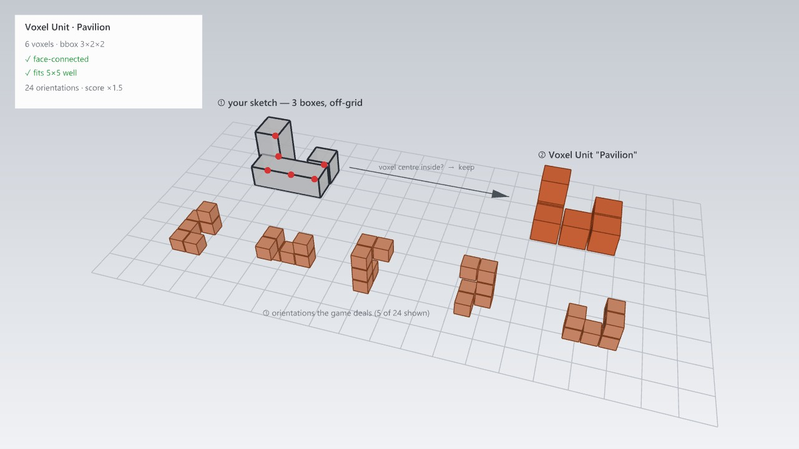

# VoxStack 叠楼 · 3D 体素消除游戏方案

> 这份 Markdown 是网页版方案的源文件。"v1 状态"一节的截图是成品插件在 Rhino 8 里的实拍；后面各节的 `stack_mock_*` 截图是动工前用一次性 DisplayConduit 脚本画的原型，用来说明设计。其余示意图在网页版里是 SVG。顶部按日期倒序是动工后的每一轮改动；第 1–11 节是原始方案，其中后来改掉的数值（速度、锁定、踢墙、井尺寸、存档文件）已改成现在代码里的值。


## Gumball 固定在角上、自定义积木、再慢一点（2026-11-03 深夜）

用户反馈："俄罗斯方块这个还是太快了；之前自定义的 Unit 好像没了；gumball 在运动过程中很难点上，你把 gumball 固定放在某个地方，这样它不会随着物体动"。

- **自定义积木"没了"**：测试文件里第二个 Massing Study 接的是 Unit Library "Hard + 1"（含自定义 Gate 门楼，7 格立体）。上一轮的"开局先发扁平积木"把所有立体和超过 4 格的积木都挡在第 3 级之前，自定义的也被挡了（第 3 级半权重、第 4 级才正常）。改成只挡内置积木，自定义积木从第 1 块起照常发（同一个种子下前 30 块里 6 个 Gate）。顺带修了一个小 bug：起始等级 > 1 时第一袋积木按第 0 级发了。
- **太快**：第 1 级 2.4 秒一格（上一轮 1.8），每级只快 8 %（上一轮 13 %），最快 0.15 秒；锁定缓冲 1.2 秒，第 11 级起 0.6 秒。测试文件里第一个 Massing Study 的 Level 滑块是 15（起始等级），原来一开局 0.26 秒一格，现在 0.75 秒。没有改你的 GH 文件。
- **Gumball 固定**：放在视口右下角（NEXT 那一列下面、按键提示上面），屏幕位置和大小都固定，积木下落时不动，只随视角转（圆环仍然沿井的 X / Y / Z）。高分屏按系统缩放放大（4K 175 % 上圆环半径 140 像素），但不超过视口高度 / 720 倍。画在场景最上层（不会被井挡住），先画圆环后半圈、再画积木小模型、再画前半圈。
- **转轴更好分**：游戏默认镜头俯角约 45°，这时 Y 环和 Z 环在屏幕上是同一个椭圆（下半圈重合）。现在 gumball 按镜头的朝向、但最多 28° 的俯角来画（绕屏幕水平轴把它倾一下；透视下按从相机到 gumball 的实际视线算），三个圆环分得很开。
- **点不准的两种情况**：两个圆环挨得很近时，先拖 6 像素，按"方向一致 − 0.6 × 离按下点的距离"选（原来只看方向，挨着跑的两个圆环会选错）；圆圈里没按到圆环、或者在开局倒计时和暂停时按到 gumball，什么都不做（原来会转视角，圆环跟着转，更难点）。
- **测试文件**（经用户同意改了 `tests/gh/MoyuStack-Test.gh`）：Pavilion 用的是用户 11-01 自己在 Rhino 里画的 3 个盒子（两根柱子一根梁，5 格 U 形），但 Sketch 里只存了这 3 个 Rhino 物体的 ID，新开 Rhino 就拿不到。按 11-01 检查时记下的坐标把 3 个盒子存进文件（Internalise），第一个 Massing Study 的 Level 滑块 15 → 1。其他 7 个滑块和 20 个对象都没动；重新打开后 Pavilion 5 格、Gate 7 格、库 "Hard + 2"，第二个 Massing Study 前 30 块里 5 个 Pavilion、3 个 Gate。改之前的文件备份在会话临时目录。
- **实测**（4K 屏、Rhino 最大化、真实鼠标 SendInput）：积木从第 11 层落到第 3 层，gumball 一直在 (3340, 1286)；9 次拖动（蓝 Z、绿 Y、红 X、红 X 按在和 Z 的交叉点、两个圆环的另一侧、转视角后再拖三个）每次正好转 90° 且轴对；倒计时里按、圆圈里空按，镜头都没动。


## Gumball 旋转与更慢的开局（2026-11-03 晚上）

用户反馈"最开始有点太难了速度太快，而且不好区分到底转哪个轴，不如旁边一个 gumball，用户转动这个 gumball 来改变物体的旋转"。

- **Gumball**（`Games/Stack/Gumball.cs`）：井的右侧（按当前视角）、和下落中的积木一样高，三个圆环红 X、绿 Y、蓝 Z，中间是当前积木的小模型。按住圆环顺着它拖，约 30° 转第一个 90°，之后每 90° 再转一次；按"已经拖出了几次"计数，不会刚转就被反向判回去。悬停变粗，拖动时有进度弧，转完圆环闪一下。三个圆环在屏幕上交叉的地方，先拖 6 个像素，按拖动方向和哪个圆环一致来决定。每个圆环旁边标着对应的键（Q E / W S / A D，随视角变）。没按在圆环上的左键拖动照常转视角。
- **速度**：第 1 级 1.8 秒一格（原来 1.0，上一轮 1.3），每级快 13 %；锁定缓冲第 1 级 1.0 秒，第 6 级起 0.5 秒。
- **实测**：在 Rhino 8 里用真实鼠标（SendInput 移动和按键）拖了 5 次：蓝 Z、绿 Y、红 X、红 X（故意按在它和 Z 的交叉点上）、再蓝 Z——每次都正好转了一个 90°，轴都对；交叉点那次悬停亮的是 Z，拖动后按方向判成了 X。


## 开局难度（2026-11-03）

2026-11-03 晚上按用户反馈（"起始关卡要简单好上手，后面逐渐变难"）调了开局：

- 下落：第 1 级 1.3 秒一格（原来 1.0 秒），每级快 14 %（原来 18 %），最快 0.08 秒。
- 落地后锁定前的缓冲：第 1 级 0.9 秒，每级少 0.1 秒，第 5 级起 0.5 秒。
- 第 1–2 级只发扁平的 4 格以内单元（标准套件里就是 I、O、L、T、S 五种），第 3 级把立体单元（螺旋、三脚转角）按一半概率混进来，第 4 级起全套。自定义单元库少于 3 种扁平单元时照原样发，不加不减。

## v1 状态（2026-11-01）

第一版已按推荐方案做完，可以直接玩：打开 `tests/gh/MoyuStack-Test.gh`，点 Massing Study 下面的 **▶ Run**。







| 范围 | 状态 |
|---|---|
| 规则引擎：8 种标准积木 + 入门 / 困难集、袋子发牌、重力与等级、锁定延迟、踢墙、暂存、计分 / 连击 / 场地清空、马拉松 / 闪电 / 禅 | 完成，`Moyu.Core.Tests` 覆盖 |
| 键盘：线程级钩子、跟随视角的方向键、长按重复、按状态吞键、中文输入法下也能用 | 完成，Rhino 8 里用真实按键测过 |
| 视角：**改为鼠标拖动旋转**（左键或右键），Z / X 每次 90°、V 俯视保留为快捷键 | 完成 |
| 渲染：井、按高度上色、Ghost + 落点虚线、NEXT ×3 / HOLD 预览、HUD、消层闪光、暂停 / 封顶 / 倒计时画面 | 完成 |
| 老板键：白模体块、场地 / 周边 / 阴影、指标面板、命令行一行、GH 上显示 Option B、失焦自动切、3-2-1 回来 | 完成，真实按键测过 |
| 组件：Massing Study（带 Run 按钮）、Voxel Unit（几何 / 点 / 文本图案）、Unit Library；三个图标 | 完成 |
| 测试 GH 文件（快速开始 + 自定义积木两组） | 完成，代码生成并自检 |
| 每日种子模式、消层以外的更多特效、"Study Log" 排行榜组件 | 未做（P5） |

动工后和方案不同的地方：

- 视角旋转改成鼠标拖动（用户要求）。按住方向键时方向锁定，拖过 45° 也不会中途换方向。
- 开局也有 3-2-1 倒计时，好让你把手放好。
- 封顶画面出现后 0.8 s 内按空格不会重开，避免狂按硬降时直接跳过成绩。
- 中文输入法：游戏中按键被输入法接管时，从扫描码还原真实按键，并把当前窗口的输入法切到英文，退出时还原。

## 一页结论

- **做什么**：Moyu 页签下新开一个子类（建议叫 `Massing`，伪装名），放一个 3D 消层游戏 **VoxStack 叠楼**：体素块落进 5×5×12 的井里，某一层 25 格铺满就消除，计分、升级、加速。
- **怎么玩**：键盘 + 鼠标。方向键平移（按当前相机朝向自动换算），Q/E · W/S · A/D 绕三个轴旋转，空格硬降，Shift 软降，C 暂存，鼠标拖动转视角。
- **老板键 `` ` ``**：一帧之内把画面切成"体块研究"：你堆出来的方块直接变成楼，带场地红线、周边建筑、日照阴影和指标面板（GFA / 容积率按你堆的体素真实算出来）。再按一次回来，3-2-1 倒计时后继续。Rhino 失去焦点（Alt+Tab）时也自动切过去。
- **自定义积木**：在 Rhino 里随手画几个盒子或任意封闭体，`Voxel Unit` 组件自动体素化成新积木，校验连通性和尺寸，生成全部旋转姿态。积木越怪，分数倍率越高。
- **技术路线**：游戏循环跑在 DisplayConduit + 60 Hz 计时器上，**不触发 GH 重算**；键盘用线程级 Windows 键盘钩子截获，只在游戏进行中吞键；规则引擎不依赖 Rhino，能直接放进 `Moyu.Core.Tests` 测。
- **分 6 步**：P0 技术验证（键盘 + 渲染）→ P1 规则引擎 + 测试 → P2 可玩版 → P3 老板键 → P4 自定义积木 → P5 模式 / 特效 / 排行榜。
- **需要你拍板**：伪装命名、老板键键位、失焦自动切换、默认井尺寸与积木集、要不要动 GH 画布（见最后一节）。

## 1. 游戏画面



- **井**：5×5×12 的线框井，底面和两面后墙画格子，帮你判断深度。
- **已落下的体素按高度上色**：底层靛蓝 → 青 → 绿 → 黄 → 橙，一眼看出哪层高、哪层低。
- **正在下落的块**：橙色发光。
- **落点预览（Ghost）**：半透明的同形块画在它会落到的位置，再从每个格子拉一条虚线下去。这是 3D 下落类游戏最关键的可读性辅助，没有它就很难判断前后位置。
- **NEXT / HOLD**：右边浮着接下来 3 块，左边是暂存块，都是 3D 小模型。视口矮于约 620 px 时 NEXT 列少于三块（下面的预览被去掉），HOLD 预览位置更高。
- 结算画面用时超过一小时显示 h:mm:ss；颜色为完全透明黑（ARGB 0）的自定义积木按不透明黑色画；Gumball 拖动要求积木做不了的转动时圆环被放开（重新按住再试），不计转动；闪电模式最后一小段时间里刚好完成的一层，在结算画面之前被消掉。
- **HUD**：左上角分数、等级、已消层数、模式计时、连击；底栏是按键提示。

坑：相机太低时看不见坑洞。默认相机是从斜上方往井里看的 3/4 视角，鼠标拖动随时绕井转（仰角限制在 8°～89°，不会钻到井底下），V 切到正上方俯视。

## 2. 键盘操作

| 键 | 作用 |
|---|---|
| ← ↑ ↓ → | 水平移动（跟随相机朝向） |
| Q / E | 绕竖直轴旋转 |
| W / S | 绕屏幕横轴旋转（前后翻） |
| A / D | 绕屏幕纵深轴旋转（左右翻） |
| Space | 硬降（直接落到底） |
| Shift（按住） | 软降（加速下落） |
| C | 暂存 / 换出 |
| 鼠标左键 / 右键拖动 | 绕井转视角（左键拖动在游戏中改成旋转，不会拉出选择框；滚轮缩放照常） |
| Z / X | 快捷键：视角绕井转 90° |
| V | 俯视 / 3/4 视角切换 |
| Esc / P | 暂停（暂停时只认 Esc 继续、Shift + Esc 退出，其他键还给 Rhino） |
| 鼠标拖 Gumball 的圆环 | 视口右下角固定的 gumball（红 X、绿 Y、蓝 Z），顺着圆环拖约 30° 转 90°；2026-11-03 起是主要的旋转方式，见 README |
| Home | 镜头回到默认视角（重开一局时也会；视图被切成平行投影时自动回去） |
| `` ` ``（1 左边的键） | 老板键 |

- **方向键跟着相机走**：↑ 永远是"屏幕上远离你"的方向。用鼠标转视角或按 Z/X 之后，程序把相机朝向吸附到最近的 90°，重新映射四个方向键。按住方向键期间方向锁定，拖过 45° 也不会中途换方向。
- **长按重复**：按住方向键，170 ms 后开始重复，之后每 50 ms 移一格（自己实现，不用系统的按键重复）。
- **怎么截键盘**：在 Rhino UI 线程上装一个 `WH_KEYBOARD` 线程钩子。Rhino 默认方向键会平移视图、空格会重复上一条命令，所以游戏中必须吞掉这些键。规则：
  - 游戏中：吞掉所有不带 Ctrl / Alt 的按键（防止误敲进命令行），包括 F 键、Tab 和 PrintScreen，前提是 Rhino 主窗口有焦点；Ctrl+S、Alt+Tab 这类组合键照常放行。
  - 暂停：只吞 Esc（继续）、Shift + Esc（退出）和老板键，其他键还给 Rhino。
  - 老板模式：只吞老板键，其他键全部还给 Rhino，你可以真的敲命令、转视图。
  - Rhino 不在前台：钩子只挂在 Rhino 的 UI 线程上，本来就收不到别的程序的按键。
  - 对话框、Grasshopper 窗口或另一个 Rhino 窗口拿走键盘，或者开始了一个 Rhino 命令：游戏暂停（倒计时也停住），按键和鼠标归那个窗口或命令；点回游戏视口、按 Esc 继续。
- **鼠标**：右键拖动和左键一样转视角（Rhino 不会把右键当成 Enter 重复上一个命令），中键在游戏视口里不起作用。游戏停下后，开局前正在看的布局页面会切回来。
- **备选方案**：如果钩子在某些环境下不稳定，退回"点一下 GH 组件进入游戏焦点"，用 GH 画布的键盘事件。P0 会先验证钩子。

## 3. 默认积木库

三档预设，名字取自建筑类型：

| 预设 | 积木 |
|---|---|
| 入门（7 块） | I3 短板、L3 小转角（三格）＋ I4 板楼、O 点式、L 翼、T 翼、S 错层（四格平面） |
| 标准（8 块，默认） | 全部 8 种四格体：I4 板楼、O 点式、L 翼、T 翼、S 错层，以及 3 种非平面的：螺旋左、螺旋右、三脚转角 |
| 困难 | 标准 ＋ 五格体：十字、合院（U）、大转角（V）、阶梯（W）、塔楼（Tower） |

- **发牌方式**：袋子随机。把每种积木各放一块进袋子，洗牌后依次发完再重洗，保证不会连续很久等不到想要的块。
- 自定义积木按权重加入袋子。

## 4. 消层与计分



- **消层**：某一层 25 格全满 → 白色闪光 250 ms、方块缩小、火花飞出 → 上方所有层整体下移。
- **得分**（都乘以当前等级）：

| 一次消掉 | 基础分 |
|---|---|
| 1 层 | 100 |
| 2 层 | 300 |
| 3 层 | 700 |
| 4 层及以上 | 1500 |

- 软降每格 1 分，硬降每格 2 分。
- **连击**：连续几块都有消层，每次额外 +50 × 连击数 × 等级。
- **场地清空**：井里一个体素都不剩，+3000 × 等级。
- **自定义积木倍率**：4 格 ×1.0，5 格 ×1.2，6 格 ×1.5，7 格以上 ×2.0；非平面再 +0.1。
- **升级**：每消 5 层升一级（3D 消层比 2D 慢，所以不是 10 层）。等级名按建筑高度：L1 亭子、L4 多层、L7 小高层、L10 高层、L13 超高层。
- **下落速度**：每格停留时间 = max(0.15 s, 2.4 s × 0.92^(等级−1))。L1 2.4 s，L10 1.13 s，L15 0.75 s，最快 0.15 s。
- **锁定延迟**：落地后 1.2 s 内还能移动 / 旋转（每级少 0.06 s，第 11 级起 0.6 s），每次操作重置计时，最多重置 15 次。
- **旋转踢墙**：转不进去时依次试 (0,0,0)、左右各 1 格、前后各 1 格、左右和前后各 2 格、向上 1 格。
- **游戏结束**：新块出生时就和已有体素重叠 → "封顶 TOPPED OUT"。

## 5. 游戏模式

| 模式 | 规则 | 适合 |
|---|---|---|
| 马拉松 | 无尽，越来越快 | 午休 |
| 3 分钟闪电 | 限时冲分 | 等渲染、等同步的空档 |
| 禅 | 没有重力、不会结束，按空格才落 | 开会、电话会 |
| 每日种子 | 今天所有人发到的积木顺序一样（种子 = 日期） | 和同事比分 |

井尺寸由 Massing Study 的 Width / Depth / Height 输入决定：4–10 × 4–10 × 8–20，默认 5×5×12。

默认**完全静音**，办公室里不出声。

## 6. 老板键



按 `` ` `` 之后，同一帧里发生这些事：

1. 游戏暂停，键盘还给 Rhino（只保留老板键）。
2. 视口：同一组体素换一种画法变成体块。1 个体素 = 7.2 m 柱跨 × 3 层（10.8 m）；只画外表面和转折棱线，外墙每 3.6 m 一条楼层线；加场地红线、道路、周边体块、投影阴影，背景换成浅灰"白模"风格。
3. 指标面板：场地面积、GFA、容积率、层数、覆盖率、高度，全部按你当前堆的体素算出来，有人细看也对得上；下面一条"Optimizing… iter 37 / 100"进度条慢慢走，看起来像在跑计算。
4. 相机跳到建筑常用的两点透视（50 mm），游戏相机记住，回来时恢复。
5. 命令行打一行：`MassingStudy: Option B updated · 15F · GFA 8,865 m² · FAR 3.85`。
6. GH 画布：组件本来就叫 "Massing Study"，老板模式下组件面板显示 "Option B · FAR 3.85" 而不是分数。
7. 如果刚开局、井里没几个体素，就用一个按种子生成的假体块，画面不会空得可疑。

- **回来**：再按 `` ` `` → 相机恢复 → 3-2-1 倒计时 → 继续。
- **失焦自动切**：Rhino 失去焦点（Alt+Tab、点了 Outlook）自动进老板模式，默认开。
- **坑**：
  - 显示模式（Shaded / Arctic）是全局用户设置，**不去改**；背景、材质全部由我们自己的 Conduit 画，切换只是换一个渲染分支，所以是瞬时的。
  - 体块网格在每次锁定时顺手预生成（体素 ≤ 300 个，开销可忽略），按键时不用现算。
  - GH 画布缩放 / 平移侵入性太强，默认不动。

状态机：空闲 → 游戏中 ⇄ 暂停；游戏中 / 暂停 → 老板模式（老板键或失焦）→ 倒计时 → 游戏中；游戏中 → 消层动画 → 游戏中；游戏中 → 封顶 → 空闲。

## 7. 自定义积木



流程：

1. 在 Rhino 里画任意封闭几何（盒子、挤出体、网格、SubD 都行），不用对齐网格。
2. `Voxel Unit` 组件在每个体素中心做"是否在实体内"测试（复用 Boundary 3D 的射线奇偶判断），在里面的格子保留。
3. 校验：面连通（只靠棱或角相连不算）；包围盒 ≤ 4×4×4；≤ 10 格；能放进当前井。不通过时给出明确提示，比如"这个积木断成了 2 块"。
4. 生成全部旋转姿态（最多 24 种），去掉对称造成的重复。
5. 和默认积木一起进 `Unit Library`，按权重进袋子。

输入：Geometry、Voxel Size（默认按最小盒子边长自动取）、Name、Colour、Weight。也可以直接给点（每个点 = 一个体素中心，超过 64 个点报错），或者给文本图案（每层一行，`##.|#..`），方便在 Panel 里手写。

## 8. GH 组件与 Ribbon

Ribbon：`Moyu` › `2D` / `3D` / **`Massing`**（新）。

| 组件 | 缩写 | 作用 |
|---|---|---|
| Massing Study | Mass | 游戏本体。输入：Library、Well（X/Y/Z）、Plane（井放在文档哪里，可以摆在真实项目旁边）、Mode、Start Level、Run。输出：State、Score、Layers、Level、Mass（当前体块 Brep，让下游看起来是正经数据）、Metrics；没有游戏在跑时 Best 跟着当前输入变；运行失败显示为组件上的警告气泡（不写命令行）；被禁用的组件 Run 不起作用，Stop 照常；Internalise 的 Moyu 值无法还原，报 “X input holds an empty T; reconnect the component that made it (Moyu data cannot be internalised)” |
| Voxel Unit | Unit | 几何 → 自定义积木（见第 7 节） |
| Unit Library | Lib | Preset（入门 / 标准 / 困难）＋ 自定义积木 ＋ 权重 → 积木库 |
| Study Log | Log | （P5）本地排行榜、今日摸鱼时长，伪装成"方案记录" |

- 游戏组件双击 / 面板上的按钮开始，不需要接 Timer。游戏进行中组件输出不刷新，只在暂停、老板模式、结束时刷新一次，避免 GH 每帧重算。
- 子类叫 `Massing` 而不是 `Games`，是为了经得起老板扫一眼 Ribbon。以后的游戏各自用一个伪装面板名（比如 2D 小游戏叫 `Facade`），共用一套老板键框架。

## 9. 技术架构

```
Massing Study 组件 ──启动──► GameSession
                              ├─ StackGame（规则引擎，不依赖 Rhino）
                              │    Polycube（24 种旋转）· Well（占用网格）· Bag（发牌）· Scoring · 锁定 / 踢墙
                              ├─ KeyboardHook（WH_KEYBOARD 线程钩子）
                              ├─ GameLoop（WinForms Timer，60 Hz）
                              ├─ StackConduit（井、体素、Ghost、HUD）
                              └─ MassingDisguise（老板模式渲染）
存档：%APPDATA%\Moyu\voxstack-scores.txt（最高分，每局一行）
```

- **不用 GH Timer**：每帧让 GH 重算整个定义既慢又卡。游戏在 GH 求解之外跑，Conduit 每帧只重画视口。
- **绘制开销**：已锁定的体素按颜色合并成几个网格，只在锁定时重建；下落块是缓存网格 + 变换。体素最多几百个，没有压力。
- **目录**：

```
src/Moyu/Games/Common/        GameLoop、KeyboardHook、BossKey、HighScores（以后的游戏共用）
src/Moyu/Games/Stack/Core/    Polycube、Well、StackGame、Scoring、Bag（不依赖 Rhino，编进 Moyu.Core.Tests）
src/Moyu/Games/Stack/         StackConduit、MassingDisguise、Hud
src/Moyu/Components/Massing/  MassingStudyComponent、VoxelUnitComponent、UnitLibraryComponent
```

- **测试**：
  - Core：无对称积木恰好 24 种姿态、I4 只有 3 种；消层与下移；锁定延迟；踢墙；同一种子 + 同一串输入 → 完全相同的结局（回放）；计分。
  - Rhino：用脚本化的输入序列在无界面 Rhino 里跑一局，把游戏画面和老板画面渲染到 `docs/images/`。
- `tests/Moyu.Core.Tests` 的 csproj 需要多 include 一行 `src/Moyu/Games/Stack/Core/**`。

## 10. 路线图

| 阶段 | 内容 | 工作量 | 完成标准 |
|---|---|---|---|
| P0 技术验证 | 键盘钩子 + Conduit + 计时器 | S | Rhino 8 里方向键移动测试方块且视图不跟着动；空格不重复命令；老板键能切换；300 个体素 60 fps |
| P1 规则引擎 | Core + 测试 | M | Core 测试全过（旋转、消层、计分、踢墙、回放） |
| P2 可玩版 | 马拉松模式、Ghost、Hold、Next、HUD、暂停、封顶 | L | 能完整玩一局 |
| P3 老板键 | 体块渲染、指标、失焦自动切、倒计时、命令行 | M | 任何状态按老板键一帧内切换，回来能接着玩 |
| P4 自定义积木 | Voxel Unit + Unit Library + 校验 + 测试 GH 文件 | M | 画盒子 → 进游戏能发到 |
| P5 打磨 | 闪电 / 禅 / 每日种子、消层特效、排行榜、图标、README、测试 GH 生成器 | L | 全部模式可玩，文档齐全 |

## 11. 需要你拍板

> 2026-11-01：全部按推荐执行，另外把视角旋转改成了鼠标拖动。

1. **伪装命名**：Ribbon 面板叫 `Massing`、组件叫 "Massing Study"（推荐），还是直接叫 `Games` / "VoxStack"？
2. **老板键**：`` ` ``（推荐，左手小指够得到）/ F12 / 连按两次 Esc？
3. **失焦自动进老板模式**：默认开（推荐）还是关？
4. **默认井和积木集**：5×5×12 + 标准 8 块（推荐）？
5. **老板模式要不要动 GH 画布**（自动平移到一组看起来在用的参数化组件）？推荐不动。
6. **游戏名**：VoxStack 叠楼是占位名，想换随时换。
